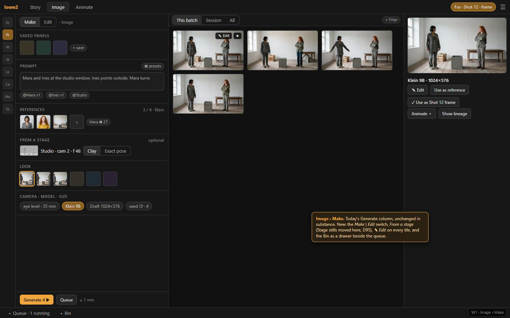
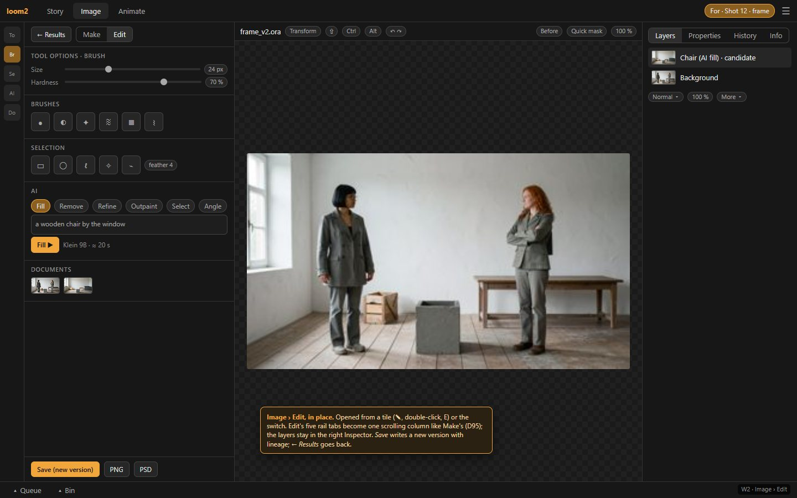
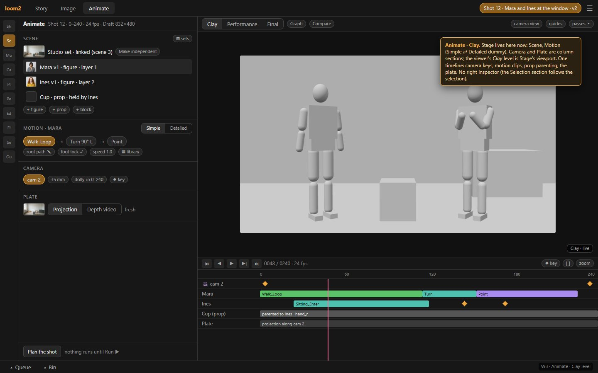
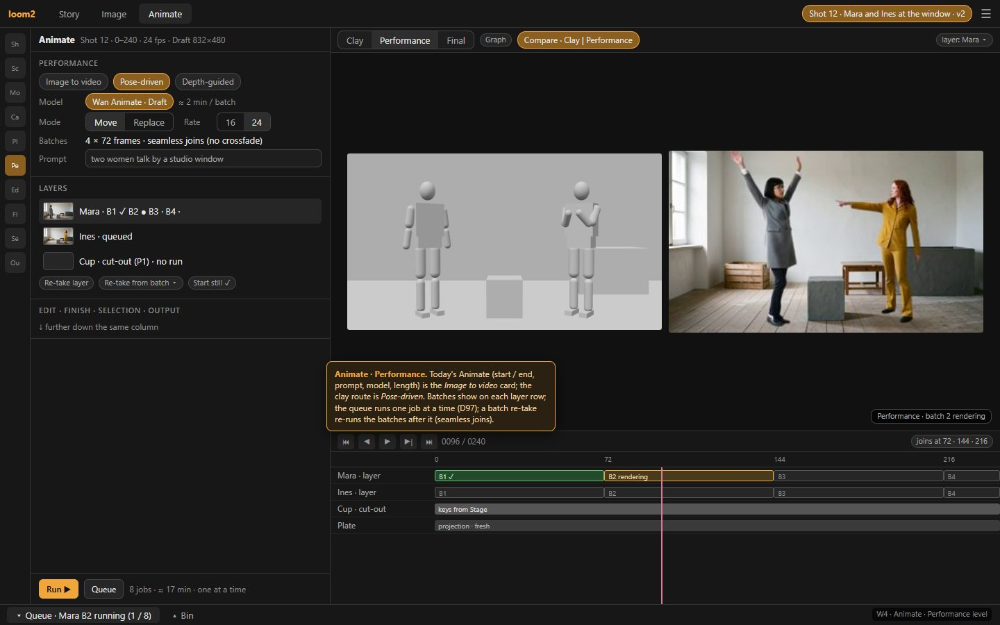
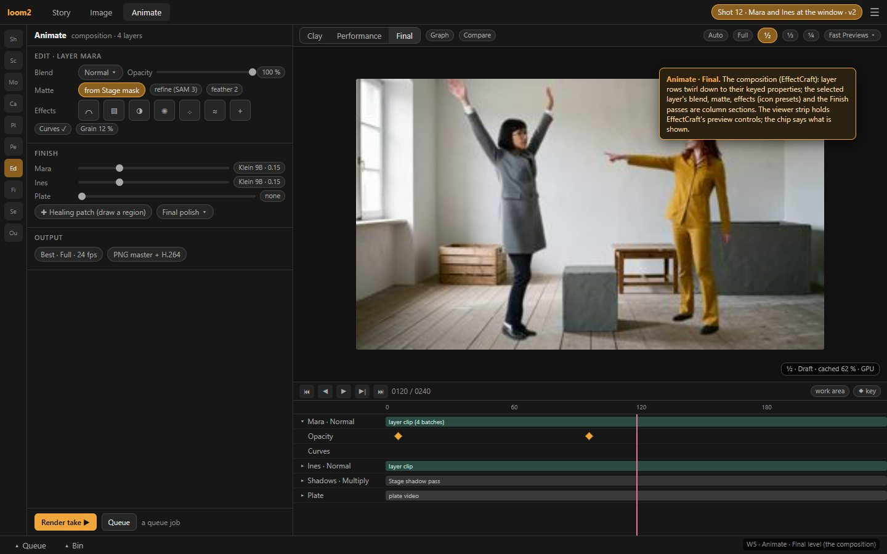
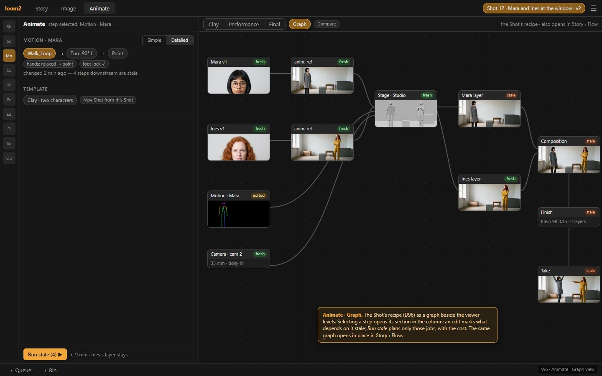
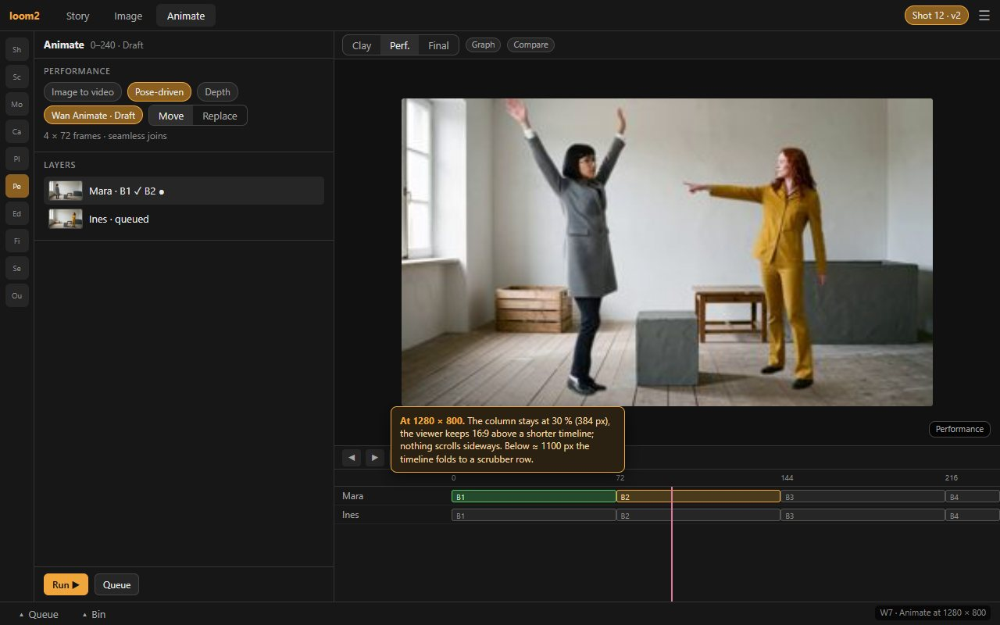

# 03 · UX0 — the UI/UX review before the build (Image and Animate)

Status: **accepted by the author, 2026-10-18 — all 23 recommendations of §4** (D99). IM1 is built on them (journal 2026-10-18 17:56).
This is the first wave of the build order
([proto01_animate/07](../proto01_animate/07-build-order.md)). Nothing is built until the author has corrected these wireframes. After
the build, UX9 walks the same paths in the app.

What it reviews: the three-tab model of D95 — Story · Image · Animate (`proto01_animate/03` §3–§4), the shot-flow of D96 (`05`), the
Bin drawer (`04`) — against every function the app has today.

It has three parts:

1. **The inventory:** every function of Generate, Edit, Animate and Stage, with its new home, in [03-ux0-inventory.md](03-ux0-inventory.md).
2. **The wireframes** (§1): seven screens, made as an HTML mock with real loom2 frames and rendered in Edge at 1440 × 900 and
   1280 × 800.
3. **The canonical paths** (§2), counted in clicks.

## 1. Wireframes

Every screen shares the same frame:

- **Top bar:** three tabs (Story · Image · Animate), the For chip (what is being made for), ☰.
- **Left rail:** the column's jump rail. Each icon scrolls the one column to its section.
- **The column:** about 30 % of the window, resizable (D90).
- **Bottom drawers:** the **Queue** and the **Bin**, collapsible, as the render queue is today (04).

### W1 · Image › Make

**What is new:**

- **Make | Edit:** a switch at the top of the column.
- **From a stage:** a section of the column. Stage's stills moved here (D95): pick a stage, a camera and a frame, then Clay or Exact pose.
- **✎ Edit on every tile:** on hover, also by double-click and the E key.
- **The Inspector** offers *✓ Use as Shot 12 frame* when the For chip names a Shot, and *Animate ▸*.

Everything else is today's Generate column.

### W2 · Image › Edit, in place

- **The column:** Edit's five rail tabs (Tool options, Brushes, Selection, AI, Documents) become **one scrolling column** with the same
  jump rail (D95).
- **Layers, Properties, History and Info** stay in the right Inspector. Image editing needs them visible while painting.
- **Getting out:** *Save* writes a new version beside the original, with lineage. *← Results* returns to Make.

### W3 · Animate · the Clay level

- **Stage lives here now:**
  - **Scene:** set, figures bound to Cast versions, props, a "linked (scene 3)" badge with *Make independent* (06 O3);
  - **Motion:** library clips chained per figure, the **Simple ⇄ Detailed** dummy, root path, foot lock;
  - **Camera** and **Plate.**
- **The viewer's *Clay* level** is Stage's three.js viewport.
- **One timeline:** camera keys, each figure's motion clips, a prop parented to a hand, the plate.
- **No right Inspector:** the *Selection* section further down the column follows the selection.

### W4 · Animate · the Performance level

- **Today's Animate suite becomes the *Image to video* card.** That covers start / end, prompt, model, length, beats.
- **The clay route is *Pose-driven*:** model, Move / Replace, rate, batches with seamless joins.
- **Each layer's batches show on its timeline row:** done, rendering, queued.
- **The Queue drawer is open:** one job at a time (D97).
- **Compare** shows Clay | Performance side by side.

### W5 · Animate · the Final level (the composition)

- **The EffectCraft composition:**
  - layer rows twirl down to their keyed properties;
  - the selected layer's blend mode, opacity, matte (from the Stage mask, refined by SAM 3) and **effects as icon presets** are in the
    *Edit* section;
  - the *Finish* section sets the layer pass per layer, the healing patch and the final polish.
- **The viewer strip holds EffectCraft's preview controls** (Auto · Full · ½ · ⅓ · ¼, Fast Previews). The status chip says what is
  shown: "½ · Draft · cached 62 % · GPU".
- **Render take ▶** is a queue job.

### W6 · Animate · the Graph view

- **The Shot's recipe** (D96) as a graph, beside the viewer levels.
- **Each step shows its state:** fresh, edited or stale.
- **Selecting a step** opens its section in the column.
- **An edit marks what depends on it stale.** Here, Mara's motion makes her layer, the composition, the finish and the take stale;
  Ines's layer stays fresh.
- **Run stale** plans only those jobs, with the cost.
- The same graph opens in place in Story › Flow.

### W7 · Animate at 1280 × 800

- **The column** stays at 30 % (384 px).
- **The viewer** keeps 16:9 above a shorter timeline.
- **Nothing scrolls sideways.**
- **Below about 1100 px** the timeline folds to a scrubber row (to confirm in AN1).

## 2. The canonical paths, counted

Clicks are mouse clicks and drags. Typing a prompt and waiting for a job are not counted. Every step has a button, a menu entry or a
drag target (D32); keys only accelerate.

| # | Path | Steps in the new layout | Clicks |
| --- | --- | --- | --- |
| P1 | **A character → an image → an edit → the Shot's frame** | Story › Shots › Shot 12 *Make frame ▸ in Image* (2) → *Generate 4 ▶* (1) → ✎ on a tile (1) → AI · Fill (2: the rail icon, the op) → drag a selection (1) → *Fill ▶* (1) → keep the candidate (1) → *Save* (1) → *← Results* (1) → the new tile, *✓ Use as Shot 12 frame* (2) | **14** |
| P2 | **A Shot → stage → motion → performance → edit → take → the cut** | Shot 12 *Make clip ▸ in Animate* (2) → Scene *+ figure* ×2, each with a Cast version from the Bin (4) → Motion: the library, three clips dragged onto Mara (4) → Camera: move + ◆ key (2) → Plate: *Projection* (1) → Performance: *Pose-driven*, *Run ▶* (2) → Edit: a layer, a Curves preset (2) → Finish: a slider (1) → *Render take ▶* (1) → *✓ use* (1) → the cut picks it up (RC3; 0) | **20** |
| P3 | **Quick: an image → image to video → a take** | a tile's *Animate ▸ as start* (2) → *Animate ▶* (1) → *✓ use* (1) | **4** |
| P4 | **Edit any picture of the project** | *▴ Bin* (1) → double-click a tile (1) → … → *Save* (1) | **3** + the edit |
| P5 | **Change one character's motion and re-take only what it touches** | the motion edit (drag) → *Graph* (1) → *Run stale ▶* (1) | **2** + the edit |

**Where clicks go and what could shorten them** (for the author's view, not decided):

- **P2's figure binding:** four clicks for two figures. A Shot made from a Flow Dialogue node could bind its speakers automatically,
  as D93 C7 already links them for *Make frame* (−4).
- **P1's AI Fill:** two clicks to reach the op. The AI section could remember the last op (−1).
- **P1's last step:** *Save* in Edit could offer *Save and use as Shot 12 frame* when the For chip names a Shot (−3).

## 3. Rules the review keeps

- **One scrolling column per making mode:** Image · Make, Image · Edit and Animate, each with the jump rail (D90, D95).
- **No right Inspector in Animate**, on trial (D95); it can come back.
- **Presets as icons with no words** (D90): looks, brushes, effect presets, the Bin's tiles.
- **Every action is a command with a mouse placement** (D32). The merged transport gets one key set; the inventory lists the
  conflicts.
- **One GPU job at a time** (D97). The Queue drawer shows the one running job; the preview's status chip says when it is on the CPU.

## 4. Decisions to confirm — each with a recommendation

The wireframes' questions and the inventory's (03-ux0-inventory.md §8, Q1–Q10), in one list. **Accept all, or correct any.**

### Image

| # | Question | Recommendation |
| --- | --- | --- |
| 1 | **Double-click on a result:** the loupe (today) or Edit? | **Edit** (the point of D95); the loupe keeps its button and Space |
| 2 | **May Esc leave Edit?** | **No.** Esc cancels the selection or the transform in progress; leaving is *← Results* or the switch |
| 3 | **A drop on the Image tab** | **In Make: references** (as on Generate today). **In Edit: a new layer.** Opening a file as a document is ☰ › *New document* |
| 4 | **Edit's Save** (today Save writes the `.ora`, *Save to Catalogue* the flattened picture) | **One verb, *Save*:** it writes the document **and** a new version in the Catalogue with lineage. *Close document* stays in the Documents section and the document's menu |
| 5 | **From a stage:** its own section (W1) or a source switch? | **A source switch at the top of Make:** *Prompt* · *From a stage*. One reference tray that knows the stage method's limit (S21–S23); not two forms |
| 6 | **Image's jump rail** | **It swaps with the mode** (Make's seven icons ⇄ Edit's five); never twelve at once |
| 7 | **The right Inspector in Image** | **Mode-scoped:** the result's Inspector in Make, Layers · Properties · History · Info in Edit. Edit needs its layers visible while painting |
| 8 | **New angle** | **The sheet only, for now.** Edit's AI section gets an *Angle ▸* button that opens it (one implementation) |

### Animate

| # | Question | Recommendation |
| --- | --- | --- |
| 9 | **The column's order:** Shot · Scene · Motion · Camera · Plate · Performance · Edit · Finish · Selection · Output | **As drawn** (it follows the process, 01 §2) |
| 10 | **The Graph:** a fourth viewer level (W6) or a separate panel? | **A fourth viewer level**, as drawn |
| 11 | **Animate's old form** (Length & Size, saved panels) | Shot-level frames, fps and format go to **Shot**; the card's own length and seed stay in its **Performance** card; **saved panels move into the project**, with a one-time import from the browser so none are lost |
| 12 | **Running jobs and takes** | Running jobs in the **Queue drawer**; takes in the **Shot** section |
| 13 | **Undo** | **One history per Shot in Animate** (scene and composition edits in order, one Ctrl+Z), as anyone expects |
| 14 | **The filmstrip** (today's frame overview) | **A thumbnail track on the timeline** (toggled) |
| 15 | **The locked H3 model card** | **Hidden until H3 is wired** (dead UI today) |
| 16 | **Render passes** feed both Image's *From a stage* and Animate's Plate / guides: who owns the button? | **Animate › Scene** owns it and shows the stale state. *From a stage* renders what it needs by itself |
| 17 | **The selection's details** (today's clip · frames · lineage tabs) | **Three folds in the Selection section** (identity, harvested frames, lineage), so none is lost |
| 18 | **Missing mouse homes found** (D32): image planes are drag-only, rename is double-click only | **Add** *Add image plane…* to Scene and *Rename…* to the right-click menus |

### Keys and shortcuts

| # | Question | Recommendation |
| --- | --- | --- |
| 19 | **One key set** for the merged transport (03-ux0-inventory.md §7) | **Accept the proposal:** K stops the shuttle, Shift+K keys the selection, F frames the selection, extract a frame on Alt+F, look through the camera on 0, Ctrl+1–3 switch tabs only. Every key has a button or menu entry (D32) |
| 20 | **Story's *Make … in Stage* commands** until the Story pass | **Interim labels in AN1:** *Make frame ▸ From a stage* (Image) and *Make clip ▸ Animate* (Pose-driven or Depth-guided) |

### Shortcuts that shorten the paths (§2)

| # | Proposal | Recommendation |
| --- | --- | --- |
| 21 | A Shot made from a Dialogue node binds its speakers automatically (P2 −4) | **Yes** |
| 22 | The AI section remembers its last op (P1 −1) | **Yes** |
| 23 | *Save and use as Shot 12 frame* when the For chip names a Shot (P1 −3) | **Yes** |
