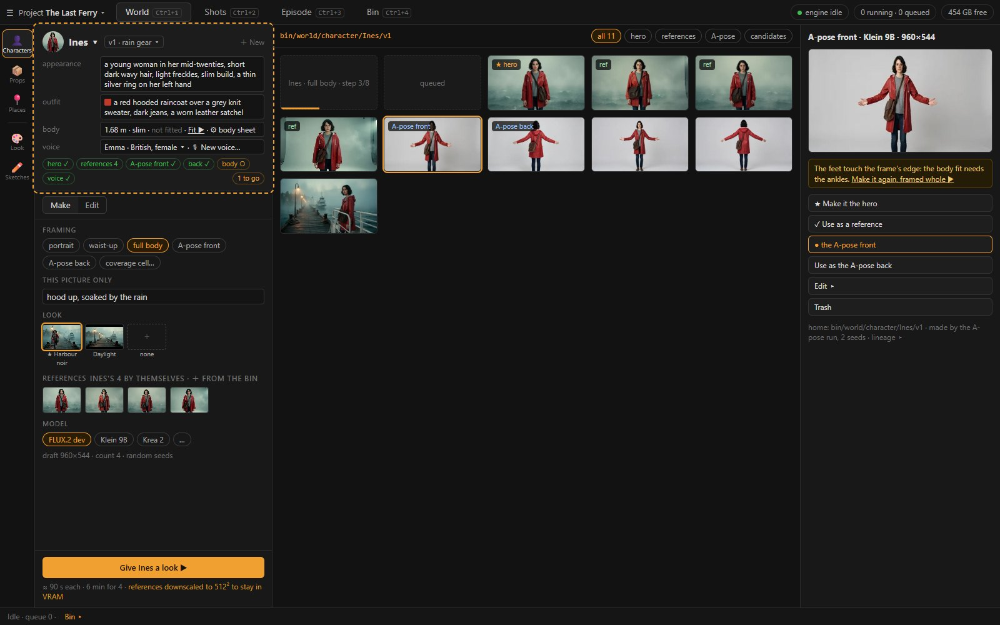
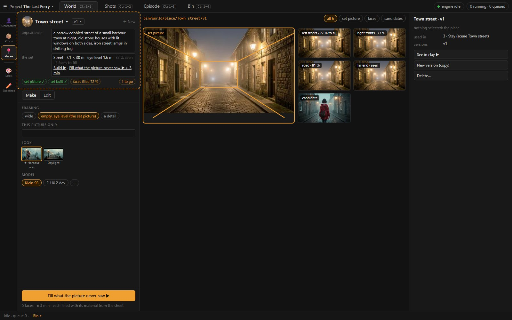

<!-- markdownlint-disable MD024 -->
# 03 · World: the entities, made and readied for Clay

World answers one question: **what exists in this story, and is each thing ready to be put on a stage?** It is the ideation layer. Nothing in it is
about a particular shot: no light, no pose, no camera, no framing beyond what the entity's own pictures need. Wireframes: `img/ui-1-world-character.jpg`,
`img/ui-2-world-place.jpg` (rendered from `mock/ui2-mock.html`).

## 1. The layout

```
┌ ☰ Project ▾ │ World · Shots · Episode · Bin ───────────────────────────────── engine · queue · disk ┐
│rail│ LEFT COLUMN (≈ 380 px)              │ CENTRE: the entity's bin                │ INSPECTOR          │
│ 👤 │ ┌ header: the entity ──────────────┐│ bin/world/character/Ines/v1   ▾ roles    │ the selected       │
│ 📦 │ │ Ines ▾   v1 · rain gear ▾   ＋    ││ ┌────┐┌────┐┌────┐┌────┐┌────┐          │ creation: preview, │
│ 📍 │ │ appearance …                      ││ │ ★  ││ ref││ ref││A·F ││    │ …        │ its role verbs,    │
│ ── │ │ outfit …                          ││ └────┘└────┘└────┘└────┘└────┘          │ lineage, prompt    │
│ 🎨 │ │ body  1.68 m · slim · fitted ✓  ⚙ ││  (newest first; running jobs on top;     │                    │
│ ✏️ │ │ voice Emma · British ▾          🎙 ││   no batch headers)                      │ nothing selected:  │
│    │ │ ready: hero ✓ refs 4 A-pose ✓ ◐  ││                                          │ the entity: used in│
│    │ └──────────────────────────────────┘│                                          │ shots, versions,   │
│    │ [ Make | Edit ]                      │                                          │                    │
│    │  … the Make panel (§3) …             │                                          │                    │
│    │ foot: Give Ines a look ▶  ≈ 3 min    │                                          │                    │
└────┴──────────────────────────────────────┴──────────────────────────────────────────┴────────────────────┘
```





**The rail:**

- the three classes: **Characters · Props · Places**;
- under a divider, **Look** (the project's styles, [01](01-evaluation.md) §2) and **Sketches** (free pictures not yet anyone's, §7).

The rail picks the class. The header picks the entity (§2).

## 2. The header: the entity

**The entity row.** `Ines ▾` opens a picker of the class's entities as thumbnails, with ＋ *New character* at the end. The row also holds the version
`v1 · rain gear ▾` (its menu: the other versions, *New version (copy)*, *Mark final*) and ＋ for a new entity of the class.

**The fields, per class** (the author's list, with voice added for characters, [01](01-evaluation.md) §3):

| Class | Fields |
| --- | --- |
| Character | name · version · **appearance** (words; colours as swatches on the field; marks are words in it) · **outfit** · **body** · **voice** |
| Prop | name · version · **appearance** · **3D model** (a turning thumbnail, its height in metres) |
| Place | name · version · **appearance** · **the set** (its kind and size, how much the set picture saw) |

**What each field opens:**

- **Body** opens the body sheet: build, height, proportions and attachments (today's `CastBody`), and the skeleton bench from Cast (CS2). A fitted body
  shows *fitted ✓*. The *Fit ▶* verb sits beside it and says what blocks it. Today a failed fit is only a toast: the walkthrough's automatic fit
  failed with *the reference does not show the whole figure*, and nothing on the page said so (F32).
- **Voice** offers *speaks with ▾* (the project's voices) and *New voice…* (Kokoro's draft voices, or cloning from a WAV).
- **3D model** offers *Make ▶* (from the hero) and *Import GLB…*, and the height.
- **The set** offers *Build ▶* (room, corridor, street or open ground, fitted to the set picture) and *Fill what the picture never saw ▶*. The faces left
  to fill show as a percentage.

**The readiness line** is the header's last line: what this version still needs to be used in Clay.

| Class | Items, in order (✓ done · ○ owed · – optional) |
| --- | --- |
| Character | hero · references (count) · A-pose front · A-pose back · body fitted · voice (owed only when a shot gives the character a line) |
| Prop | hero · 3D model · height |
| Place | set picture · set built · faces filled (a percentage) |

An item is its verb: a click runs it, or opens what it needs. The line ends in *Ready for Clay* or *N to go*. The foot (§5) is the first owed item.

## 3. Make: the entity's pictures

Make is Image's column, scoped to the entity. **The entity is the subject**: its sheet, references and colours are always on, and it is the
only subject, so nothing can be left behind (F16).

What stays from Image's column:

- **This picture only**: words added after the sheet for this run (*soaked, hood up*).
- **Framing**, a short list per class. It is not the Library's 17 fields: the entity needs pictures of itself, not of a shot.

  | Class | Framings |
  | --- | --- |
  | Character | portrait · waist-up · full body · A-pose front · A-pose back |
  | Prop | on its own · in a hand · in its setting |
  | Place | wide · empty, eye level (the set picture) · a detail |

- **The Look**: the project's style tiles (§6), the default ★ preselected.
- **References**: the entity's own reference set is attached by itself. Extra references come from the Bin, and their count drives the estimate (§3.1).
- **Model, size, count, seed**: as today; the model list is the image specs.

What goes, and where:

| Today in Image's column | Here |
| --- | --- |
| Scene, place, subject cards, holds | the entity *is* the subject; a place's pictures are its own |
| Lighting, camera (shot size, angle, lens, depth of field, aperture), composition | Clay: real lights and cameras ([04](04-ui-shots.md) §3) |
| Pose, action, position | Clay: the figure's pose and animation |
| Mood, art style, palette | the Look (§6) |
| Background | the framing (*empty, eye level*; *on its own*) |
| Expand's Poses section, LoRA slots | gone: no Expand and no LoRA (D157, [09](09-answers.md) §1) |

**The verbs** (the foot shows the one that fits):

| Verb | Class | What it does |
| --- | --- | --- |
| *Give ‹name› a look ▶* | all | N pictures of the entity in the chosen framing (the casting run) |
| *Make the A-pose ▶* | character | front, then back; the first becomes the animation reference, and the body fit runs on it |
| *Make the set picture ▶* | place | the empty eye-level view, ready for *Build ▶* |
| *Make the 3D model ▶* | prop | Pixal3D from the hero |

### 3.1 The estimate tells the truth

The foot's estimate includes the references (count and size) and says when they will not fit in VRAM. The walkthrough was promised 42 s and got 16
minutes with eight references at 1024² (F27). When the references would spill, the panel downscales them to 512² by itself and says so (10.5 s per
step instead of 117, F27b).

## 4. Edit: the same editor, on a creation

Edit is today's image editor (layers, brushes, selections, the AI verbs Inpaint · Refine · Upscale · Instruct · New angle, the text tool). It is opened
on the selected creation. *Save* writes a new creation into the same bin, with its lineage; *Save as the hero* or *as a reference* sets its role at once.
Nothing about the editor changes except where it lives.

## 5. The bin and the Inspector

**The centre** is the version's bin: every creation of `bin/world/<class>/<name>/<version>`, newest first. It has no batch headers (F23):

- running jobs sit on top as placeholders;
- a run's seeds sit together because they finished together.

Role chips filter the grid: *all · hero · references · A-pose · set · model · candidates*. A tile's corner shows its role (★, ref, A·F, A·B, set). Its
hover offers ✓ *reference* and ★ *hero*.

**Roles, not pages.** Today the reference set and the candidates are two album pages, and making the hero *moves* the picture between them (F15). The
bin keeps those pages underneath, as its role pages: mentions, training and staleness read them (06 §1.2). The author sees one grid, in which a picture
stays where it is and gains a role:

- one hero;
- any number of references;
- an A-pose front and back;
- a set picture;
- a model.

Everything else is a candidate by default.

**The Inspector:**

- with a creation selected: its preview, its role verbs (*Make it the hero · Use as a reference · Use as the A-pose front / back · Use as the set picture
  · Edit · Trash*), its prompt and lineage;
- with nothing selected: the entity's facts.
  - **Used in shots**: from the stages, the lines and the places (not today's speaker-only count, F30). A click opens the shot in Shots.
  - **Versions.**
  - **Delete…**

## 6. Look: the project's styles

The styles that today sit in Story › World, made the same way as an entity's pictures:

- a name and the prompt fragment;
- a sample image, rendered on **the project's own sample scene**. The scene is a field here, not an app-wide setting (F3: a harbour story's style was
  judged on "a cyber spy in an office");
- ★ for the default;
- the words that are part of a look rather than of a shot: mood, art style, palette. The Library's entries for those fields become the Look's word
  presets, with ＋ to add.

Every Make in World and every picture made in Shots uses the default Look unless a run picks another.

## 7. Sketches: pictures that belong to no one yet

The brainstorm's loose pictures:

- free generations with the full prompt, or the Library's words if the author wants them, here only;
- imports and moodboard images.

They live in `bin/world/sketches`. A sketch's *Prototype ▸* makes a **draft** entity of a class from it: the picture becomes its hero, and the name comes
from the prompt. That replaces today's separate ideas store (D136 U1); an entity with no references or body is simply a draft, and the readiness line says
so.

## 8. Commands (rule 3)

| Command | Mouse homes | Calls (today's routes, 06 §1) |
| --- | --- | --- |
| `world.entity.new` | the rail's ＋, the entity picker's last tile | `POST /story/profiles` |
| `world.entity.pick` | the header's `name ▾` | — (selection) |
| `world.version.new` | the version menu | `POST /story/profiles/{pid}/versions` |
| `world.make.look` | the foot, the Make panel | `POST /jobs` (t2i, origin cast) |
| `world.make.apose` | the readiness item, the framing list | the animation-reference route (front / back) |
| `world.body.fit` | the body field's *Fit ▶*, the readiness item | the keypoints job |
| `world.voice.new` | the voice field's 🎙 | `POST /story/voices` |
| `world.model.make` / `.import` | the 3D model field | the Pixal3D job / the GLB import |
| `world.set.build` / `.fill` | the set field | `image_to_set`, the Fill chain |
| `world.creation.role` (hero, reference, A-pose, set picture) | the tile's hover, its right-click, the Inspector | the profile setters (06 §1.1) |
| `world.creation.edit` | the tile's right-click, the Inspector, Make ⇄ Edit | opens Edit on the asset |
| `world.sketch.prototype` | a sketch's right-click and Inspector | `POST /story/profiles` with the sketch as hero |

Every command has a tooltip with its key (D72) and a right-click home where it applies to a tile. Explanations live behind a ? (rule 11).

## 9. What World no longer has

- **The Story › World page:** logline, synopsis, spine, variables ([01](01-evaluation.md) §2).
- **Cast's centre form:**
  - the coverage table, Expand and the LoRA training block (D157: Clay keeps the character consistent);
  - the candidates strip (the bin is the candidates);
  - the animation-reference cards (a role, a readiness item);
  - the set and model blocks (header fields);
  - *In N shots* (the Inspector).
- **Cast's Inspector duplicates of Image:** *Use as a subject in Image*, *Expand in Image…*.
- **The line-up and the bench as separate stages in the stage lists.** *See in clay ▶* on an entity opens a temporary stage in Shots' Clay, bound to it,
  and closes back to World (D142's bench, without listing it).
