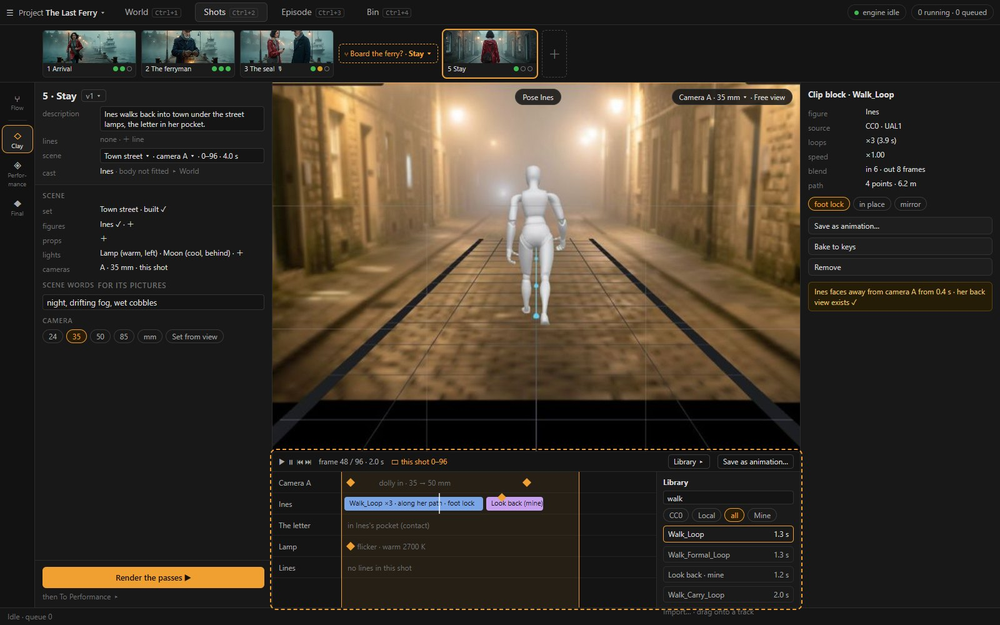
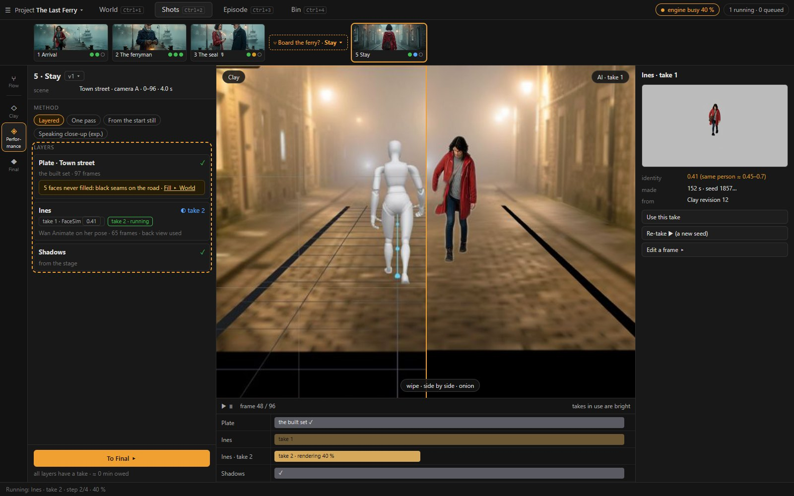
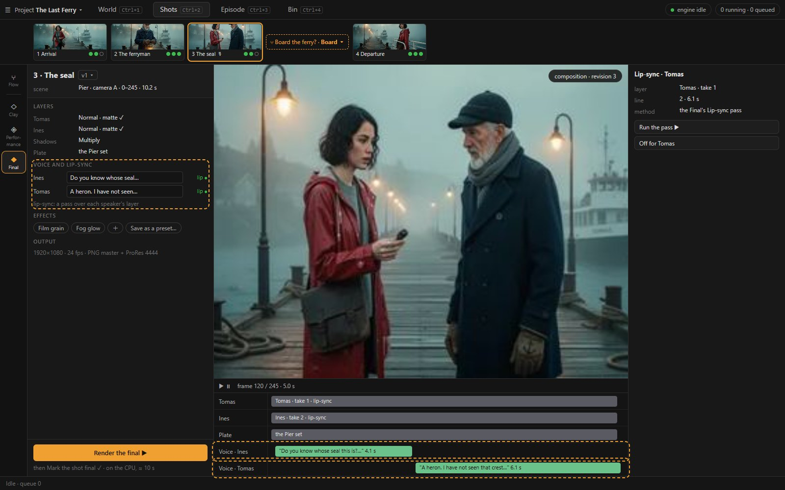
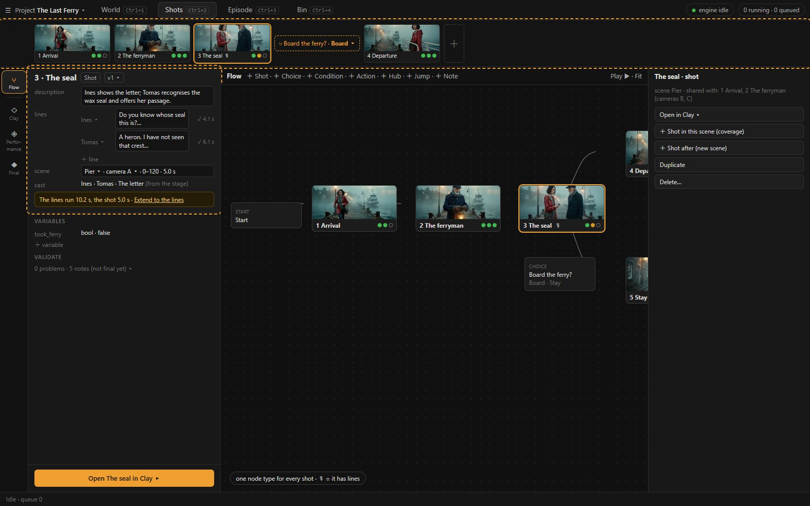

<!-- markdownlint-disable MD024 -->
# 04 · Shots: the Flow, and every shot refined Clay → Performance → Final

Shots answers: **what happens, shot by shot, and how far is each shot?** Every shot is a camera on a clay stage (its *scene*). It is refined in three
levels: **Clay** (the arrangement and the animation), **Performance** (the clay made into footage, with no new motion), **Final** (the shot assembled
with its voice and processing). The Flow is the order of the shots and the story's logic.

Wireframes:

- `img/ui-3-shots-flow.jpg`
- `img/ui-4-shots-clay.jpg`
- `img/ui-5-shots-performance.jpg`
- `img/ui-6-shots-final.jpg`

## 1. Scenes and shots

| Term | What it is | Today's record (06 §2) |
| --- | --- | --- |
| **Scene** | one clay stage: a set (a World place), figures (World characters), props, lights, cameras, and one timeline of animation | a stage (`stages/<id>.json`) |
| **Shot** | a Flow node: its description, its lines, **one camera of its scene, over a range of the scene's timeline**, and its outputs (Performance takes, the Final) | a Flow node + its Story shot (RC2a: the shot inside the node's file) + the version's `stage_id` / `camera_id` |

**What a scene gives its shots.**

- **One shot per scene** is the author's one-to-one case, and the default for a new shot.
- **Coverage** (a master and its close-ups) is *New shot in this scene*: another camera on the same stage, often over the same range. The blocking and the
  animation are made once and stay consistent across the cut ([01](01-evaluation.md) §6; Q2 in [07](07-plan.md) §5).
- **Lines belong to the shot they are spoken in.** In shot / reverse-shot each close-up holds its speaker's lines. The scene's timeline places all of
  them, so the action can be timed to the speech.

## 2. The layout

```
┌ ☰ Project ▾ │ World · Shots · Episode · Bin ────────────────────────────────────────── engine · queue ┐
│    │ STORYBOARD: [1 Arrival ●●○] [2 The ferryman ●●●] [3 The seal ●○○] ⑂ Board ▾ [4 Departure ●●●] [＋]     │
│rail├───────────────────────────────┬────────────────────────────────────────────────┬─────────────────┤
│ ⑂  │ SHOT  3 · The seal ▾  v1 ▾    │                                                │ INSPECTOR       │
│Flow│ description …                 │        CENTRE: the level's viewer               │ the selection:  │
│ ◇  │ lines  Ines  "Do you know…" ✓ │   Clay: the stage through camera A (or free)    │ a figure, a     │
│Clay│        Tomas "A heron. I…"  ✓ │   Performance: clay ⇄ AI, wipe                  │ camera, a light,│
│ ◈  │ scene  Pier · camera A · 0–96 │   Final: the composition                        │ a clip block, a │
│Perf│ cast   Ines · Tomas (from the │                                                │ take, a layer   │
│ ◆  │        stage)                 │                                                │                 │
│Fin │ ── the level's sections ──    ├────────────────────────────────────────────────┤                 │
│    │                               │ TIMELINE / ANIMATION EDITOR (tracks, §3.2)      │                 │
│    │ foot: the shot's next step ▶  │                                                │                 │
└────┴───────────────────────────────┴────────────────────────────────────────────────┴─────────────────┘
```

- **The storyboard strip** across the top shows the current route's shots in order. Each card has a thumbnail (the latest still or final frame), a
  number, a name, and three dots: Clay · Performance · Final, each ✓ done · ○ owed · ! stale · ◐ running. A Choice shows as ⑂ with its option picker, so
  the strip follows one branch at a time. ＋ at the end adds a shot after the last one. A click opens the shot at the level last used.
- **The rail** is **Flow** (the graph), then the shot's three levels: **Clay · Performance · Final**.
- **The left column** opens with the shot's header (§2.1). Below it are the level's sections, and the shot's next step is in the foot (Ctrl+Enter).
- **The centre** is the level's viewer. Under it is the timeline, which is the animation editor in Clay (§3.2).
- **The Inspector** shows the selected thing.

### 2.1 The shot header

| Field | What it holds |
| --- | --- |
| `3 · The seal ▾` `v1 ▾` | the shot's name and number in the route; its versions (*New version (copy)*, *Mark final*) |
| description | the beat: what happens, in words. It is also the action of the shot's pictures (§6) |
| lines | ＋ *line*: speaker (a character in the scene's cast), the words, the voice (✓ with its length, ▶ to play, 🎙 to voice). A shot with no lines is simply silent; there is no Dialogue type ([01](01-evaluation.md) §7) |
| scene | the stage (`Pier ▾`: *New scene…*, *Same scene as the shot before*), the camera (`A ▾`), the range (`0–96 · 4.0 s`). When the lines outlast the range: *the lines run 10.2 s, the shot 4.0 s · Extend to the lines* (F39) |
| cast | read from the stage's figures and props, bound to World. ＋ adds one to the stage. A cast member that is not ready for Clay shows what it lacks, with a link to World |

## 3. Clay: the arrangement and the animation

Clay is today's Stage engine and viewport (06 §5), opened on the shot's scene through the shot's camera.



**The left column's sections:**

- **Scene.** The set, from a World place's built set or a set preset (a preset gets the place's words only when it is bound to a place, §6). Then:
  - figures: World characters, ready or not, with the gaps shown;
  - props: World props;
  - lights: templates (Window, Sun, Lamp, moonlight, candle, golden-hour rim, studio key and fill, …) and **a full light editor** on the selected
    light, as the pose editor is on a figure: a gizmo for position and aim, colour temperature, intensity, size and softness, falloff and cone,
    shadows, and the words it gives the pictures (§6). *Save as a light template…* keeps one for the project or the author's library (D157 Q10,
    [09](09-answers.md) §2);
  - cameras: A, B…, each the camera of one shot (its name says which).

  An entity added here lands on the floor inside the shot camera's frame (F35).
- **Camera.** Lens (24 · 35 · 50 · 85 mm, or any length), height, *Set from the view*, guides, picture-in-picture.

The **foot** offers *Render the passes ▶*, then *To Performance ▸*.

**The viewer:**

- the shot's camera by default; *Free view* to walk around;
- the pose pill on a selected figure (D121);
- the stage's other cameras shown as frusta, so coverage is visible.

### 3.1 Pose editor

Unchanged: joints, IK, pins, contacts, gaze, mirror, and the character's own poses (D141). It runs on the figure selected in the viewer, and its keys
land on the figure's key layer (§3.2).

### 3.2 The animation editor

The timeline under the viewer becomes an editor with one track per thing that moves:

```
 ▶ ⏸ ⏮ ⏭   frame 48 / 96 · 2.0 s     ▭ this shot's range       Library ▸       Save as animation…
 Camera A   ◆───────────────────◆  dolly in · lens 35 → 50
 Ines       [ Walk_Loop ×3  ·  along her path  ─────────── ][ Idle_LookBack 1.2 s ]    keys ◆   ◆
 Tomas      [ Idle_Lantern_Loop ─────────────────────────────────────────────────── ]  ◆
 The letter ◆ in Ines's hand (contact) ─────────────────────────◆ handed to Tomas
 Lines      ▮ Ines "Do you know…" 4.1 s ▮      ▮ Tomas "A heron…" 6.1 s ▮
```

**Clip blocks, not baked keys.**

- A library clip, a template or a walk along a path is a **block** on the figure's track. Drag it to move it; drag an edge to trim; the ⟳ handle loops it;
  the corner handles blend it in and out with its neighbour.
- Its right-click menu: speed, mirror, in place, foot lock, *Bake to keys*, *Save as animation…*.
- Today, applying a 1.3 s walk baked 329 keys and stretched the stage's range from 120 to 328 frames without a word (F37). A block keeps its clip, so
  changing the path or the loop count re-flows it. A block longer than the shot is shown past the range's end, and the range never moves by itself.

**The key layer.** Each figure's track carries a layer of pose keys (◆) on top of its blocks: corrections, a head turn, a gesture. They come from the
pose editor and Shift+K, as today.

**The camera's track** holds keys of position, target and lens.

**The props' tracks** hold keys and contacts (*in Ines's hand*), so a prop is carried, put down or handed over.

**The lines' track** is read-only: each spoken line at its place in the scene, its length from the voice. The action is timed to it.

**The library** is a drawer on the editor's right edge (*Library ▸*):

- **CC0:** the starter set;
- **Local:** your folder, now with an *Import…* button;
- **Mine:** the templates.

Search finds clips, not files (F36), and a picked clip plays on a dummy. Drag a clip onto a track, or *Apply to ‹figure›*.

**Saving an animation.** Select a range on a figure's track (one block, several, or the keys) and choose *Save as animation…*. A name is asked, and the
segment is stored as a template in the stage's own key format on the shared mannequin rig. It is re-based to frame 0 and its start position, and keeps
the Detailed bones and the pins. It appears under *Mine* and applies to any figure: the root is scaled to the figure's hip and the contacts are re-run
(D141; 06 §2.4). A template is the project's; *Save to my library* makes it the author's in every project (Q4).

**A figure facing away.** When a figure turns its back to the camera, the track marks that stretch. If the character has no A-pose back, the mark says so
and links to it: *Ines faces away from camera A here, and has no back view · Make the back view ▸ World* (F42).

A back view alone did not fix the walkthrough's take: Ines still faced the camera (F43). So the facing is an open problem, and spike E42 comes before U6
([07](07-plan.md) §2). The spike tests what Wan Animate is given: the back reference, the pose guide's facing, and the prompt.

## 4. Performance: the clay made into footage

Performance turns the arranged, animated clay into pictures. **It never invents motion:** a change of motion is a change in Clay, and it makes the
dependent takes stale.



**The method**, chosen per shot:

| Method | What it does | Today (06 §2.6) |
| --- | --- | --- |
| **Layered** (default) | the plate, each character, each prop and the shadows, each its own take, then Final composes them | the final shot's layers (D111) |
| **One pass** | the whole frame at once from the clay's passes (depth, or pose for one figure) | the stage clip (IC-LoRA, Wan Animate) |
| **From the start still** | a still made from the clay, animated by an image-to-video model. The clay camera's move becomes the model's camera move where one matches | image to video (Wan 2.2, LTX, Fun-Camera, D156) |
| **Speaking close-up** (experimental) | a talking head from the still and the line's voice | Wan S2V (D88) |

**The layers** (Layered). Each layer is a row with its takes:

- **The plate** shows its source: *the built set* (the default for a bound place), *projected*, *filled* or *generated along the path*. When the set's
  faces are not all filled, the row warns before the take and offers *Fill ▸* (F43).
- **Each character** shows its takes (*take 1 ✓ · take 2*), each with its identity score (FaceSim against the World references) and *Re-take ▶*. Today
  the score is only a clip's fact: Departure's clip showed 0.31, below the "same person" band of 0.45–0.7, and nothing on the shot said so.
- **Each prop** shows its render.
- **The shadows.**

The viewer plays **clay ⇄ AI** with a wipe, side by side or as an onion skin, in step with the timeline. The timeline shows a row per layer with its
takes stacked, so the one in use is visible.

The **foot** offers *Perform the owed layers ▶ · ≈ 5 min on the GPU*, then *To Final ▸*. It acts on **this shot's** takes. Today the final shot's foot
acted on the stage's oldest final (F41).

**D164** (E45) adds each character layer's face work to the owed list:

- the face pass, for a head of 48–78 px facing the camera;
- lip-sync, for a character who speaks.

The server counts the items (`GET /finals/{fid}/owed`), and the same button sits on Final's foot. Something that is only listed shows as
*N not queued*: a line longer than 4.8 s, a head seen from behind. Its reasons are in the hover.

## 5. Final: the shot assembled as it was arranged

Final is today's Final level: the EffectCraft composition, mattes, effects and the render. Two things are added: the shot's voice, and lip-sync as a
pass.



**The left column's sections:**

- **Layers:** depth order, blend, mattes, parent, as today.
- **Voice and lip-sync:**
  - the shot's lines on their audio rows, with gain;
  - lip-sync on or off per speaking character, as a pass over that character's layer (Final's *Lip-sync* pass, settings from `Settings.lipsync`).
- **Effects:** today's 22, with *Save as a preset…* (the inventory's gap).
- **Output:** the render settings and the output modules.

**The timeline** shows layer lanes and audio rows.

**The foot** offers *Render the final ▶*, then *Mark the shot final ✓*. The render is **the shot's final**, the one thing Episode reads (05 §1).

## 6. The words of a shot's pictures

Every picture Shots makes is built from the shot's own records. This covers the plate, the start still, a still from the stage and a performance's
prompt. Nothing is carried over from the last picture made (F25, F29):

1. **the Look:** the default style, or the scene's own;
2. **the place:** the appearance of the place bound to the set, with its references;
3. **the cast in frame:** each visible figure's and prop's sheet and references (the stage's masks say who is visible);
4. **the lights as words:** each Clay light's kind, colour and direction from the camera (*warm lamp light from the left, cool moonlight behind*);
5. **the scene's words:** time of day, weather, the air (*night, drifting fog*), a scene field;
6. **the action:** the shot's description;
7. **this shot only:** the author's extra words, kept with the shot.

The composed prompt is always visible (*Show the words*) and every part names its source. Today the plate of a set preset read "The room is empty …
bare walls and floor" even on a street: none of the seven was there (F38).

## 7. The Flow

The rail's **Flow** shows the graph in the centre.



Its node types:

- **Shot:** a description, lines, and its scene; it replaces Shot and Dialogue;
- **Choice, Condition, Action:** the story's logic, on the project's variables;
- **Start, Hub, Jump, Note.**

The variables, moved from World, are a section of the left column.

**Fixes from the walkthrough:**

- a new node lands beside the selection and pushes its neighbours aside (F20);
- fit-to-view keeps a readable minimum zoom and pans instead (F20);
- the outline lists nodes in route order (F8);
- *Validate* separates problems from advice, and its count opens the list (F21);
- a logic node shows no shot verbs (F19).

**A Shot node's card** carries its storyboard thumbnail, the three level dots and 🎙 when it has lines. A double-click opens it in Clay.

**New shot.** ＋ *Shot* (the strip, the storyboard's ＋, the canvas's right-click) asks one question:

- **a new scene**: from the place of the shot before, from a World place, or from a stage template;
- **or the same scene as the shot before** (coverage): a new camera on that stage.

The new shot is connected after the selection.

## 8. Commands (rule 3)

| Command | Mouse homes | Calls (06 §2) |
| --- | --- | --- |
| `shots.open` | a storyboard card, a node's double-click | — |
| `shots.new` / `shots.newCoverage` | the storyboard's ＋, the Flow strip, the canvas menu | `POST /story/flow/nodes` + a stage or a camera (06 §2.7) |
| `shots.line.add` / `.voice` | the header's lines | `PATCH` the node · `POST …/voice` |
| `shots.range.fitLines` | the header's warning | `PATCH` the shot's range |
| `clay.add.figure` / `.prop` / `.set` / `.light` | the Scene section, the viewer's right-click | the stage's objects |
| `clay.clip.apply` | the library drawer (drag, *Apply*) | a block on the track (06 §2.4) |
| `clay.clip.saveAsAnimation` | a block's or a range's right-click, the editor's bar | writes a template (06 §2.4) |
| `clay.passes` | the foot | the passes render (client) |
| `perf.method` | the Method section | the shot's method |
| `perf.performOwed` / `perf.retake` | the foot, a layer's row | the finals' layer jobs |
| `final.lipsync` | the Voice section | the Lip-sync pass |
| `final.render` / `shots.markFinal` | the foot | `comp_render` · `POST …/finalize` |

## 9. What Shots no longer has

- **The five recipe routes** (Image to video, From the stage, Clay one / two characters, Dialogue with voice). There is one pipeline, and the
  Performance methods are its choices.
- **The For chip and the trips to Image and Animate**, with their *Back*. Image › From a stage becomes Performance's start still; Animate is the levels.
- **The Shots board as a workspace.** The storyboard strip carries its states. A *List* view of the Flow (one row per shot with its three levels) remains
  for a long episode.
- **Stage-only shots and stage pickers.** A stage is a scene of the Flow or a temporary bench (World's *See in clay ▶*).
- **"Make frame", "Make clip" and "Link a stage camera…".** A shot always has its camera.
