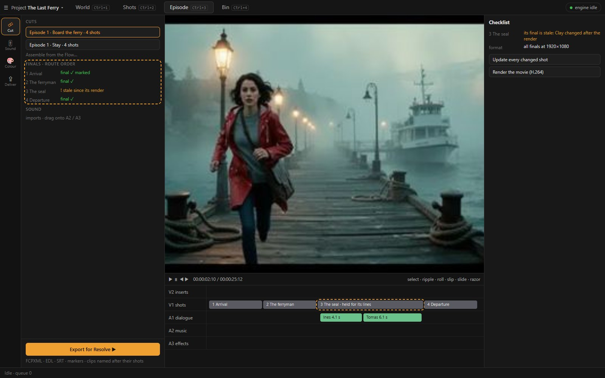
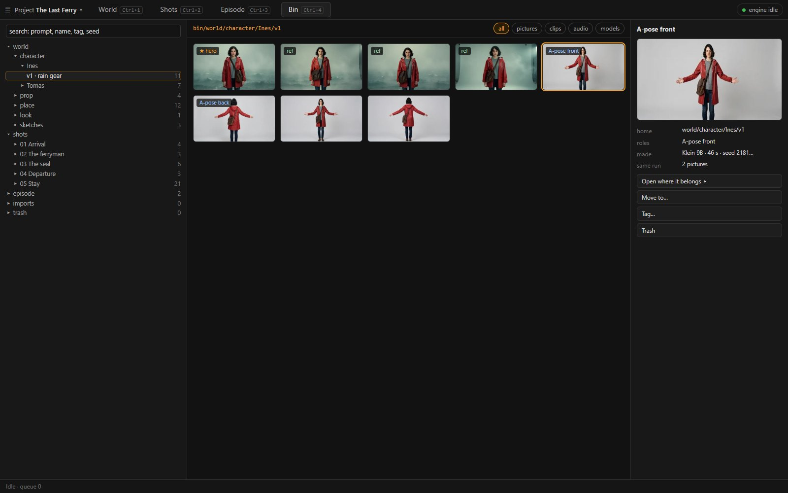

<!-- markdownlint-disable MD024 -->
# 05 · Episode and the Bin

Wireframes: `img/ui-7-episode.jpg`, `img/ui-8-bin.jpg`.

## 1. Episode: the finals, cut

Episode answers: **how do the shots play together, and what leaves loom2?** It is today's FilmCraft-backed cut editor (D126, CE1–CE5: tracks, trims,
dissolves, sound, VST3 chains, colour, captions, delivery). It changes only in what it reads and in four fixes from the walkthrough.



**The layout:**

- **the left column:**
  - **Cuts**: one per route, named after it (*Episode 1 · Board the ferry*);
  - **Finals**: the route's shots in order, each with its final (✓ rendered, ○ not yet, ! stale since its render) and whether it is marked final;
  - **Sound**: the project's audio imports.
- **the centre:** the preview over the tracks: V1 shots, V2 inserts and titles, A1 dialogue, A2 music, A3 effects.
- **the Inspector:** the selected clip (its shot, its final, the trims), the checklist, the grade, captions, export.
- **the foot:** *Export for Resolve ▶*, and *Render the movie* beside it.

**What it reads.** **A shot's final**, the render of its Final level ([04](04-ui-shots.md) §5), is the only thing that goes on V1. This is already how a
clay shot's take lands (A1), and it becomes the rule for every shot. *Assemble from the Flow…* takes, for each shot of the route:

- its final when the shot is marked final;
- otherwise its latest final;
- otherwise nothing, and the shot is listed as missing.

*Update* swaps in a newer final and keeps the trims (RC3's rule).

**Fixes:**

1. **A shot is held for its lines.** A shot's clip is as long as its final, and its lines are placed inside it. When the lines are longer, Assemble
   extends the shot's out-point to them when its final has the frames. Otherwise the checklist lists *The seal: the lines run 10.2 s, the final 5.1 s*.
   Today Tomas's line and its subtitle play over the next shot (F39).
2. **Clips are named after their shots** in the FCPXML and the EDL (F40). A clip enters as its PNG master when it is at the cut's rate; today the
   16 fps Wan clips enter as their H.264 proxies (06 §3). A 16 fps final is conformed to the cut's rate by RIFE as it lands, as one undoable step. Today
   that happens only inside the movie job, which changes the live cut without an undo step.
3. **The Assemble sheet counts the route's shots:** *4 shots on this route · 2 without a final (left out): The seal, Departure* (F33).
4. **The board's and Episode's ideas of "changed" agree.** Both compare with the shot's final as Episode takes it (review FE#2).

**Unchanged:**

- the tools (select, ripple, roll, slip, slide, razor);
- the dissolves;
- the channel strips and VST3 chains;
- the grade per scene, *Match to…*, LUTs;
- captions and their four styles;
- the Resolve folder (FCPXML, EDL, SRT, markers) and the movie (H.264 or ProRes, −16 LUFS).

The inventory's closed lists here (two transitions at 12 frames, four caption styles) are worth opening when the editor is touched: a duration field and
FilmCraft's other transitions (Q8 in [07](07-plan.md) §5).

## 2. The Bin: every creation in its home

The Bin replaces the Catalogue tab and the Dock's Bin. It answers: **where is everything, and what is it for?**

### 2.1 The tree

```
bin/
├── world/
│   ├── character/  Ines/ v1/   (hero ★, references, A-pose front · back, candidates)   v2/ …
│   ├── prop/       The letter/ v1/   (hero, 3D model, candidates)
│   ├── place/      Harbour pier/ v1/   (set picture, faces, candidates)
│   ├── look/       (style samples)
│   └── sketches/   (free pictures, imports for the brainstorm)
├── shots/
│   └── 03 The seal/ v1/   (stills, passes, layers and their takes, the final)
├── episode/
│   └── Episode 1 · Board the ferry/   (movie renders, the Resolve folders)
├── imports/        (files brought in from disk, until moved)
└── trash/
```

**Rules:**

- **Every asset has exactly one home.** It is the path of what it was made for, written when the job lands. World's Make writes to the entity's
  version. Shots writes to the shot's version. A file brought in from disk lands in `imports` until it is moved.
- **A role is a tag inside the home**, not a second place: hero, reference, A-pose, set picture, model, final, in use.
- **There are no batches in the Bin.** A run's pictures sit together because they finished together. The run's seeds and recipe are in the Inspector
  (*Same run*).
- **There is no Unprocessed and no Library place.** An asset with no owner is in `world/sketches` or `imports`, and the Library's preset pictures
  belong to the Look or to Clay.

### 2.2 The screen



- **The left:** the tree, with counts; search across every home (prompt, name, tag, seed).
- **The centre:** the selected home's grid (pictures, clips, audio, models), filtered by role and kind.
- **The Inspector:** the asset's preview or player, its home and roles, *Move to…*, lineage, recipe, *Open where it belongs ▸* (World's entity, the
  shot's level, the cut), and *Trash*.

The loupe, compare and *Detach* stay as today (D155). The detached window must not take the app down when it closes (review: `lib.rs:283`).

### 2.3 The Bin as a drawer

In World, Shots and Episode the Dock's Bin tab opens a narrow tree-and-grid drawer. Dragging from it is how a reference, an image plane, a sound or an
insert gets anywhere: a reference into Make, an image plane onto a stage, a sound onto A2, an insert onto V2. The Bin has no verbs of its own beyond
move, tag and trash; making is always done in a layer.
