# 01 · Today: how an idea gets from a picture to clay

Status: **research, 2026-10-25.** Read from the code at `6cafacc`; nothing in the app was changed. The screenshots are from copies of
the rig projects (real pictures). The proposal is [02](02-the-workshop.md), its two technical parts are [03](03-clay-from-a-picture.md)
and [04](04-places-and-the-set-builder.md), and the plan is [05](05-plan.md).

## 0. How to read this

**Counting rules.** These are UX0's rules ([proto01_UI/03-ux0-review](../proto01_UI/03-ux0-review.md) §2), as in
[proto01_UIcomp/01](../proto01_UIcomp/01-current-workflow.md) §0.2:

- A **click** is a mouse click or a drag, including a dialog's OK and opening a menu. Typing is not counted, and neither is waiting for
  a job.
- A **tab switch** is a change of top tab: Story · Image · Animate · Catalogue.
- A **dead end** is a goal no mouse path reaches.

**Naming.** Places in the app are written **Tab › section › "label"** (`command.id`). File references are to the code at `6cafacc`.

**The screenshots** (`img/cur-*.jpg`) come from a throwaway Playwright walk on copies of four rig projects:

| Project | What it shows |
| --- | --- |
| A1 | Mara and Ines, with animation references and fitted bodies |
| E28 | three props with their Pixal3D models |
| CE4 | a place |
| SC3f | a picture set with two things |

The red banner on some screenshots is a one-time migration notice: a project copy from before RC2 opening in today's app.

## 1. What exists, and where it lives

### 1.1 Cast (Story › Cast)

Cast is the **identity bootstrap** of [17](../proto01/17-ui-suite-story.md) §3b. A profile (character, place or prop) has versions, and a
version holds the following:

- a hero;
- a **reference set** (an album page);
- a **candidates** page;
- the **sheet**: appearance, outfit, colours, marks (`story.py:156-202`);
- a LoRA;
- for a character, a **body** (height, build, eight proportion factors, attachments; `body.py:24-38`) and an **animation reference**
  (front, and an optional back view);
- for a prop, a **3D model** (`model_asset_id`).

The page leads with a readiness row. Each item is a button that runs that item's next step: *Hero · Sheet · References · Animation
reference · Body / 3D model · Voice · LoRA · Final* (`castReady.ts:13-17`, `StoryParts.tsx:288-307`). Below it come the hero, the sheet
with the body editor and its silhouette, the shots that use the profile, a coverage table, the animation reference, the 3D model (props)
and the candidates.

| | |
| --- | --- |
| 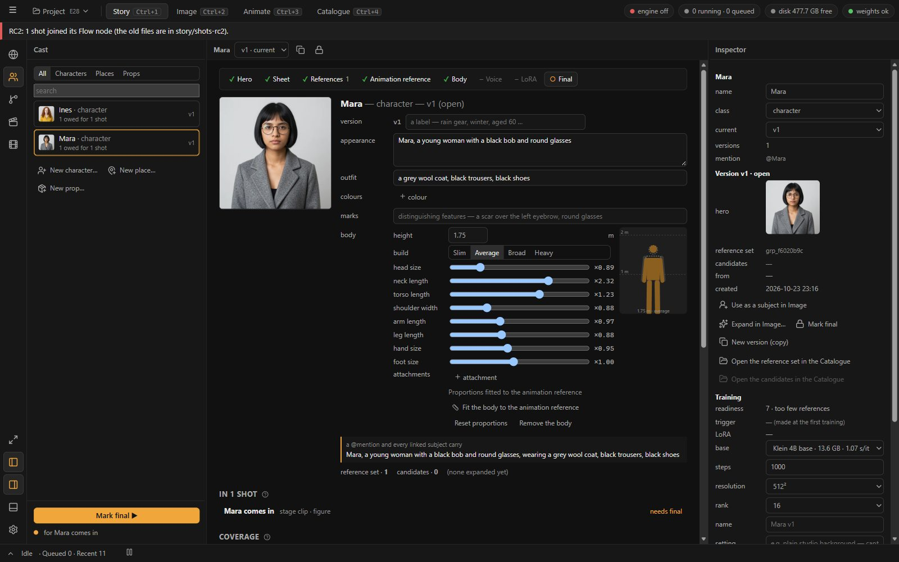 | 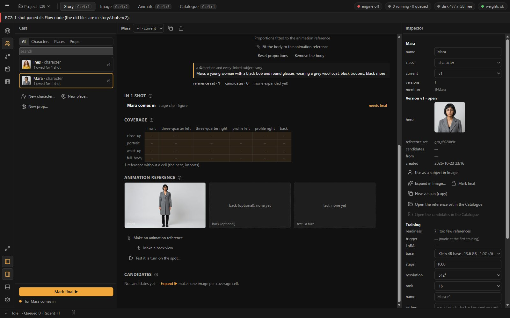 |
| **Mara**: the readiness row, the sheet, the fitted body and its silhouette, the Inspector's training block | the animation reference and the test slot |
| 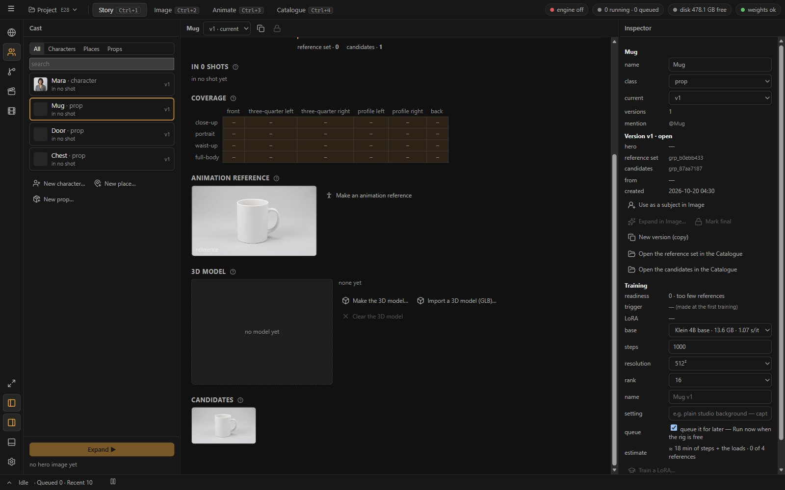 | 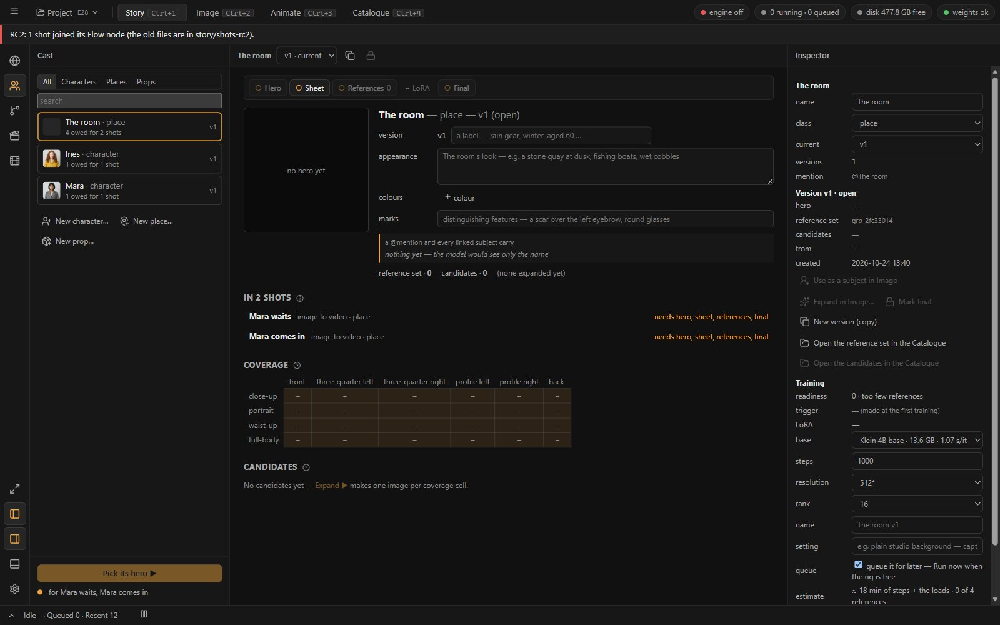 |
| **a prop**: its 3D model block (Pixal3D, ≈ 4–6 min) | **a place**: a hero, a sheet and references, and nothing else |

**What it is built for:** one consistent identity per profile, which a shot can trust. Version copies duplicate the reference set
(`story.py:2005-2021`), *Mark final* locks it, and Expand fills a coverage grid with one job per cell.

**What it is not built for:** trying things. These are missing:

- a light variant (a version is a full copy, and the copy loses its animation references, model and LoRA: `story.py:2016-2017`);
- a board of ideas to compare;
- any clay or 3D for a character beyond the eight proportion numbers.

### 1.2 From a picture to Cast (Image, Catalogue, Bin)

Image's results are the Catalogue's grid with its tile menu, Inspector and loupe (`GenerateSuite.tsx:224`, `catalogueStore.ts:279`). Every
Cast verb on a picture is two levels deep:

- **right-click › "Start from this image ▸" › "Make a character… / Make a place… / Make a prop…"** (`cat.start.character|place|prop`,
  `catalogueCommands.ts:110-121`). It asks for a name, then:
  - **switches to Story › Cast**;
  - **moves** the picture onto the new profile's page;
  - starts the sheet **empty**. The picture's prompt is not carried over (`story.py:1858-1876`).
- **right-click › "Add to character ▸" › ‹profile› ▸ "as the hero / into the reference set / as a candidate"**
  (`addToCast.ts:21-42`). It always targets the **current** version (`storyStore.ts:639`). The menu also lists props and places under
  "character".
- **right-click › "Start from this image ▸" › "Make a 3D prop…"** (`cat.start.mesh`, `catalogueCommands.ts:132-148`). This makes a
  **loose mesh**, not a Cast prop. Nothing in the UI turns it into a prop's model, although the server can (`PUT
  /story/profiles/{pid}/versions/{vid}/model`, `routes/story.py:498-515`; the client only ever clears it, `storyCommands.ts:341`).

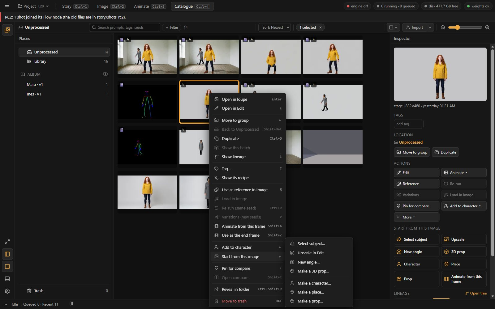

What a picture cannot do:

- **There is no "For: ‹character›" context.** Image's For chip is for shots only (`origin.ts:21`). Free generations, *New angle*,
  *Variations* and *Re-run* never come back to a profile (`generateStore.ts:242, 254, 450-452`). Only a linked subject card's casting
  run, and Expand for the first linked subject, land on a profile (`generateStore.ts:562-580, 603`).
- **It cannot become a character's animation reference** except by going into Cast: add it as a candidate, then right-click it there ›
  *Use as the animation reference* (`StoryParts.tsx:517-521`).
- **The Dock's Bin has no Cast verbs and none for meshes:** no Meshes filter, an empty right-click on a mesh, top-level groups only
  (`Bin.tsx:17, 47-56, 83`).

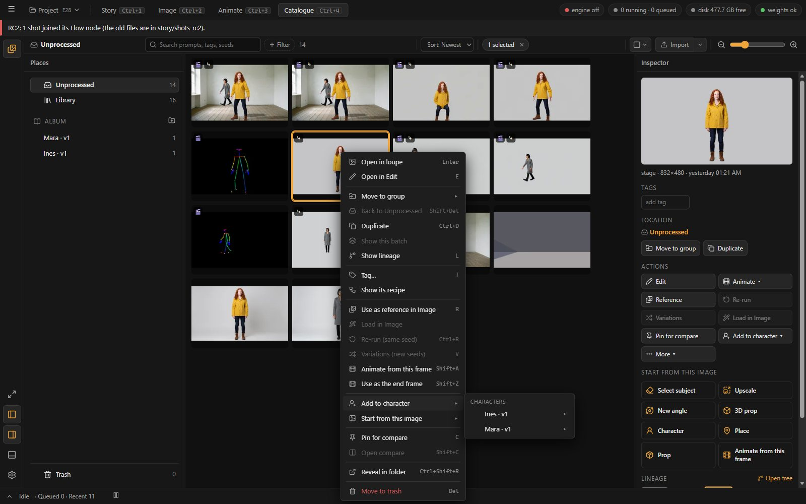

### 1.3 Clay (Animate › Clay)

The Scene section is one outliner with a `+` preset panel per group (D119): Figures · Sets · Props · Stand-ins · Meshes · Lights · Image
planes · Cameras · Templates (`StageParts.tsx:71-143`). Its parts:

- **Figures** are the mannequin (12 joints, COCO-18 markers), shaped by a **body** (`builders.ts:49-93`). A Cast character reaches a
  figure only through the figure's Inspector tiles or the right-click *Bind to a character ▸*. Binding copies the version's body onto
  the figure (`stageStore.ts:770-776`). **There are no character cards in the Scene panel.**
- **Sets** are four fixed presets — *room*, *street*, *deck*, *empty* — grey boxes of fixed size. A room is a 9 × 9 m floor, a 9 × 3.2 m
  back wall and a left wall (`builders.ts:112-125`). **No dimension, wall or texture can be edited, and the preset cannot be changed after
  adding.** *From an image…* makes a **picture set** (§1.4).
- **Props** lists Cast props that have a model; a click places the model bound to the prop (`FigureBinding.tsx:66-77`). **Meshes** lists
  every mesh asset, newest 60, each labelled "prop ‹6 chars of its id›". That mixes picture-set reliefs, the things' models and Cast
  models (`StageParts.tsx:83, 97`, `stageStore.ts:307-310`).
- **Only a figure or a mesh can carry a Cast binding** (`stages.py:211-212`). A set, a stand-in and an image plane cannot. **Nothing in
  the Stage code reads a Cast place.**

| | |
| --- | --- |
| 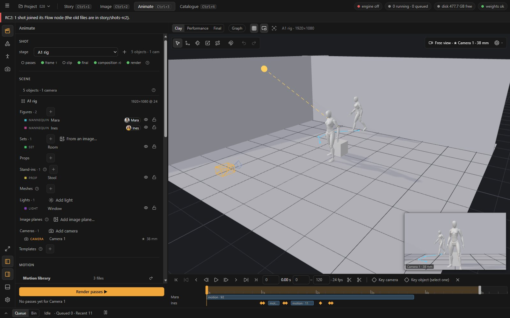 | 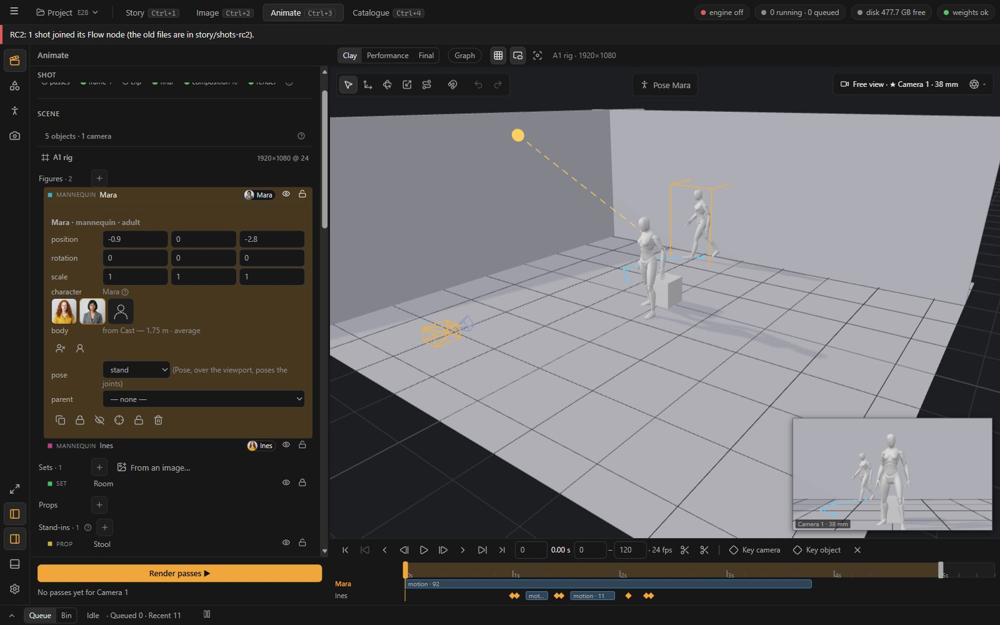 |
| the A1 stage: two bound figures on the room preset | a figure's editor: the character tiles and "body · from Cast — 1.75 m · average" |
|  | 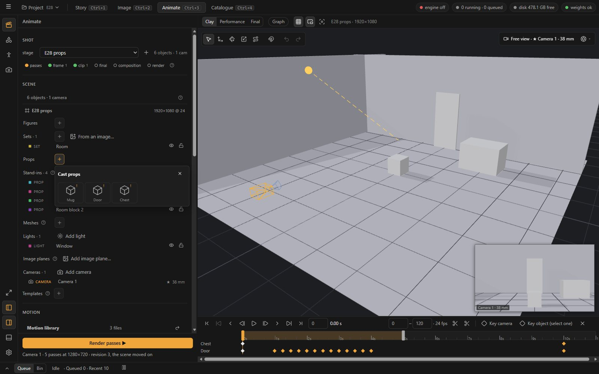 |
| the Sets `+`: four presets and *From an image…* | the Props `+`: Cast props with models |
| 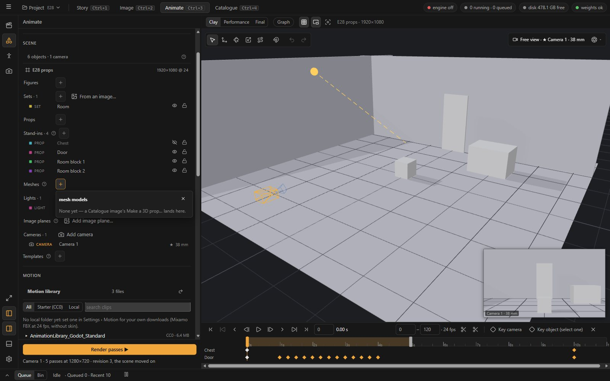 | 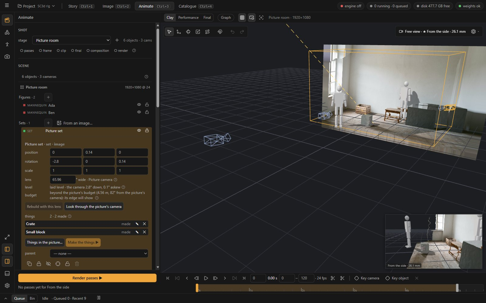 |
| the Meshes `+`: every mesh, unnamed | a picture set from the side: a relief, "beyond the picture's budget … its edge will show" |

### 1.4 A set from a picture (SC3, D120)

*From an image…* (Clay only, with a stage open) runs as follows:

1. It opens the Bin in pick mode.
2. It asks for the picture's lens.
3. It runs MoGe-2 for a metric point map, and `MoGePointMapToMesh` turns that into a **relief**: the picture as a textured mesh seen from
   the camera that took it (`graphs.py:1186-1211`).
4. The set lands **locked**, with a new *Picture camera*. Its floor is fitted by RANSAC and laid level (`stages.py:268-291`,
   `relief.py:94-175`).

After that, *Things in the picture…* picks objects with SAM 3, and *Make the things ▶* does three things:

- it cleans the plate under them (a Klein Fill);
- it rebuilds the relief;
- it stands a Pixal3D model of each thing on it (`set_things.py`).

**What it is good for:** a place exactly as pictured, from close to where the picture was taken.

**What it cannot be:**

- **a set to move through.** The camera budget is ±0.25 m and ±5° (orbit ±10°) before the picture's edge shows (D120, measured). From
  the side it is a flat shell (cur-12).
- **edited as architecture.** You cannot move a wall, widen the room or open a door.
- **a Cast place.** It is made from any Bin picture, and nothing links it to a place profile (`relief.py` and `set_things.py` never read
  a profile).
- **a source of Cast props.** Its things land as unbound meshes (`set_things.py:512`).

### 1.5 Clay from a character picture

The only clay that comes from a character's picture is **the body's proportions** (D104, CA1b):

1. *Make an animation reference* draws two full-body A-pose candidates with Klein (`story.py:754-789`).
2. The first one becomes the reference.
3. An SDPose `keypoints` job measures it.
4. Levenberg–Marquardt fits the head, neck, torso, shoulders, arms, legs and hands factors to the dummy's ratios (`body.py:68-143`).

The figure stays the grey mannequin or the Detailed UAL2 mannequin. Hair, coat, hat, silhouette and colour never reach the clay. One
piece of the way is already in the engine and unused:

- `StageObject.shadow_proxy` with `stage/proxy.ts` skins **a mesh made from the animation reference** to the figure's 12 joints, so that
  it casts the character's shadow (`engine.ts:580`).
- **Nothing sets it**: there is no command, route or UI for it.

### 1.6 The skeleton Wan Animate gets (Mara and Ines, measured)

The author, 2026-10-25, on Mara's test animations: "her body and the skeleton doesn't match … like her neck missing from the skeleton, or
her feet and hands look proportionately larger than her body. Her hands were also held in an unnatural manner, with her fingers bending
outwards". Measured on a copy of A1: the two references, the SDPose points their fit jobs kept, and the walk shot's guide and frames.

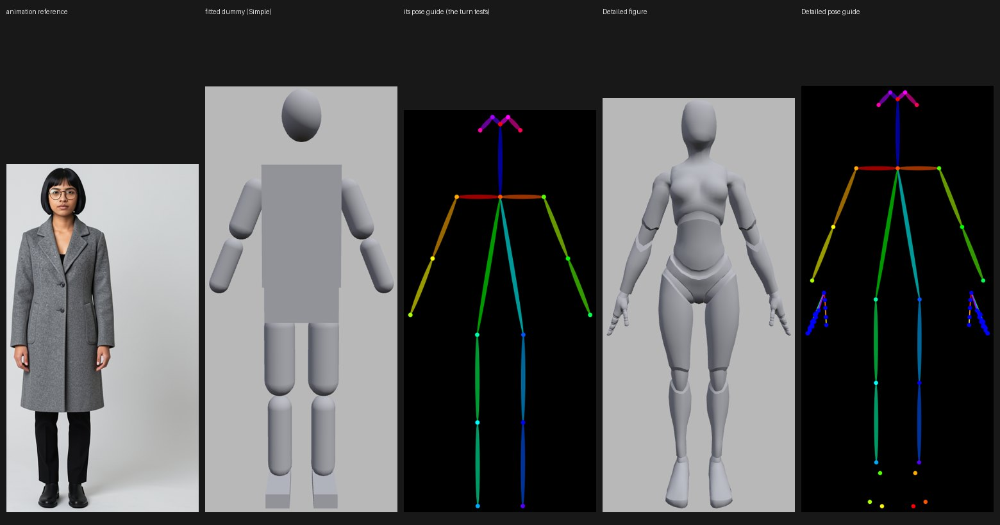

*Mara's reference, her fitted Simple dummy, the guide the turn test renders from it, the Detailed figure, the Detailed guide.*

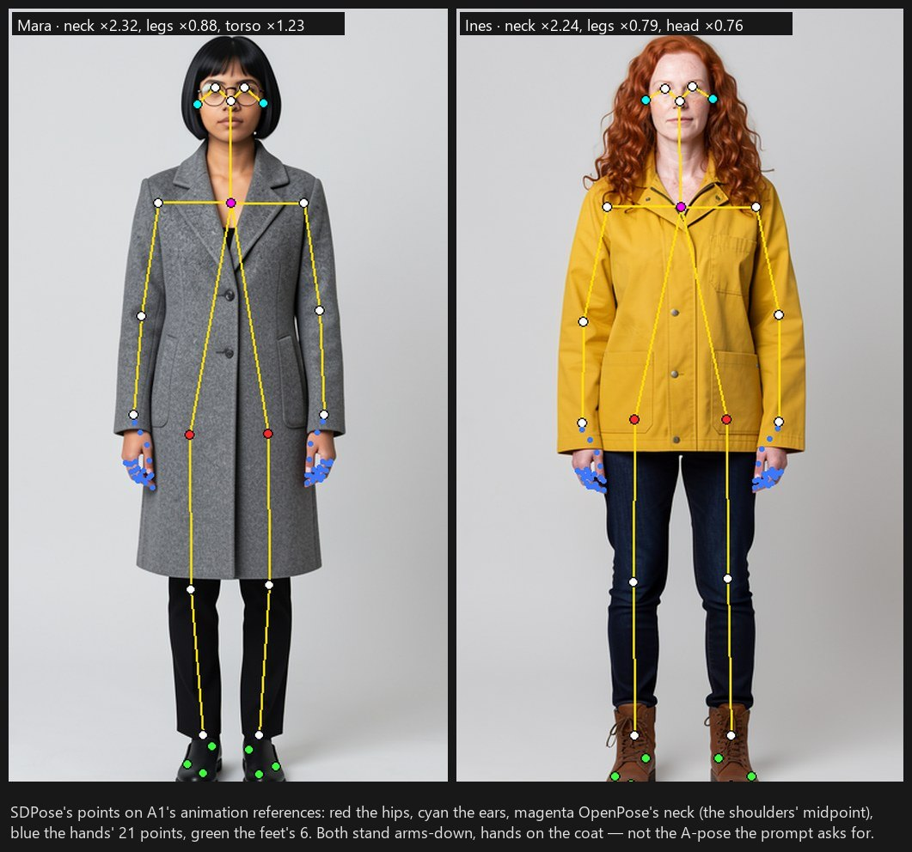

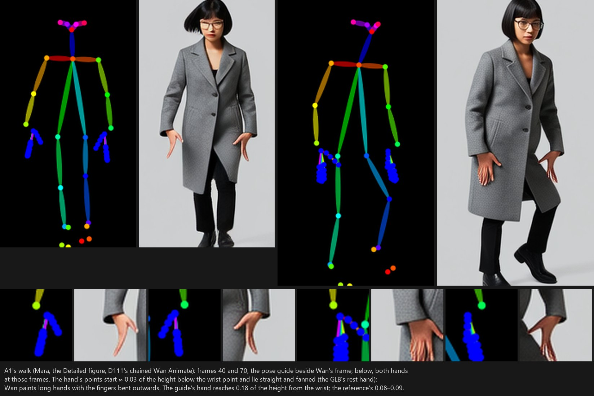

| The author saw | Measured | Why |
| --- | --- | --- |
| **The neck missing** | The fit meets its eight measures to within 0.0004 (the jobs' reports). Nose to the shoulders' midpoint reads 0.160 (Mara) and 0.167 (Ines) of nose to ankles; the default dummy has 0.116. So the neck factor ran to ×2.32 and ×2.24 (its bound is 3.0) | The dummy's neck is short by construction: 6 cm from the neck joint to the head's pivot, with the nose 8 cm above that pivot (`builders.ts:63-67`). ×1 is not an adult's neck; ×2.3 is a 14 cm neck at 1.75 m. The Simple dummy draws nothing along it: a box, a gap, a ball (cur-13, **CB6**). The Detailed figure ignores the factor (next row). Klein also draws fashion proportions: small heads (ear to ear 0.105 of the height, the dummy 0.123) and long necks |
| **Hands too large** | In A1's walk the guide's hand points begin 0.033 of the height below the wrist point and reach 0.177 from it (median of 42 hands over 21 frames). On the references, SDPose's hands begin 0.011 from the wrist and reach 0.079–0.090 | The guide draws two bodies (**CB5**). The 18 body points are the fitted dummy's markers (`engine.ts:991`); the hand and foot points ride on the Detailed figure's bones (`engine.ts:995-997`, `detailed.ts:191-221`). That figure is UAL2's mannequin scaled by the leg, with only its arm and leg segments set to the fit (`detailed.ts:76-86`): its torso, neck, head and shoulders keep UAL2's own. Its hands hang where its own arms end, with the fingers straight |
| **Fingers bending outwards** | The guide's fingers lie straight and fanned in every frame (cur-15). Wan paints them so, with the thumb out | A Detailed figure's hands keep the GLB's flat rest hand until a preset is clicked in Clay: per hand, per figure, keyed with the pose (`StageParts.tsx:359-377`). The references' hands are relaxed and half closed, and nothing carries that over |
| **Feet too large** | Never fitted: ×1.0 on both (`body.py:104`). SDPose found all six foot points on both references (confidence 0.56–0.78); the fit ignores them | The feet are the author's slider, with nothing shown to judge it against. The Detailed feet are UAL2's, scaled by the leg, whatever the shoes in the picture |
| **Posture out of place** | Both references stand arms-down with the hands against the coat (cur-14), though the prompt asks for "the arms held a little away from the body" (`story.py:762`). The hips read low where a coat or jacket hides them: legs ×0.88 and ×0.79, Mara's torso ×1.23 | SDPose places hips it cannot see, so the figure's legs bend below the picture's hips (not measured; E37 measures it) |
| **The test showed none of it** | The turn test renders the Simple figure (`turnTest.ts:20`, `detail: null`). Its guide has no hand or foot points (cur-13, third tile), and it starts from a 22° A-pose the reference does not stand in | The test predates D101's hands. The shots have used the Detailed guide since |

None of this can be seen or fixed in Cast. Its body section is eight sliders and a 2D silhouette (cur-02), and its test checks a guide
the shots never use. The fixes are [03](03-clay-from-a-picture.md) §3.

## 2. The journeys

Seven things an author prototyping a story wants to do. Each is counted from the code paths (§0).

### J1 · An Image result becomes a clay character on a stage — 13 clicks, 2 tab switches, a dummy with only the proportions

| # | Where | What | Clicks |
| --- | --- | --- | --- |
| 1 | Image results | right-click the picture › *Start from this image ▸* › *Make a character…* › name, OK | 4 |
| — | (switches to Story › Cast; the picture has moved to "‹name› · v1"; the sheet is empty) | | tab |
| 2 | Cast | readiness *Animation reference* (`story.cast.makeAnimRef`) | 1 |
| — | (two Klein jobs; the first result becomes the reference; the body fit runs by itself) | wait | |
| 3 | top bar | *Animate*, then the *Clay* pill | 2 · tab |
| 4 | Clay › Shot | the stage picker, or *New stage…* + OK | 2 |
| 5 | Scene › Figures | `+` › *Adult (1.75 m)* | 2 |
| 6 | the figure's row | open it › the character's tile | 2 |
| | | **total** | **13 · 2 tabs** |

**Result:** a grey mannequin with the character's proportions. The hair, coat and silhouette, which are what the author was looking at
in the picture, are not in it (§1.5).

### J2 · Three takes on a character, compared in clay — about 36 clicks

The steps:

1. *Variations (new seeds)* on the result: 2 clicks.
2. J1's steps 1–2 for each of the three pictures: 3 × 5. Three separate profiles, because a version is a full copy and there is no
   variant.
3. Animate › Clay and a stage: 4.
4. Add and bind three figures: 3 × 4.
5. Drag them side by side: 3.

**Result:** three grey mannequins that differ only in their proportions. The ideas cannot be compared in clay.

### J3 · An Image result becomes a prop on a stage — 11 clicks (the Cast route) or a loose mesh (the Catalogue route)

**The Cast route:**

1. *Make a prop…*: 4 clicks.
2. In Cast, *Make the 3D model…* + confirm: 2.
3. Wait ≈ 4–6 min.
4. Animate › Clay: 2.
5. A stage: 1.
6. Props `+`, then the prop: 2.

That is **11 clicks and 2 tab switches.**

**The Catalogue route:** *Start from this image ▸* › *Make a 3D prop…* + confirm (4) gives a mesh that is not a Cast prop. It does not
appear in Clay's Meshes list until the project is reloaded (**CB2**). When it does, it is one of many "prop ‹id›" tiles.

### J4 · A picture becomes a place on a stage — 7 clicks and the search for the picture; the place and the set never meet

1. Animate › Clay: 2 clicks.
2. A stage: 1.
3. Sets › *From an image…*: 1. The Bin opens; find the picture (top-level groups only).
4. The tile's corner button: 1.
5. The lens dialog's *Make the set*: 1.
6. Wait about a minute.

**Result:** a relief with a ±0.25 m / ±5° camera budget. *Make a place…* in Cast makes a place record, with a hero and a sheet, that
Image's scene and Flow's *where* use. **The two never meet**: a set cannot carry a Cast binding.

### J5 · A room to move through, its walls from a picture — dead end

The room preset cannot be resized, opened, re-walled or textured. The picture set is a relief that tears beyond its budget. No mouse path
gives a box room with the picture on its walls.

### J6 · The character's look in clay (hair, coat, hat) — dead end

The body is eight factors and the attachments are six rigid shapes (tail, horns, ears, wings, antennae, hat, backpack). The shadow proxy,
a skinned mesh from the animation reference, exists in the engine, but nothing makes or sets it (§1.5).

### J7 · Make the skeleton match the character (Mara's neck, hands and feet) — partly a dead end

| What | Today | Clicks |
| --- | --- | --- |
| See the skeleton over the reference | nowhere | **dead end** |
| Shorten the neck, shrink the hands and feet | three drags on Cast's sliders, against a 2D silhouette with no picture beside it | 3 |
| See what Wan will get | *Test it: a turn on the spot…* (`story.cast.testAnimRef`) + the cost's OK, then a GPU wait. The guide is the Simple figure's, with no hands or feet (§1.6) | 2 + the wait |
| Relax the hands | Animate › Clay, the stage, the figure, the Pose tab, *relaxed* for each hand: per figure, on every stage, keyed with the pose | 7 · tab, each time |
| Fit the elbows, knees or feet to the picture | no such factors (one `arms`, one `legs`; the feet are never fitted) | **dead end** |

## 3. The friction register

| # | Friction | Where (code) |
| --- | --- | --- |
| **CF1** | Cast verbs on a picture are two levels deep (*Start from this image ▸*, *Add to character ▸*). The loupe hub and the Bin have none | `catalogueCommands.ts:110-121, 172-190`; `Loupe.tsx:97-111`; `Bin.tsx:47-56` |
| **CF2** | No "For: ‹character›" context. Free generations, New angle, Variations and Re-run never return to a profile | `origin.ts:21`; `generateStore.ts:242, 254, 450-452` |
| **CF3** | *Make a character…* leaves Image, moves the picture and starts the sheet empty. The prompt that made the picture is lost | `catalogueCommands.ts:118-119`; `story.py:1858-1876` |
| **CF4** | A picture cannot become the animation reference without the detour through Cast's candidates | `StoryParts.tsx:517-521` |
| **CF5** | *Add to character* targets only the current version, and lists props and places as "character" | `storyStore.ts:639`; `addToCast.ts:42` |
| **CF6** | Cast never shows the reference set's pictures, only counts. Seeing them means switching to the Catalogue | `StoryParts.tsx:638-672` |
| **CF7** | A version is a full copy (reference set duplicated; animation reference, model and LoRA dropped). Nothing lighter exists for a variant, and there are no ideas to compare | `story.py:2005-2021` |
| **CF8** | *Make a 3D prop…* makes a loose mesh. Nothing in the UI makes it a prop's model (the server route exists) | `catalogueCommands.ts:132-148`; `routes/story.py:498-515` |
| **CF9** | Clay's Meshes: "prop ‹id›" tiles mixing reliefs, things and Cast models. Mesh tiles elsewhere get image verbs | `StageParts.tsx:83, 97`; `catalogueCommands.ts:44-65` |
| **CF10** | Clay's Scene has no Cast characters and no places. A character reaches a figure only through its editor or the right-click | `StageParts.tsx:88-102`; `FigureBinding.tsx:31-52` |
| **CF11** | A Cast place has no Stage counterpart: sets cannot be bound, picture sets are not places, things are not props | `stages.py:211-212`; `set_things.py:512` |
| **CF12** | Set presets are fixed grey boxes. No size, walls, openings or textures; no preset switch after adding | `builders.ts:112-125`; `StageParts.tsx:276-297` |
| **CF13** | A picture set is a relief with a ±0.25 m / ±5° camera budget, a flat shell from the side | D120; `stageStore.ts:832-843` |
| **CF14** | The clay figure is generic. Only eight proportion factors come from the character; the shadow proxy (a skinned mesh of the character) is unused | `body.py:24-38`; `proxy.ts`; `stages.py:110` |
| **CF15** | No way to compare ideas in 3D (a line-up, a turnaround) short of building a stage by hand | — |
| **CF16** | *Set from an image* lives only in Clay, with a stage open, through the Bin | `stageCommands.ts:64-65`; `stageStore.ts:666-690` |
| **CF17** | Labels that disagree. *Expand ▶* means two things (the foot opens Image, the empty candidates' link queues in place); the foot's tooltip is stale; the hints "New profile…" name a command that no longer exists | `StoryParts.tsx:269, 678`; `StoryParts.tsx:1080`; `GenerateColumn.tsx:158` |
| **CF18** | *New version* drops the animation references, the model and the LoRA. Re-making them costs GPU minutes | `story.py:2016-2017` |
| **CF19** | Prototyping is slow per idea: a prop's model is 4–6 min (Pixal3D) and an animation reference a Klein job. There is no quick, rough tier to try ten ideas | D84, D134 |
| **CF20** | The fit is unseen and cannot be checked: Cast shows eight sliders and a 2D silhouette, never the skeleton over the reference | `CastBody.tsx:12-14, 32, 83-84` |
| **CF21** | The turn test checks a guide the shots never use: the Simple figure, with no hands or feet, from an A-pose the reference does not stand in | `turnTest.ts:20`; `animTest.ts:38-39` |
| **CF22** | No rest hand. A Detailed figure's fingers are the GLB's flat hand until a preset is clicked in Clay: per hand, per figure, keyed with the pose | `StageParts.tsx:359-377` |
| **CF23** | The feet are never fitted, though SDPose reads six foot points on every reference | `body.py:104`; `finishers.py:839` |
| **CF24** | The animation reference is not in the A-pose its prompt asks for (A1's two stand arms-down, hands on the coat), and nothing checks it | `story.py:762` |
| **CF25** | One `arms` and one `legs` factor: the elbow's and the knee's places along the limb are fixed, though SDPose reads both | `body.py:24-38, 57` |

## 4. Defects found on the way

These are worth fixing on their own (CB1–CB4 in wave CW0 of [05](05-plan.md), CB5–CB6 in CS1):

- **CB1 · "Go to origin" of a *Make a 3D prop…* job opens a page that does not exist.** The job's origin `ref` is the picture's id
  (`catalogueCommands.ts:144`), but the Catalogue branch of `goToOrigin` opens it as a group (`origin.ts:113-121`). The page then says
  "This group no longer exists."
- **CB2 · A mesh made outside a stage does not reach Clay's Meshes list until a reload.** The list loads once per project
  (`StageParts.tsx:620-624`) and updates live only for assets whose origin suite is `stage` (`session.ts:310-312`).
- **CB3 · The Candidates help promises "✕ rejects", but the card has only ✓** (`StoryParts.tsx:677` against `:529-534`). D122 removed
  rejecting, so the help is the stale part.
- **CB4 · A stage object's *parent* select has no visible effect.** The engine places every object from its own transform and reads
  `parent` only for held things (`engine.ts:429-433, 735-745`).
- **CB5 · A Detailed figure's pose guide draws two bodies.** The 18 body points are the fitted dummy's markers (`engine.ts:991`). The
  hand and foot points ride on the UAL2 mannequin's bones (`engine.ts:995-997`), and that mannequin follows the fit only in its limb
  lengths (`detailed.ts:76-86`). In A1's walk each hand begins 0.033 of the height below its wrist point (§1.6).
- **CB6 · The Simple dummy has no neck.** The neck factor (D104) lengthens empty space between the torso box and the head ball
  (`builders.ts:61-65`), so a fitted ×2.3 shows as a floating head (cur-13).
