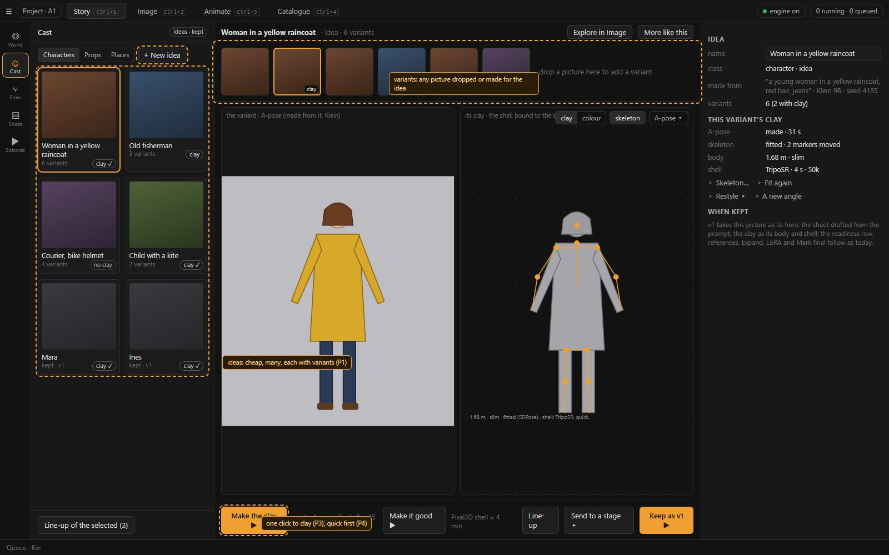
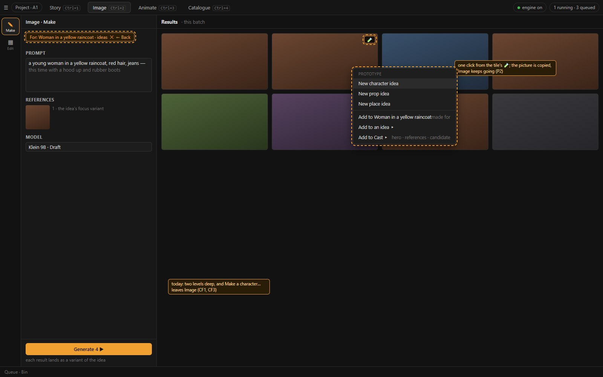
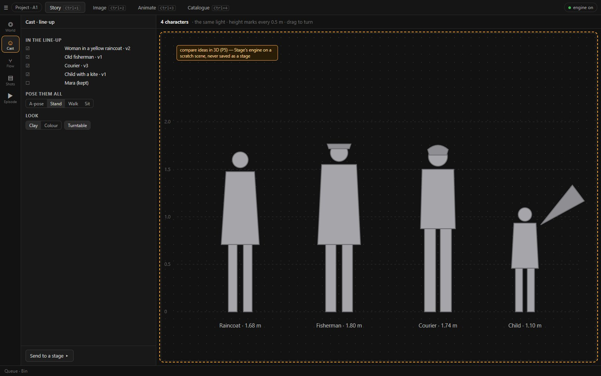
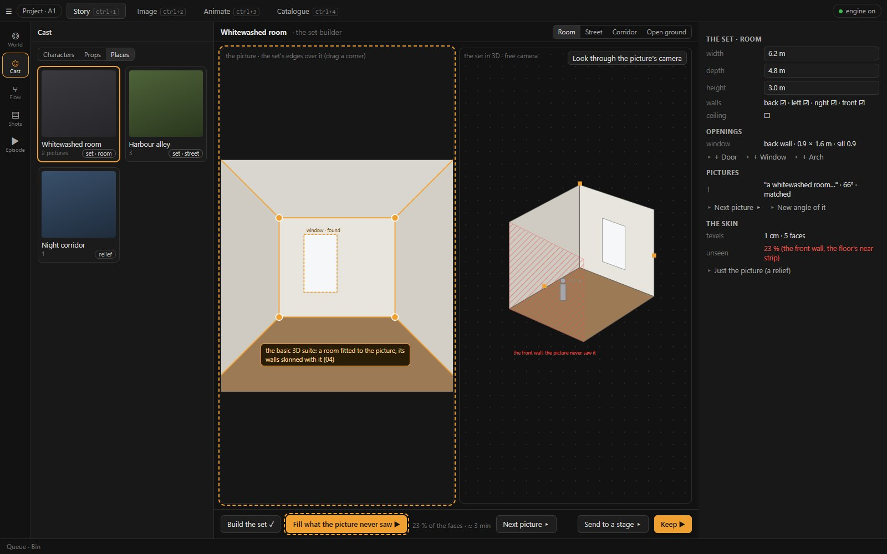
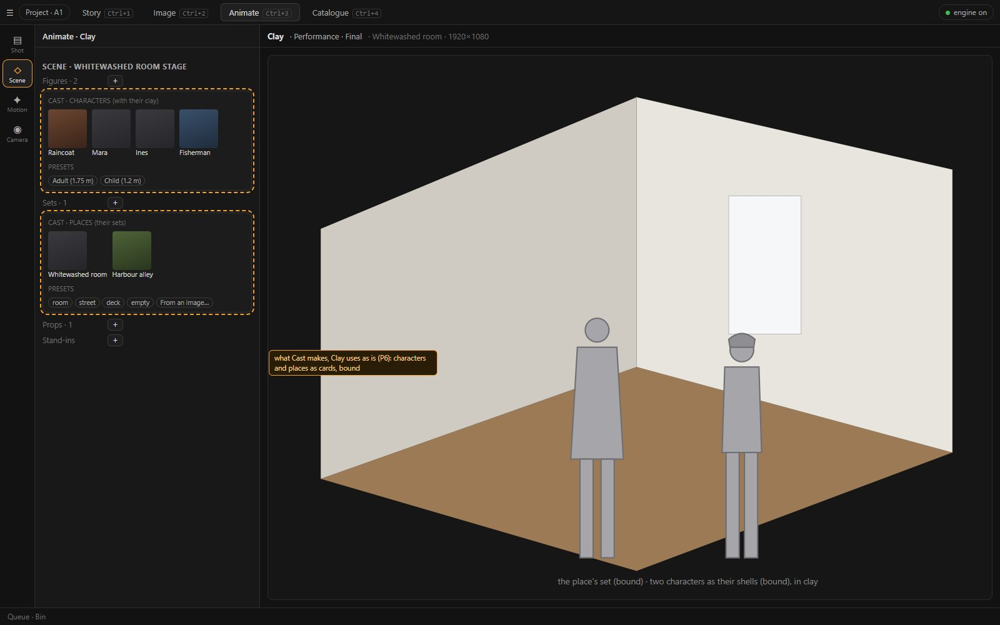

# 02 · The proposal: Cast as a workshop

Status: **proposal, 2026-10-25 — answered the same day → D136; where [06](06-answers.md) differs, it holds** (ideas in their own store,
no automatic variants, no TripoSR, Cast's bench as bound clay). Today's state is [01](01-today.md). The two
technical parts are [03](03-clay-from-a-picture.md) (characters and props in clay) and [04](04-places-and-the-set-builder.md) (places and
the set builder). The wireframes `img/ui-*.jpg` are rendered from `mock/cast-mock.html`, a static mock, not the app.

## 1. The request

The author, 2026-10-25:

> I'd like you to revise how Cast is currently working. Cast should be a prototyping suite, where you could easily experiment with
> different ideas for characters/props/places. Currently you do free generations in image, and I'm missing a link between a generated
> image and a clay object you are using in the first stage of animate. It could be a good place to generate a clay dummy from an image
> and fit a skeleton to it. I'd also like if places (stage backgrounds) could be generated from an image here. Backgrounds usually simple
> geometry objects, perhaps a basic 3d suite could be helpful here, where you could "skin" an image to a room or a street… The main goal
> should be the streamlining of the user workflow and unlocking creative diversity.

## 2. Principles

| # | Principle | Answers |
| --- | --- | --- |
| **P1** | **An idea first, an identity later.** Cast starts loose: many ideas, each with variants. It commits late, when an idea is kept and becomes a version for production with its sheet, references, LoRA and *Mark final* (today's Cast, unchanged). | CF7, CF15 |
| **P2** | **Every picture is one click from an idea.** A *Prototype ▸* verb on every picture: the tile's hover button, its right-click, the loupe, the Bin, the Inspector. Image's For context can name an idea, so what Image makes lands on it. | CF1–CF5, CF16 |
| **P3** | **Every idea is one click from clay.** *Make the clay* per class: a character's dummy with its skeleton; a prop's model; a place's set. | CF14, CF8, CF11–CF13 |
| **P4** | **Quick, then good.** A quick tier in seconds for trying (TripoSR for shapes, MoGe for places), the good tier when an idea is kept (Pixal3D, the full set build). Ten ideas in clay cost minutes, not an hour. | CF19 |
| **P5** | **Compare in 3D.** The line-up: ideas side by side in clay, in the same light, with height marks and a turntable. | CF15 |
| **P6** | **What Cast makes, Clay uses as is.** Characters, props and places are cards in Clay's Scene panel. A set can be bound to a place, as a mesh is bound to a prop. | CF10, CF11 |
| **P7** | **Mouse-first, nothing mandatory** (D32, D116). Every step is a button or a menu entry. An idea needs no sheet, name or references until it is kept; help sits behind a `?`. | — |
| **P8** | **Reuse the engines loom2 has.** SDPose and the body fit, Pixal3D, MoGe, Klein's Fill, the plate projector with its coverage pass (PF1), the shadow proxy's skinning. The new model is TripoSR (D134), used in `full` as the quick tier. | — |

## 3. The shape

```
Story › Cast         ┌ Characters ┐ ┌ Props ┐ ┌ Places ┐          (the class chips, as today)
  ideas board  ─────▶ an idea: its variants (pictures) ─ Make the clay ▶ ─ the bench (clay, skeleton, set) ─ Keep ▶ a version (today's Cast)
        ▲                       ▲                                    │
        │ Prototype ▸           │ For: ‹idea› (Image lands variants)  └▶ Line-up (compare in 3D)    └▶ Clay: cards in the Scene panel
   any picture            Image › Make
```

Cast keeps its rail place (World · **Cast** · Flow · Shots · Episode, D125) and its three classes. What changes is that every class now has
a **board of ideas**. Opening an idea shows its **bench**:

| Part | What it holds |
| --- | --- |
| **The variant strip** | the pictures the idea has gathered, each a variant, with the one in focus |
| **The bench viewer** | a 3D view of the variant's clay, using Stage's engine on a scratch scene: a character's dummy with its skeleton, a prop's model, a place's set |
| **The bench's verbs** | *Make the clay ▶* (quick), *Make it good ▶* (the full tier), *Explore in Image*, *Line-up*, *Keep as …* |
| **Kept** | once an idea is kept, today's version page (readiness, sheet, references, Expand, LoRA, final) is the idea's second half, one click away |



## 4. Ideas and variants (P1)

**An idea is a Cast profile in a new first state, `idea`**, before `open` and `final`. It is recommended over a separate record (Q1),
because:

- there is one name, one `@mention` and one place in Flow's pickers from the first minute;
- keeping the idea changes its state, not its identity.

**A variant** is new and light:

```
ProfileVariant { id, asset_id (the picture), made_from (its prompt, model, seed — read from the asset),
                 clay: { kind: dummy|model|set, asset_id, body?, skeleton?, set? } | null, note, created_at }
```

- Variants live in the idea, with their pictures on its album page, "‹name› · ideas".
- They are not copies of anything, so any number are cheap.
- A version, by contrast, stays what it is: a full identity for production.

**Keeping a variant** (*Keep as v1*, or *Keep as a new version* on a kept profile) makes a version from it:

- the variant's picture becomes the hero;
- the sheet is drafted from the picture's prompt (the subject and outfit phrases, editable), which fixes CF3's empty sheet;
- its clay carries over: the body, the shell or model, the set;
- the profile's state becomes `open`.

The idea's board stays as the profile's workshop, so a later idea can become v2 (*Keep as a new version*).

**On the board:**

- an idea card shows its focus picture, the variants' count and a clay badge (a dummy, a model, a set);
- a right-click offers *More like this* (Variations into the idea), *A new angle*, *Restyle ▸* (the World's styles), *Make the clay ▶*,
  *Line-up*, *Keep…*, *Rename*, *Delete*;
- a drop of any picture on a card adds it as a variant, and on the board starts a new idea (P2).

## 5. From any picture to an idea (P2)

**The *Prototype ▸* verb** sits on every picture and is one click deep:

| Where | How it shows |
| --- | --- |
| a tile (Image results, Catalogue, a group page) | a hover button 🧪 and the first item of the right-click |
| the loupe | the hub's button |
| the Bin | its right-click (it has none today) |
| the Inspector | a card |

The menu:

```
Prototype ▸   New character idea      (the picture is its first variant; Cast is not opened — a toast offers "Open")
              New prop idea
              New place idea
              ──────────
              Add to ‹idea› ▸         made-for ideas first (the picture's recipe names them), then the recent
              Add to ‹kept profile› ▸ as the hero · into the reference set · as a candidate   (today's Add to character, renamed)
```

What changes from today:

- the picture is **copied** (its page keeps it), not moved;
- the Image or Catalogue work **is not interrupted** (CF3);
- the name is optional: an idea without one is named from its prompt's first noun phrase ("woman in a yellow raincoat"), editable later.

**The For context names an idea.** Today's For chip carries a shot (`origin.ts:21`). It gains `kind: 'idea'`:

- *Explore in Image* on an idea opens Image with the chip **"For: ‹idea› · ideas"**, the idea's focus picture as reference 1 and its
  draft prompt;
- every result made while the chip is on lands as a **variant** of the idea: Generate, Variations, New angle, Re-run and Expand alike.
  This is the take mechanism shots already use (`finishers.py:114-118`);
- *Back to ‹idea›* returns to the bench.

This is CF2's fix: free generation stays free, and becomes a variant the moment the chip is on.



## 6. From an idea to clay (P3, P4)

*Make the clay ▶* does what the class needs. [03](03-clay-from-a-picture.md) and [04](04-places-and-the-set-builder.md) have the
technique, the measures and the spikes.

| Class | Quick (seconds to a minute, for trying) | Good (when kept) | The bench shows |
| --- | --- | --- | --- |
| **Character** | the A-pose picture (Klein, as *Make an animation reference*), the body fitted (SDPose, D104), a **clay shell** of the silhouette (TripoSR, ≈ 4 s) **skinned to the 12 joints** (the shadow proxy's skinning) | the shell by Pixal3D (≈ 4 min) | the clay dummy with the skeleton's joints, the A-pose picture beside it with the joints drawn over it, a draggable joint to correct, *Fit again* |
| **Prop** | a model by TripoSR (≈ 4 s), stood upright | Pixal3D (≈ 4–6 min), or a GLB import (D128) | the model turning, at its real size (a height in metres) |
| **Place** | MoGe's relief of the picture (≈ 1 min, today's picture set): a look from where the picture was taken | **the set builder**: a room, street, corridor or open ground fitted to the picture, the picture skinned onto its faces, what it never saw filled by Klein (PF1's Fill) | the set from the picture's camera and from a free camera; its sizes, walls and openings editable; the unseen faces hatched until filled |

**The skeleton bench** ([03](03-clay-from-a-picture.md) §3) is the "fit a skeleton" of the request, and the place for the skeletal
fine-tuning the author asked for after Mara's tests ([01](01-today.md) §1.6). Today the fit is a hidden job whose result is eight numbers.

- **The reference** with SDPose's points and the figure's drawn over it. Either set is dragged with the mouse, and *Fit again* refits.
- **The figure** with its bones. A bone's end is dragged to lengthen it.
- **The guide Wan Animate will get**, hands and feet included, played on a short motion over the reference, with no GPU job.
- **The parts** in centimetres with an adult range, locks, and a rest hand per character (from the picture or a preset).

Before the bench, wave CS1 fixes what needs nobody: one body in the guide, a visible neck, relaxed hands by default, fitted feet, and
a turn test on the shots' own guide ([03](03-clay-from-a-picture.md) §3.1).


## 7. Comparing ideas: the line-up (P5)

*Line-up* puts the ideas picked on the board, or every idea of the class, side by side on a neutral floor:

- **characters** in their clay, with 0.5 m height marks, in the same light, on a turntable (drag to turn). They can all be posed at once
  (*A-pose · stand · walk · sit*, from the motion library), and the clay can be swapped for the textured shell;
- **props** on a ground grid at their real sizes;
- **places** as a strip of their sets, each with a fly-through camera.

The line-up is a scratch scene in Stage's engine, never saved as a stage. *Send to a stage ▸* copies it to a new or open stage.



## 8. Places and the set builder

Places get a **set** of their own: the "basic 3D suite" of the request. It is designed in [04](04-places-and-the-set-builder.md). In short:

- **Four kinds of set:** room, street, corridor and open ground with a backdrop. Each is a few faces with sizes you can edit, walls on or
  off, and openings (a door, a window, an arch).
- **Fitted to the picture:**
  1. MoGe's point map of the picture gives the camera (its lens, height and tilt).
  2. The floor and walls come out as planes.
  3. The set's sizes are read from them.
  4. The author adjusts by dragging the set's corners over the picture (the fSpy way).
- **The picture skinned on:** Stage's plate projector casts the picture onto the faces, and the result is baked into each face's texture.
  The coverage pass (PF1) shows what the picture never saw, and *Fill ▶* paints it with Klein's Fill, as PF1's keyframes do. A second
  picture, from another angle, covers more.
- **What comes out** is a set a camera can move through: not D120's ±0.25 m relief, but a room that can be orbited, re-lit and re-walled.
  It is the place version's set, and Clay binds it like a prop.



## 9. Cast in Clay (P6)

Clay's Scene panel shows Cast's work where it is used:

| Group | The `+` panel |
| --- | --- |
| **Figures** | the Cast characters first, as cards with their clay, then *Adult* and *Child*. A click adds a figure bound to the character, with its shell and body (CF10) |
| **Sets** | the Cast places first, as cards with their sets, then the presets and *From an image…*. A click adds the place's set, bound to the place (CF11) |
| **Props** | as today, plus ideas that have a quick model |

**Binding.** A set may carry a Cast binding (`stages.py:211-212` gains `set`). A bound set follows its place version's set, as a bound
mesh follows its prop's model.

**Bridges for what already exists:**

| Object | New verb |
| --- | --- |
| a loose mesh | *Make it a Cast prop…* (the server's `PUT …/model` exists; CF8) |
| a picture set | *Make it a Cast place…* (the relief becomes the place's quick set) |
| a picture set's things | made as Cast prop ideas, not loose meshes |

*Open in Cast* works on any bound object.



## 10. The journeys again

The same six journeys as [01](01-today.md) §2, through the workshop:

| Journey | Today | The workshop | What changes |
| --- | --- | --- | --- |
| **J1** a result becomes a clay character on a stage | 13 clicks, 2 tabs; a grey dummy with only the proportions | **4** · 1 tab: *Prototype ▸ › New character idea* (2), *Make the clay ▶* (1), *Send to a stage ▸* (1) | the dummy has the character's silhouette and a checked skeleton |
| **J2** three takes on a character, compared in clay | ≈ 36; the ideas look alike | **6**: *More like this* on the idea (1), *Make the clay ▶* on three variants (3), select them on the strip and *Line-up* (2) | variants of one idea, compared in 3D |
| **J3** a result becomes a prop on a stage | 11, or a loose mesh | **4**: *Prototype ▸ › New prop idea* (2), quick model (auto), *Send to a stage ▸* (2) | seconds instead of 4–6 min while trying; Pixal3D on *Keep* |
| **J4** a picture becomes a place on a stage | 7 + the search; the place and the set never meet | **5–9**: *Prototype ▸ › New place idea* (2), *Build the set ▶* (1), corner drags (0–4), *Fill ▶* (1), *Send to a stage ▸* (1) | a set to move through, bound to its place |
| **J5** a room to move through, walls from a picture | dead end | **as J4** | new |
| **J6** the character's look in clay | dead end | **in J1** (the shell) | new |

[05](05-plan.md) §1 has the step-by-step counts.

## 11. The commands

All are in `commands.ts` with at least one mouse placement (D32). Ids are proposals.

| Id | Label | Placements |
| --- | --- | --- |
| `cast.idea.new.character` / `.prop` / `.place` | *New character / prop / place idea* | Prototype ▸; Cast board `+`; board right-click |
| `cast.variant.add` | *Add to ‹idea›* | Prototype ▸; drop on an idea card |
| `cast.idea.explore` | *Explore in Image* (For: ‹idea›) | idea card; bench |
| `cast.idea.more` | *More like this* | idea card; variant right-click |
| `cast.variant.clay` | *Make the clay ▶* | bench foot (primary); variant right-click |
| `cast.variant.good` | *Make it good ▶* (the full tier) | bench |
| `cast.skeleton.open` | *Skeleton…* / *Fine-tune the skeleton in Cast…* | Cast's body section; idea card's clay badge; a bound figure's right-click in Clay |
| `cast.skeleton.fit` | *Fit again ▶* | skeleton bench (footrow) |
| `cast.skeleton.sdpose` | *Back to SDPose's points* | skeleton bench (footrow) |
| `cast.skeleton.mirror` | *Mirror left to right* | skeleton bench (footrow); a row's right-click |
| `cast.skeleton.reset` | *Reset to fitted* | a part row's right-click |
| `cast.skeleton.copy` | *Copy the skeleton from…* | skeleton bench (panel head) |
| `cast.skeleton.test` | *Test in motion ▶* | skeleton bench (footrow) |
| `cast.lineup` | *Line-up* | board strip; bench |
| `cast.variant.keep` | *Keep as v1 / as a new version* | bench; variant right-click |
| `cast.place.build` | *Build the set ▶* | place bench (primary) |
| `cast.place.fill` | *Fill what the picture never saw ▶* | set builder |
| `cast.send.stage` | *Send to a stage ▸* | bench; line-up |
| `stage.add.cast.character` / `.place` | (card click) | Clay Scene › Figures / Sets `+` |
| `stage.mesh.toProp` / `stage.set.toPlace` | *Make it a Cast prop… / place…* | a mesh's or picture set's right-click and editor |

## 12. What stays

Cast after *Keep* is today's Cast: the readiness row, the sheet, the references, Expand, the animation reference, the LoRA, voices and
*Mark final*. Shots, Flow and the final shot read versions as they do now. Image's Make keeps its subjects and scene linked to kept
profiles (D93). The workshop adds a front to Cast; it does not replace its back.
