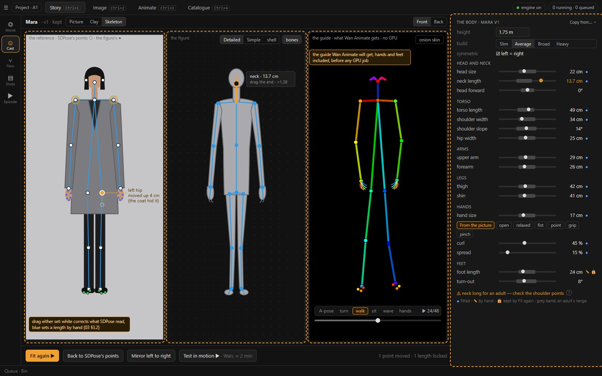

# 03 · Clay from a picture: a character's dummy and skeleton, a prop's model

Status: **proposal, 2026-10-25 — answered the same day → D136; where [06](06-answers.md) differs, it holds** (no TripoSR, the skeleton
fitted inside the shell, the pose pass from the shell, the Detailed figure only, skeleton keys). The workshop it serves is
[02](02-the-workshop.md) §6. Places are [04](04-places-and-the-set-builder.md).

## 1. What loom2 already has

| Piece | What it does | Where / measured |
| --- | --- | --- |
| **The animation reference** | Klein draws the character full-body, A-pose, on a plain grey ground, from the sheet and the references (two candidates; the first is taken) | `story.py:754-789` (CA0) |
| **The body fit** | SDPose's keypoints of the A-pose picture → the dummy's head, neck, torso, shoulders, arms, legs and hands factors, by Levenberg–Marquardt on the front-view ratios (the hands from the palm only); height, build, feet and attachments stay the author's. SDPose also returns the feet's six points and the face's, unused | `body.py:68-143`; D104 (Stage's ratios within ±10 % of the reference's) |
| **The mannequin** | 12 joints, COCO-18 markers, shaped by the body; the Detailed figure (UAL2) adds a spine, hands and feet, and follows the fit only in its limb lengths | `builders.ts:49-93`; `detailed.ts:76-89`; D101 |
| **The shadow proxy** | a mesh of the character (image → mesh on the animation reference) **bound to the figure's 12 joints**: posed in the A-pose, scaled to the figure's height, stood under it, each vertex weighted to its two nearest limb segments by inverse squared distance (a `THREE.SkinnedMesh` whose bones are the joints). It follows every pose. Today it is unseen and casts the character's shadow | `stage/proxy.ts`; E23d, D106 (Mara 252 s and Ines 218 s of Pixal3D; "the proxies follow Mara's walk and Ines' sit and point; the jacket stretches where sitting bends it") |
| **Pixal3D** | a textured GLB from one picture, stood upright | D84, D109 (E14: IoU 5/5 ≥ 0.85, ≈ 4 min warm) |
| **TripoSR** | a mesh with vertex colours from one picture | D134, E33 (IoU 4/5 ≥ 0.85; 4 s warm; 2.4 GB). MIT, so allowed in `full` |

**The gap.**

- The proxy is the clay dummy the author asks for. It has been built and measured, but it is **never made visible, and nothing in the
  product makes or sets it** (`StageObject.shadow_proxy` has no setter; [01](01-today.md) §1.5).
- The body fit is a hidden job whose result is eight numbers. There is no check of the skeleton against the picture, and no way to correct
  it.
- The figure drops part of the fit on its way to Wan Animate: no neck on the Simple dummy, two bodies in the Detailed guide, the GLB's
  flat hands, unfitted feet. Mara's test animations showed it ([01](01-today.md) §1.6).

## 2. A character's clay dummy

*Make the clay ▶* on a character variant runs four steps. Each is an existing job, and each is skipped when its result is already there.

| # | Step | Job | Quick | Good |
| --- | --- | --- | --- | --- |
| 1 | **The A-pose picture.** The variant's picture as reference 1, drawn full-body in the A-pose on grey. Skipped when the picture already is one (a full-body figure on a plain ground, with both wrists and ankles found by step 2). | Klein (today's *Make an animation reference*, run on a variant) | ≈ 20–40 s | — |
| 2 | **The skeleton.** SDPose's keypoints, then the body fit. | `keypoints` + `fit_body` | ≈ 5 s | — |
| 3 | **The shell.** A mesh of the A-pose picture. | image → mesh | TripoSR ≈ 4 s | Pixal3D ≈ 4 min |
| 4 | **The binding.** The shell bound to the fitted figure's 12 joints. | `bindProxy` (client) | instant | — |

**The result.** The figure is drawn as its shell, in clay or with the shell's colours (a toggle). The 12-joint mannequin stays inside as
the skeleton:

- it is what the pose tools grab;
- it is what the pose pass draws, so Wan Animate's guide is unchanged.

The shell is the character's outline, with its hair, coat, hat and skirt, so:

- **the clay, depth and mask passes** see the character's shape instead of a generic dummy's. That helps Klein's clay method and LTX's
  depth guide (Q8: the passes use the shell);
- **the line-up** compares real silhouettes ([02](02-the-workshop.md) §7);
- **shadows** come from the shell for free, which is D106's proxy source.

**Where it is kept.**

- While trying, the variant's clay holds `{asset_id of the shell, body, skeleton}`.
- *Keep* makes it the version's (`ProfileVersion` gains `shell_asset_id` and `shell_from`, beside `body` and `body_fit_from`).
- A figure bound to the character carries it, as it carries the body today (`withBody` / `syncBodies` gain the shell), and fills
  `shadow_proxy` with it. That field has been waiting since D106.

**Known limits, from E23d:**

- **Proximity weights are rough.** A coat stretches where sitting bends it, and a long skirt or coat between the legs belongs to whichever
  leg is nearer.
- **Hands are mittens.**
- **The quick shell is softer** than Pixal3D's, and TripoSR loses thin parts such as straps and the spokes of E33's wheel.

None of these matter for the shadow. For a clay to judge a design by they may. E36 (§5) measures them, and tries a better weighting:

- heat diffusion over the mesh instead of straight-line distance;
- an auto-rigging model, if its licence passes D17. UniRig and similar are to be read; nothing is fetched before the author's OK.

## 3. The skeleton: fitted, checked and fine-tuned in Cast

The request asked to "fit a skeleton to it". Later, after Mara's test animations, the author added: "I should be able to do these
skeletal fine-tunings here in cast". [01](01-today.md) §1.6 measured what went wrong. Most of it is not in the fit's numbers but in what
the figure does with them. So this section has two parts:

- fixes that need nobody (§3.1);
- the bench where the author checks and tunes the skeleton (§3.2).

### 3.1 The fixes that need nobody (wave CS1)

| # | Fix | Answers ([01](01-today.md) §1.6) | Checked by |
| --- | --- | --- | --- |
| **S1** | **One body in the guide.** The Detailed figure follows the whole fit, not only its limbs: the spine chain spread over the fitted torso, the clavicles to the shoulders' width, the neck bone's child onto the head joint, the head scaled by the head factor. Its hand and foot bones are pinned to the body's wrist and ankle points | hands too large, the neck; CB5 | in the guide, a hand's first point within 0.011 of the height of its wrist point (SDPose's own gap on the references) |
| **S2** | **A rest hand.** Every Detailed figure's hands start from the character's rest hand (§3.2), `relaxed` until one is set, and never the GLB's flat hand. A key's hand preset still overrides it | fingers bending outwards; CF22 | the guide's fingertips within the reference hand's reach (0.08–0.09 of the height on A1's two) |
| **S3** | **A neck you can see, and ×1 an adult's.** The Simple dummy gets a neck from the shoulders' line to the head's pivot. The pivot moves down to the jaw's line and the default neck lengthens, so that ×1 is an adult's neck (≈ 10 cm at 1.75 m) and a fitted factor reads as a departure from an adult. `dummy_ratios` and `builders.ts` change together (`test_body_fit_ca1b.py` keeps them in step). Stored bodies convert exactly, because the dummy's lengths are linear in the factors | the neck; CB6 | Mara's and Ines's necks near ×1.3–1.4 instead of ×2.3 (E37 confirms) |
| **S4** | **The test tests the shots' guide.** The turn test renders the Detailed figure, hands and feet included, and starts in the reference's own stance (its arms' angle from SDPose's points) before it turns | the test showed none of it; CF21 | the test's first guide frame over the reference: every point within 3 % of the height |
| **S5** | **Feet fitted.** The fit reads SDPose's foot points: the toes' reach from the ankle and the shoe's breadth from the front, the heel from the back view when there is one | the feet; CF23 | the feet within ±10 % of the reference's points |
| **S6** | **Elbows and knees placed.** Two new factors, the elbow's and the knee's place along the limb, fitted from SDPose's elbows and knees | the posture; CF25 | — |
| **S7** | **A fit that stays human unless the picture insists.** A weak pull toward ×1 on every factor (after S3, ×1 is an adult). A loosely read length stays near an adult's instead of running to a bound, and the hips' width can become a factor instead of the fit's fixed anchor | the posture, the neck | the fit's residuals on A1's two no worse than 1 % |
| **S8** | **A reference in the A-pose.** The prompt asks harder: the arms 25–30° from the body, the hands open and clear of the clothes. After the keypoints job, a check: if a wrist is closer to the hips than 10 % of the height, the reference's slot says *The arms touch the body — draw it again?* (a line in the slot, not a dialog) | the posture; CF24 | A1's two drawn again; the share of E36's eight that pass |

**SDPose's hand sides.** On both references SDPose's `hand_left` lies 0.011 of the height from body point 4, the right wrist. So it is
the hand on the picture's left, which is the person's right. The fit takes the median of both palms and is unaffected, but S2's
per-side rest hand must swap them.

### 3.2 The skeleton bench (the author's fine-tuning)

**Where it is.** The character's bench gets a **Skeleton** view beside the picture and the clay ([02](02-the-workshop.md) §6). It opens
from:

- Cast's body section: today's sliders stay, and *Skeleton…* opens the view;
- the idea card's clay badge;
- in Clay, a bound figure's right-click *Fine-tune the skeleton in Cast…*, which opens Story › Cast on it.

On a kept character it edits the version; on an idea, the variant.

**Three panes.**

1. **The reference** (front; the back view as a toggle). SDPose's points are drawn in white and the figure's markers in blue, in the
   reference's stance. A short red line marks every pair more than 3 % of the height apart. Both sets can be dragged:
   - dragging a **white** point corrects what SDPose read (a hip hidden by a coat). *Fit again* then refits from the corrected points;
   - dragging a **blue** point sets that length by hand and locks it.

   The hands' 21 points and the feet's three per side are shown and can be dragged too.
2. **The figure.** The Detailed figure (Simple and the shell as toggles), orbited with the mouse, with its bones drawn. Clicking a bone
   selects its row in the panel. Dragging the handle at a bone's end lengthens it.
3. **The guide.** What Wan Animate will get: the pose pass with hands and feet, played on a short motion from the starter library
   (*A-pose · turn · walk · sit · wave · hands*). The reference lies under the first frame at 40 % (an onion skin). This is Stage's own
   renderer, not a GPU job, so it can run while a shot renders (D97).

**The panel.** The parts in groups. Each row shows:

- a length **in centimetres at the figure's height**, with the factor in its tooltip;
- a slider with the **adult range** drawn as a grey band;
- a dot for *fitted* or *by hand*;
- a lock.

| Group | Rows |
| --- | --- |
| Whole | height, build, *symmetric* (left = right, on by default) |
| Head and neck | head size, neck length, head forward (a stoop or a proud stance) |
| Torso | torso length, shoulder width, shoulder slope (square ↔ sloped), hip width |
| Arms | upper arm, forearm |
| Legs | thigh, shin |
| Hands | hand size; the rest hand: *From the picture* or a preset (*open · relaxed · fist · point · grip · pinch*), then curl, spread and the thumb as sliders |
| Feet | foot length, turn-out |
| Attachments | as today |

- **A value outside its adult range turns amber**, and the status line names it: "neck long for an adult — check the shoulder points".
  The two points are ringed in the reference pane. Nothing blocks: a child or a creature is the author's call. The why sits behind a
  `?` (D116).
- **A locked value survives *Fit again*.**
- ***From the picture*** picks the preset whose 21 points, posed in the reference's stance and projected, lie nearest SDPose's hand
  points, then fits the curl and the spread. No new model.

**The commands** (mouse-first, D32):

- *Fit again ▶*: on the CPU, in milliseconds, from the corrected points, keeping the locks;
- *Back to SDPose's points*;
- *Mirror left to right*;
- a row's right-click: *Reset to fitted*;
- *Copy the skeleton from…* another character;
- *Test in motion ▶*: S4's turn test, a GPU job through the queue, its cost shown first.

Undo and redo are the store's.

**Where it lands.** In the version's (or variant's) `body`, as today. Bound figures already follow a sheet's body
(`stageStore.ts:242, 811`), so every stage picks the change up. A shot whose guide was rendered with an earlier skeleton shows *the
skeleton changed* on its character layer, with *Render the guide again*. For that, the guide stamps the body's hash when it is rendered
(rule 4: lineage at write time).

**The data.**

- `Body` gains:
  - `head_forward`, `shoulder_slope`, `hips`, `elbow`, `knee` and `feet_out`;
  - `hand_rest`: `{preset, curl, spread, thumb}`;
  - `locks`;
  - `points`: the corrected 2D points of the front and back views, so that a refit needs no job.

  Each has a default that leaves today's figure unchanged, and the profile record's `schema_version` moves up.
- `POST /story/profiles/{pid}/versions/{vid}/body/fit` takes an optional `{points}` and refits without a job. It returns the body and
  the fit's report. A variant has the same route under `/variants/{id}`.
- `fit_body` gains:
  - the new measures (elbow, knee, feet, hips);
  - S7's pull;
  - the locks: a locked factor drops out of the unknowns.
- The bench reads SDPose's points from `people[0]`, which the keypoints job already keeps (`finishers.py:825`).

**As built (CS2 and CS3, 2026-10-25; screenshots `img/cs2-*.jpg`, journal 11:42 and CS3's entry).** Where the build differs from the
design above:

- **Not built:**
  - *symmetric*, the fitted / by-hand dot, the shoulder slope (the carriage's *shoulder drop* stands for it), a bone's end
    handle in the figure pane;
  - the back view's points, the variant routes (no ideas store yet: CW1).
- **The reference pane** is cropped to the figure. SDPose's points are white rings, and the figure's markers blue dots inside them.
- **The figure pane** shows the shell in x-ray once it exists, and rings a joint the shell's volume does not hold (E36: thin limbs a
  centimetre off).
- **The refit** is its own route, `POST …/body/refit {points}` (not an option of `/body/fit`). SDPose's first read is kept in
  `body_points.sdpose` for *Back to SDPose's points*. The fit does not depend on where it starts, and a lock rescales the other parts
  (the factors only fix proportions).
- **The shell:**
  - *Make the shell ▶* (`POST …/shell`), or a Catalogue mesh picked (`PUT …/shell`, an un-turned copy);
  - a bound figure's shell is its shadow proxy, then, in CS3, its clay;
  - every guide is drawn on the shell: the bench's, the turn test's, the shots'.
- ***The skeleton changed*** (CS3, 06 §2.10):
  - each final's character layer stamps its body and one hash per frame;
  - the chip on the layer offers *Re-render with the new skeleton ▶* and *Apply from the playhead…*;
  - the second writes skeleton keys (the frames before held, Cast's from the playhead), draws the guide again and performs only the
    batches from the first changed frame.

## 4. A prop's model

| | Quick | Good | Already there |
| --- | --- | --- | --- |
| **Model** | TripoSR ≈ 4 s: vertex colours, decimated to 50k, stood upright (D110) | Pixal3D ≈ 4–6 min (D109): a baked texture | GLB import (D128) |
| **Use** | trying ideas, the line-up, blocking in Clay | *Keep*, and the final shot's prop layer (rendered or drawn, D109 R1/R2) | the author's own models |

**Size.**

- Both generators give a model of unit size. Stage stands it "at its own size" (`engine.ts:534-557`), so a cup and a wardrobe come out
  alike.
- The prop gains a **height in metres**: an editable field, prefilled from the sheet's words when it can be ("a cup" ≈ 0.1 m, "a door" ≈
  2.1 m, from a short table of common things), else 1 m.
- The model is scaled to it. The line-up and the bench show a 1.75 m figure beside it for scale.

**The bridges** ([01](01-today.md) CF8): *Make it a Cast prop…* on a loose mesh (the Catalogue's *Make a 3D prop…*, a picture set's
things) uses the existing `PUT /story/profiles/{pid}/versions/{vid}/model`.

**TripoSR in `full`.** E33 built TripoSR for `open`, and the author works only in `full` (2026-10-25), so D134's build (OM1) is dropped.
TripoSR is proposed instead as `full`'s **quick tier** for props and character shells, run in its own venv as voices and lip-sync are
(Q6). Its licence is MIT, so it is free to ship in either build.

## 5. Spikes

**E36 · The clay dummy** (GPU, about a day).

The subjects:

- Mara and Ines from A1;
- six new characters with hard silhouettes, made by Klein: a long coat, a dress, a big hat with a cape, a child, a broad heavy build, a
  creature with a tail.

For each one:

1. the A-pose picture;
2. the fit;
3. a TripoSR shell and a Pixal3D shell;
4. bound by `proxy.ts` and by a heat-diffusion weighting;
5. posed in walk, sit, point and crouch (the starter motion library).

**Measures:**

| What | How |
| --- | --- |
| The shell's likeness | silhouette IoU of the front render against the A-pose cut-out |
| The skeleton | its error, SDPose's points against the fitted markers in px |
| The deformation | the share of triangles stretched more than 2× in each pose, and a sheet for the author's look |
| The cost | seconds for each step |

**Decides:**

- quick shell yes or no;
- the weighting;
- the amber threshold for §3.2.

**Ran 2026-10-25 → D138** (as 06 §2.4 changed it: Pixal3D only, no TripoSR). Bone heat is the weighting: 0.2–4.3 % of the triangles
stretched past 2× against proximity's 3.3–14.8 %. The shells score aligned IoU 0.80–0.95 against their pictures. 85 of 96 joints sit
inside their shell. A shell is never stood upright, and its +X is the character's left. The bench's red tick is at 3 % of the height and
its amber at an adult's range. Sheets `img/e36-*.jpg`; the journal 2026-10-25 11:42 has the table.

**E37 · The skeleton on Mara and Ines** (GPU for the renders, about 2 days). It starts from A1, where the author saw the faults
([01](01-today.md) §1.6).

1. **S1–S7 on a branch.**
2. **The guide before and after**, against SDPose on the reference:
   - the hand's gap to its wrist and its reach;
   - the toes' reach;
   - nose to the shoulders' midpoint.
3. **A1's walk and sit rendered again** with the same seeds (chained Wan Animate, one render at a time, D97). SDPose then reads Wan's
   frames, and each measure is compared, Wan's figure against the guide: the hand's reach, the neck's length, the foot's reach. The
   target is within ±10 %. Today's walk gives the starting value.
4. **The refit by hand.** Five bad fits from E36 (the coat, the cape, the child, the heavy build, the creature) corrected by dragging:
   the ratios' error before and after, and the clicks.
5. ***From the picture*** on E36's eight references: the rest hand it picks against the author's pick.

Steps 1–3 are CS1's rig. Steps 4–5 need E36's subjects and run with it.

**Decides:**

- S1–S8 ship as CS1;
- the adult ranges and the amber threshold;
- *From the picture*, or presets alone.
