# 01 · Today's workflow: an episode from scratch, as loom2 does it now

Status: **research, 2026-10-23.** Read from the code at `0a943c2`; nothing in the app was changed. The screenshots come from a seeded demo
story on the fake engine (§0.3). The efficient workflow is [02](02-efficient-workflow.md), the comparison [03](03-comparison.md), the
proposal for Story [04](04-story-structure-and-ui.md).

## 0. How to read this

### 0.1 The reference episode

One small episode that touches every making route loom2 has, so that each route is walked once:

| | Content |
| --- | --- |
| **World** | logline, synopsis, one style (*Ink wash*, with its sample), a spine of three beats: *Arrival · Reunion · The door* |
| **Cast** | Mara and Ines (characters: hero, sheet, Expand + 8 picks, animation reference, body fit, a voice, marked final); the Tavern (a place: hero, sheet); the Lantern (a prop: hero, animation reference, 3D model) |
| **Flow** | Start → *Arrival* (Shot) → *Reunion* (Dialogue, Mara and Ines, two lines) → *Mara close* (Dialogue, Mara's line) → *Ines close* (Dialogue, Ines's line) → *Stay or go* (Choice) → Stay: *Talk* (Dialogue, two lines) · Leave: *The door* (Shot). Every visual node at the Tavern |
| **Shots** | six, one per visual node, by route: *Arrival* and *Talk* **Image to video**; *Mara close* and *Ines close* **Lip-sync (S2V)** from their frames; *The door* a **Stage clip** on the Tavern stage; *Reunion* the **Clay final shot** (two figures, a Lip-sync pass on Mara's layer) |
| **Cut** | the *Stay* route, two dissolves; the *Leave* route as a second cut |
| **Delivery** | FCPXML with markers, EDL, SRT, a draft render; finishing in DaVinci Resolve |

### 0.2 Counting rules

The rules of UX0 ([proto01_UI/03-ux0-review](../proto01_UI/03-ux0-review.md) §2):

- A **click** is a mouse click or a drag, including a dialog's OK and opening a menu. Typing text is not counted, and neither is focusing
  a field to type into it. Waiting for a job is not counted.
- A **tab switch** is a change of top tab (Story · Image · Animate). A change of Animate level (Clay · Performance · Final) is counted
  separately.
- A **dead end** is a step the UI offers (or promises) that cannot be completed by any mouse path.
- Counts are read from the code paths, not timed on the rig. Each step is listed so a wrong count can be corrected.

### 0.3 The screenshots

`img/cur-*.jpg`, taken by a throwaway Playwright walk on the e2e build (headless Edge, the fake engine, the synthetic 200-asset project,
the story of §0.1 seeded through the API; the spec was deleted after the run). Pictures are flat colours and clips are magenta because the
fake engine draws them. The banner "29 roster weights missing" and the foot's "Internal error (FileNotFoundError)" belong to the test
machine, not to the workflow.

### 0.4 Naming

**Tab › workspace or level › section › "label"** (`command.id`), with labels exactly as the code has them. File references are to the
code at `0a943c2`.

## 1. The map: where each step lives today

```
Top bar   ☰ · Project ▾ · Story (Ctrl+1) · Image (Ctrl+2) · Animate (Ctrl+3)         engine · jobs · disk · weights
Story     rail: World · Cast · Props · Catalogue · Shots · Flow · Episode     (panel · stage · Inspector)
Image     Make | Edit                                                          (column · results or canvas · Inspector)
Animate   Clay · Performance · Final, each its own column, viewer and foot     (no Inspector)
Dock      Queue · Bin (the Catalogue as a drawer)
```

| Phase | Where it happens | The main controls |
| --- | --- | --- |
| Project | top bar | Project ▾ › *New project…* |
| Bible | Story › World | Logline · Synopsis · Styles · Library · Saved panels · Spine · Variables |
| Characters, places | Story › Cast; heroes and Expand in Image | *Make a character / place…* on a result; *Expand in Image…*; the version page |
| Props | Story › Props | as Cast, plus *Make the 3D model…* |
| Script | Story › Flow | the node palette on the strip; the node Inspector (lines, where, speakers, shot, board) |
| Voices | Story › Cast (a voice per character), Story › Flow (a line's 🎙, *Voice all lines*) | |
| Shots | Story › Shots, and the Flow node | *New shot…*, *New shot for this node…*; *Make frame ▾*, *Make clip ▾*; takes, *Mark final* |
| Frames | Image › Make (Prompt or From a stage) | *Generate n ▶*, *Render frame ▶* |
| Clips | Animate › Performance (cards *Image to video · Stage clip · Final shot*) | *Animate ▶*, *Render clip ▶*, the final shot's next step |
| Staging | Animate › Clay (Shot · Scene · Motion · Camera) | *New stage…*, the outliner, *Render passes ▶*, *New shot from this camera…* |
| Finishing | Animate › Final (Shot · Layers · Output) | passes, masks, effects, *Attach a line…*, *Render the finished shot ▶* |
| Lip-sync | Story › Shots (S2V, experimental); Animate › Final (the *Lip-sync* pass) | |
| Cut | Story › Episode | *New cut…*, the Shots and Clips bins, the lane, the checklist |
| Delivery | Story › Episode › Inspector | *EDL*, *FCPXML + markers*, *SRT*, *Render draft*; the rest in Resolve |

**How work comes back to a shot.** A maker opened by *Make frame ▾* / *Make clip ▾* carries the **For chip** ("For: Reunion · v1",
`store/origin.ts:21`). Its jobs get the `for_shot` origin, and the server records each result as a **take** of that shot version; the first
result fills an empty frame or clip slot (`engine/finishers.py:114-115`, `story.py:740`). A stage's stills and clips come back another
way: they become takes of every open shot whose current version points at that stage and camera (`story.py:806-820`). *Back to <shot>*
on the chip returns to Story › Shots (`origin.ts:76-79`).

## 2. The workflow, step by step

### 2.1 Project — 4 clicks

1. **Project ▾** › *New project…* (2). Folder and name typed. The format is fixed: "16:9 · 1920×1080 @ 24 fps · default tier Draft
   (D18)". **Create** (1).
2. The Story tab opens on its last workspace. A new project has none, so it opens on the **Catalogue** (`frame/topTabs.ts:11`,
   `storyLast ?? 'catalogue'`). Rail **World** (1).

### 2.2 The bible — Story › World — 21 clicks

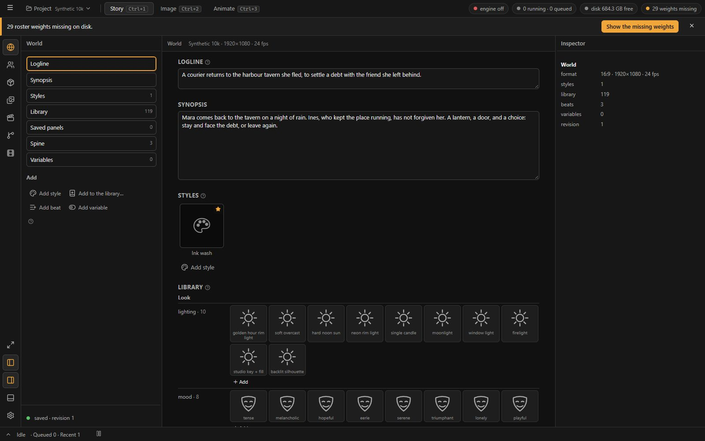

1. Logline and synopsis typed.
2. Panel *Add style* (1); its name and fragment typed in the Inspector; *Make a sample image* (1).
3. *Add beat* ×3 (3); title and line typed.
4. Each beat to the Flow: the beat row (1), then *Make a Flow node from this beat* (1). The rail **jumps to Flow** after each one
   (`storyStore.ts:906-909`), so every next beat costs rail *World* + the row + the verb (3). Three beats: 2 + 3 + 3 = **8**.
5. In Flow the new Shot nodes land stacked at the view's centre. *Add Start* (1), drag the four nodes apart (4), connect Start →
   Arrival → Reunion → The door with three handle drags (3) = **8**.

What the screenshot shows: the **Library** (119 prompt-field presets) and **Saved panels** sit between *Styles* and *Spine*. The bible is
split by Image's tool presets.

### 2.3 Characters, a place, a prop — Story › Cast, Story › Props, Image — 77 clicks

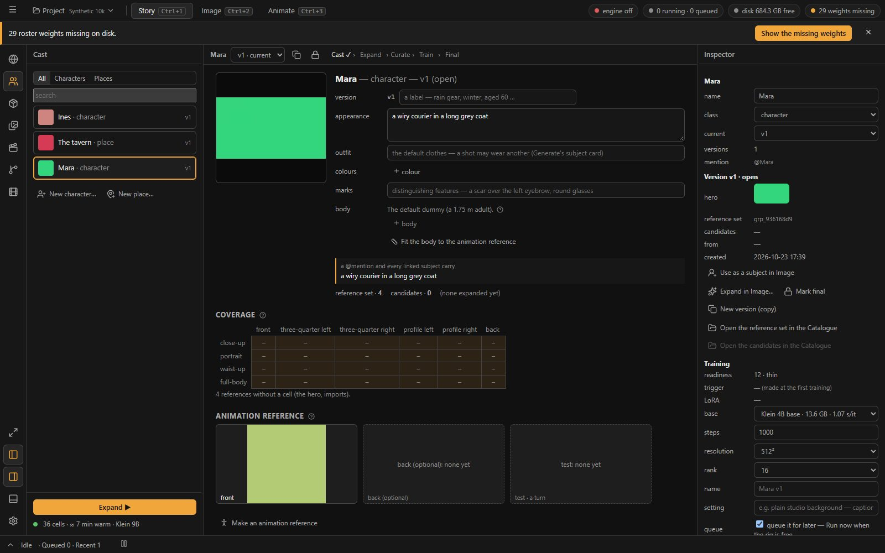

**A character (Mara) — 30 clicks:**

1. **The hero:** tab *Image* (1), the prompt typed, *Generate 4 ▶* (1); right-click a result (1) › *Start from this image ▸* (1) ›
   *Make a character…* (1); the name, OK (1). Story › Cast opens on *Mara v1*. **6**
2. **The sheet:** appearance, outfit, colours and marks typed on the version page.
3. **Expand:** *Expand in Image…* (1). Image opens on its *Poses* section with Full coverage picked (D115); *Expand N ▶* (1); the cost
   dialog's *Queue N jobs* (1). Tab *Story* (1); ✓ on eight candidates (8). **12**
4. **The animation reference:** *Make an animation reference* (1); two candidates arrive; right-click one › *Use as the animation
   reference* (2); *Fit the body to the animation reference* (1). **4**
5. **A voice:** Inspector › Voices › *New voice…* (1); the Kokoro voice picked (2); *Create* (1); the character's voice select (2). **6**
6. *Mark final* + confirm (2).
7. Optional, a LoRA: *Train a LoRA…*, confirm, *Run now* (+3).

Ines is the same: **30**.

**The Tavern (a place) — 6:** the hero as above, through *Make a place…*.

**The Lantern (a prop) — 11:** the hero through *Make a prop…* (6) (Story opens on Props, D110); *Make an animation reference* and
*Use as the animation reference* (3); *Make the 3D model…* and *Queue it* (2).

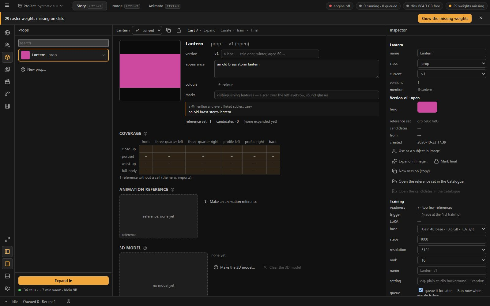

What is not said anywhere: the **clay route** needs each character's animation reference and body fit; **lip-sync** needs a voice. The
bootstrap strip on the Cast page ("Cast › Expand › Curate › Train › Final") lists neither.

### 2.4 The script — Story › Flow — 64 clicks

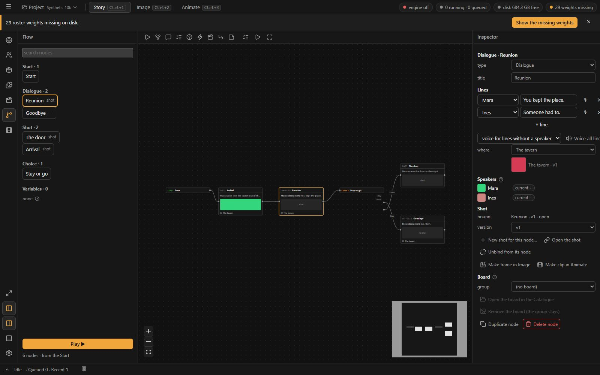

The three Shot nodes from the spine exist (2.2). The rest:

1. *Reunion* becomes a Dialogue: the type select (2); two lines, each *+ line* and a speaker pick (3 + 3). **8**
2. New nodes from the strip's palette, each dragged into place: *Mara close* (Dialogue, one line: 1 + 1 + 3 = 5), *Ines close* (5),
   *Talk* (Dialogue, two lines: 8), *Stay or go* (Choice, two *+ option*: 4). **22**
3. The connections: right-click Reunion → The door › *Delete the connection* (2); five handle drags (Reunion → Mara close → Ines close →
   Stay or go; Stay → Talk; Leave → The door) (5). **7**
4. **Where** (the Tavern) on each of the six visual nodes: the select (2 × 6). **12**
5. **A shot for each visual node:** *New shot for this node…* and OK (2 × 6), plus selecting the three spine nodes first (3). Without
   it *Make frame* and *Make clip* stay disabled on the node. **15**

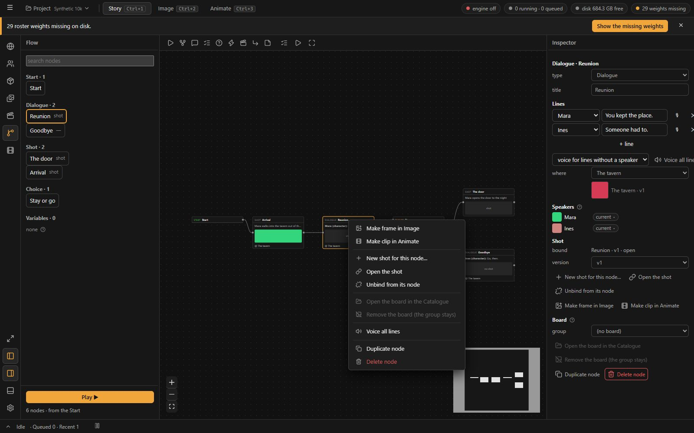

The close-ups repeat Reunion's lines: **one node binds one shot** (loom R146), so the coverage of one dialogue (a wide and two
close-ups) is three nodes with the lines typed again in each — and voiced again (2.5).

### 2.5 Voices — Story › Flow — 8 clicks

For each of the four Dialogue nodes: select it (1), *Voice all lines* (1). The lines are spoken by each speaker's voice (Kokoro on the
CPU, or a cloned voice on the GPU). The two close-ups re-voice lines Reunion already has.

### 2.6 Frames — Story › Shots → Image › Make — 36 clicks (4 shots × 9)

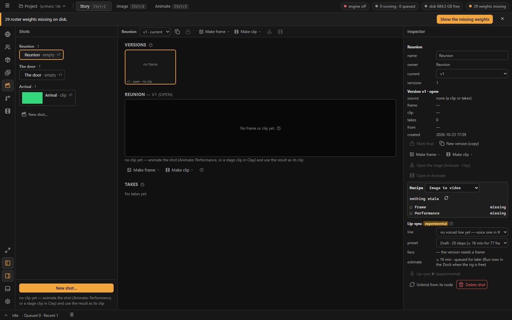
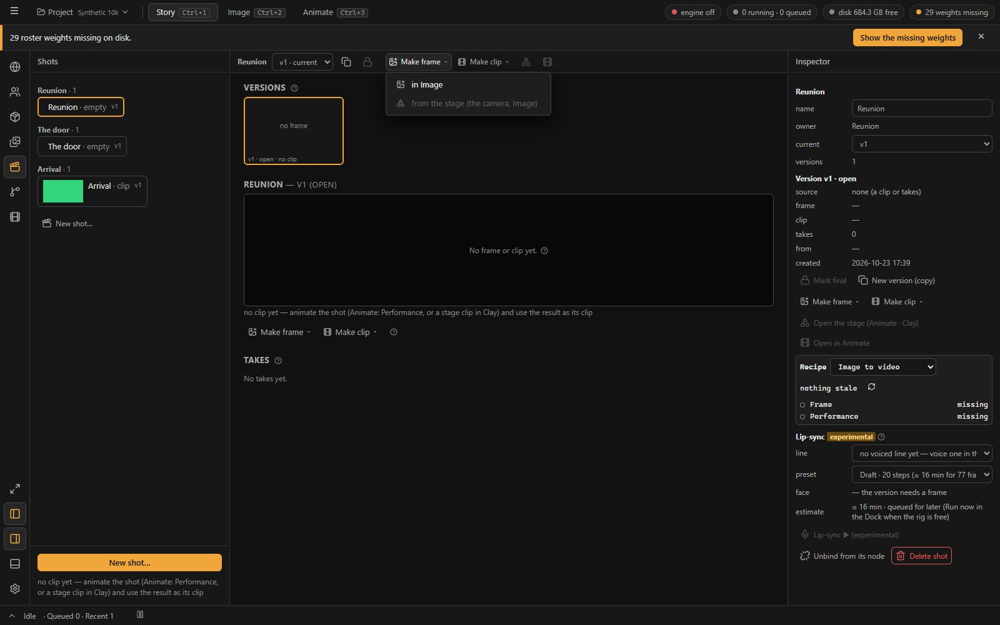

For *Arrival*, *Mara close*, *Ines close* and *Talk*:

1. Rail *Shots* (1), the shot's row (1), the strip's *Make frame ▾* (1) › *in Image* (1).
2. Image opens with the shot's pre-fill (the speakers as linked subject cards, the line as "saying …", the place as the scene, the Shot
   node's line as the lead text — `story/makeFor.ts:55-68`). The **For chip is above the visible part of the column**: the landing scroll
   shows *Saved panels* first (cur-09). Scrolling up to check it (1).
3. Whatever the previous shot left is still there: the look, the camera, the model, the LoRAs, and the references when the node has no
   board (`generateStore.ts:545`, `makeFor.ts:113-118`). Resetting what leaked (≈ 2).
4. *Generate 4 ▶* (1).
5. The first image to finish becomes the frame. To use a better one: *Back to <shot>* (1) › Takes › *✓ use* (1). **No verb in Image
   picks the frame** — not the tile menu, the Inspector or the loupe.

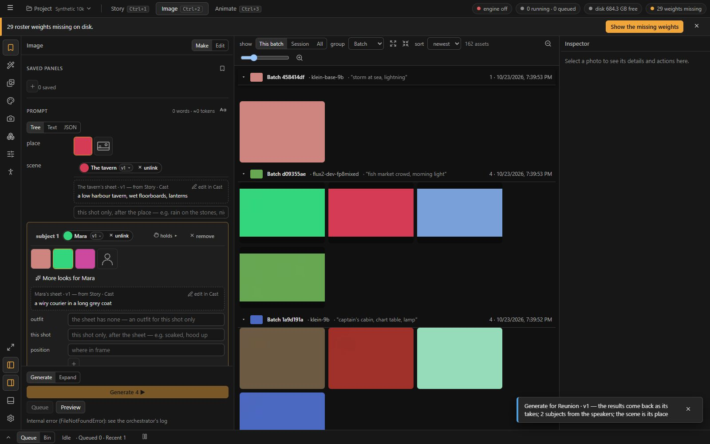
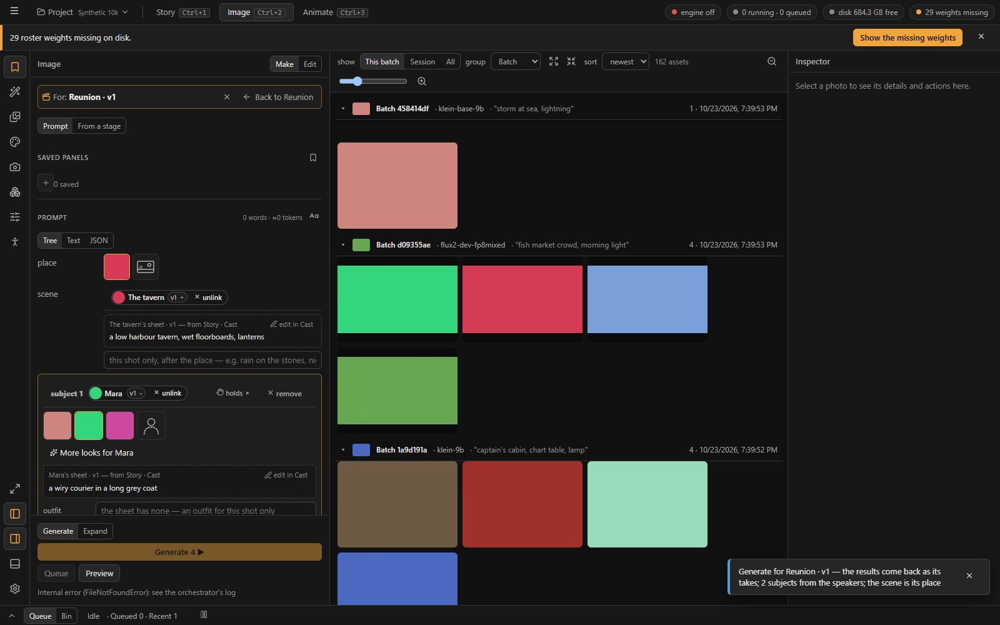

*Back to <shot>* leaves the For chip **on**: later images made in Image still become takes of that shot until the ✕ is pressed.
Re-run, Variations and New angle on a result ignore the chip although it says "Every image made here also becomes a take".

### 2.7 Clips, Image to video — Story › Shots → Animate › Performance — 10 clicks (2 shots × 5)

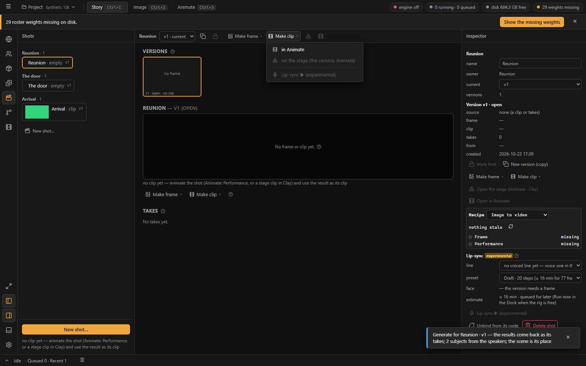
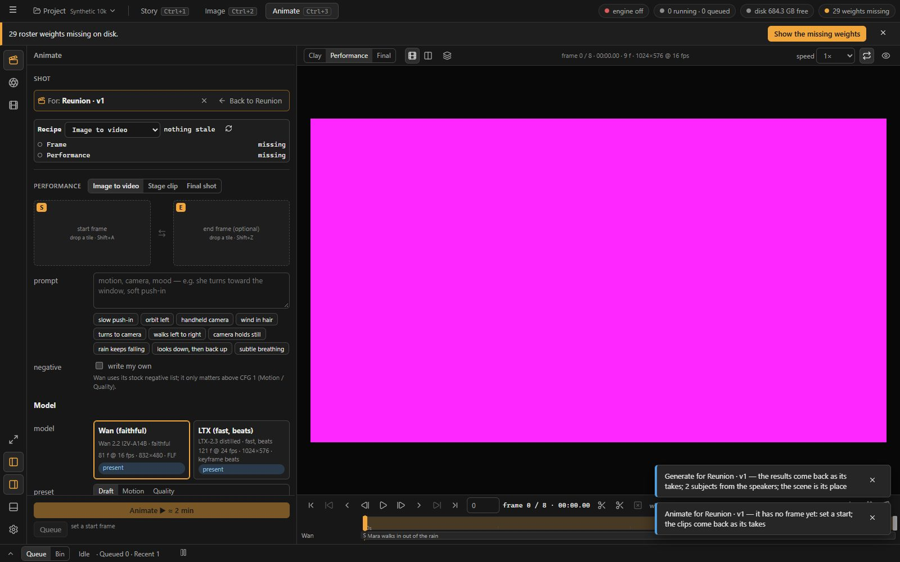

For *Arrival* and *Talk*: the row (1), *Make clip ▾* (1) › *in Animate* (1). Animate opens on Performance › *Image to video* with the
frame as the start and the Shot node's line as the prompt (a Dialogue node's lines are not used). *Animate ▶* (1). The clip fills the
empty clip slot. *Back to <shot>* (1).

### 2.8 Lip-sync on the close-ups (S2V, experimental) — Story › Shots — 10 clicks (2 × 5)

For *Mara close* and *Ines close*, once the line is voiced: the row (1), *Make clip ▾* (1) › *Lip-sync ▶ (experimental)* (1), *Queue the
job* (1). About 16 min at Draft. The talking clip lands as a take that is **not** used; Takes › *✓ use* (1). English only, a line of at
most 4.8 s.

### 2.9 A stage clip (The door) — Animate › Clay → Story → Image → Animate — 33 clicks

The door's shot came from its Flow node. **Story cannot point an existing shot at a stage camera**: the Inspector's *source* is read-only
(`StoryParts.tsx:835`), and the *from the stage* entries of the Make menus stay disabled until a stage is set (cur-08, greyed). The only
link is *New shot from this camera…*, which makes a **new** shot.


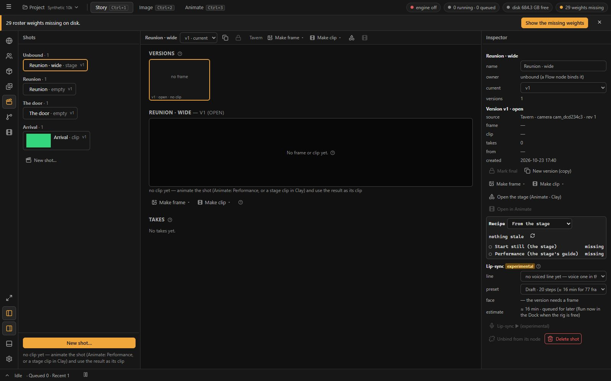

1. **The camera:** tab *Animate* (1), *Clay* (1), the stage picker › Tavern (2); Scene › Cameras *Add camera* (1); framed in the viewport
   (≈ 2); Camera › *Set from view* (1); *New shot from this camera…* and OK (2). Story › Shots opens on a new, **unbound** shot. **11**
2. **One shot per node again:** rail *Flow* (1), the node (1), *Unbind from its node* (1), the bind select › the new shot (2); rail
   *Shots* (1), the old shot (1), *Delete shot* + confirm (2). **9**
3. **The start still:** *Make frame ▾* › *from the stage (the camera, Image)* (2); Image › From a stage; *Render passes* (1); *Render
   frame ▶* (1). The still becomes the shot's frame by the camera match. **4**
4. **The clip:** tab *Story* (1), *Make clip ▾* › *on the stage (the camera, Animate)* (2). It lands in **Clay**, not on the card
   (`storyCommands.ts:58`, cur-18). *Performance* (1), card *Stage clip* (1), the start still (1), *Render clip ▶* (1; it renders the
   guide sequence first). The clip becomes a take by the camera match; the viewer does not open it (a toast does). Tab *Story* (1). **9**

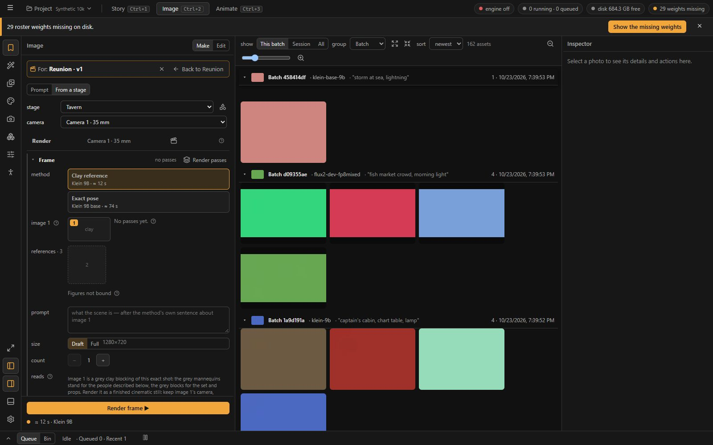
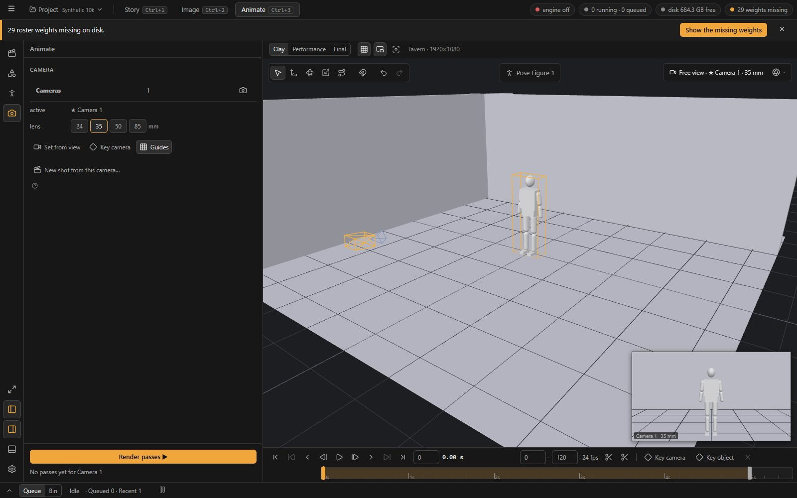
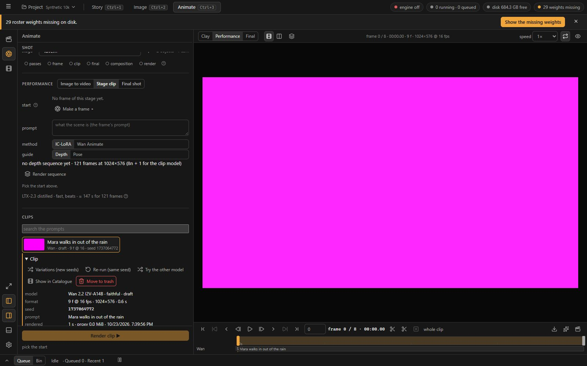

The For chip is not set on this route: stage stills and clips carry the origin `stage`, so the chip shown above them (in Image's From a
stage, in Animate's Shot head) does not decide where they land.

### 2.10 The clay final shot (Reunion) — Animate › Clay → Performance → Final — 49 clicks and a dead end

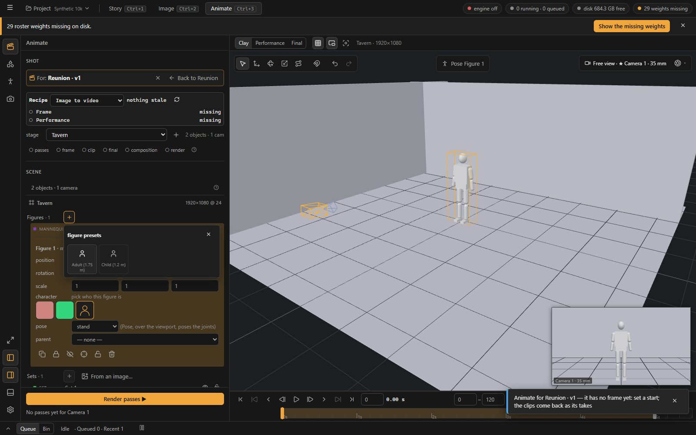
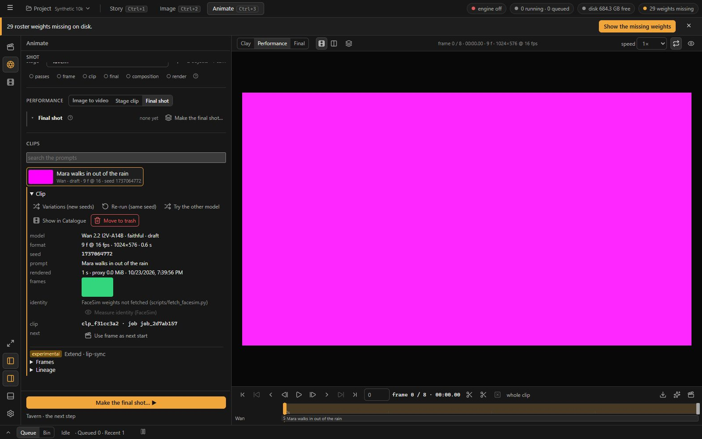
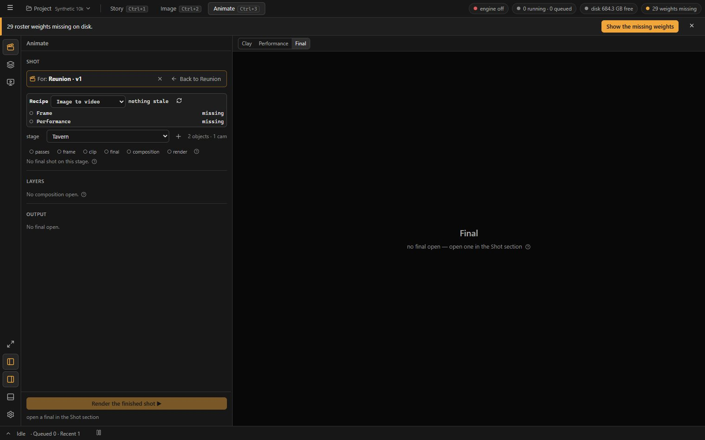

1. **The stage:** tab *Animate* (1), *Clay* (1), *New stage…* + OK (2), *Add set · room* (1) (or Sets › *From an image…* with the place's
   picture), Figures › + › *Adult* ×2 (4), each figure's character tile (2), a library motion per figure (pick, *Apply to <figure> at the
   playhead*, trim: 3 × 2), *Set from view* (1), *Key camera* at the start and the end (3), the range typed, *Render passes ▶* (1). **22**
2. **The link to the Story shot:** *New shot from this camera…* + OK (2), then the re-bind of 2.9 step 2 (9). **11**
3. **Performance:** *Performance* (1), card *Final shot* (1), *Make the final shot…* + *Split into layers* (2), *Make the plate* (1),
   *Perform* ×2 (2), *Assemble the shot* (1), *Make the composition* (1), *Open in Final* (1). **10**
4. **Final:** Mara's layer (1), *Passes* (1), *Lip-sync* (1), *Attach a line…* → "No voiced line in this shot — voice one in Story · Flow
   (🎙)" although the line is voiced: **dead end** (WB1). A *Clean up* pass instead (2). *Render the finished shot ▶* (1). **6**
5. **Back on the shot: dead end.** The render does not become a take of the Story shot (WB1, WB2), although four places in the UI say
   it does (`FinalPanel.tsx:85`, `FinalSuite.tsx:67,128`, `animateCommands.ts:87`). No mouse path attaches an existing clip to an
   existing shot: *Make a shot from this clip…* makes another new shot, and the Episode's Clips bin puts it on the lane as a plain clip
   that the checklist flags.

### 2.11 Approval — Story › Shots — 12 clicks, none of them succeeds

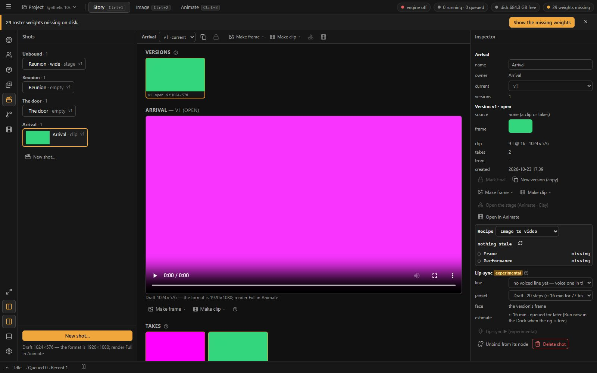

*Mark final* + confirm per shot (2 × 6). It is refused unless the clip is the project format within 32 px (`story.py:326-340`):
1920×1080. No tier makes that size:

| Route | Size |
| --- | --- |
| Image to video, Wan 2.2 | Draft 832×480, HD 1280×720 |
| Image to video, LTX-2.3 | Draft 1024×576, HD 1280×704 |
| Stage clip | the guide's size (1024×576 for LTX) |
| Final shot | the pose-driven model's size, 832×480 (`finalShot.ts:168-171`) |
| Lip-sync (S2V) | the model's size, 77 frames |

Only Image to video at a custom 1920×1088 would pass. The refusal says "render Full in Animate", but Animate has no Full tier. **None of
the six reference shots can be marked final**, so the Episode's checklist flags every clip.

### 2.12 The cut — Story › Episode — 20 clicks per route

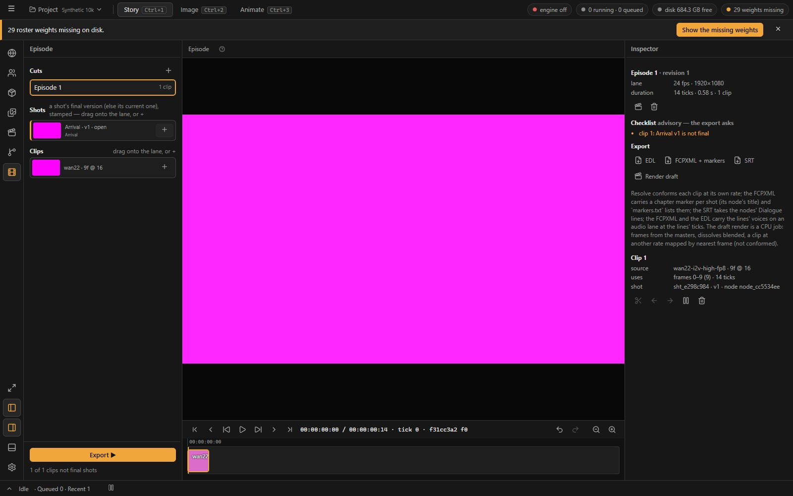

Rail *Episode* (1), *New cut…* + OK (2); the Shots bin's **+** on each shot (6). The bin lists the shots by the Shots list, not by the
Flow's route, so the order is fixed by hand (*Move clip earlier / later*, ≈ 4). A dissolve at two joins: the clip (1), right-click (1),
*Dissolve from the previous clip (12 frames)* (1), twice (6). *Play* (1).

The *Leave* route is a second cut built the same way (+20). The lane holds clip ids: a new take or version of a shot does not reach the
lane; it is removed and added again.

### 2.13 Delivery — Story › Episode → DaVinci Resolve — 7 clicks, then outside loom2

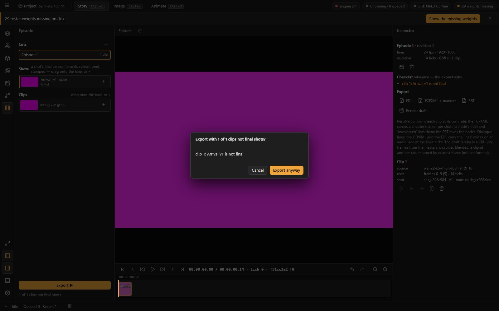

*Export ▶* (FCPXML with markers) → *Export anyway* (2); Inspector *EDL* → *Export anyway* (2); *SRT* → *Export anyway* (2); *Render
draft* (1). The checklist asks before each of the three exports.

What the exports are (`timelines.py`):

- **FCPXML 1.10:** the clips' H.264 proxies (not the PNG masters), a chapter marker per clip (its node's title), the voiced lines on an
  audio lane; `markers.txt` beside it.
- **EDL (CMX 3600):** cuts, dissolves, the voice lines as audio events.
- **SRT:** the Dialogue lines **spaced evenly across their clip**, not timed to the speech.
- **Render draft:** a CPU job, frames from the masters, dissolves blended, other rates mapped by the nearest frame (no RIFE), **no audio**.

Everything after that happens in Resolve: the fps conform (Wan clips are 16 fps; D27 planned RIFE at export, not built), the grade, the
voice mix, titles, the delivery render. The Resolve round trip has not been checked yet (journal 2026-10-15, CN5; deferred at 2026-10-18).

## 3. Totals

| Phase | Clicks | Tab switches | Dead ends |
| --- | --- | --- | --- |
| 2.1 Project | 4 | 0 | |
| 2.2 World | 21 | 0 | |
| 2.3 Cast (2 characters, a place, a prop) | 77 | 12 | |
| 2.4 Flow | 64 | 0 | |
| 2.5 Voices | 8 | 0 | |
| 2.6 Frames (4) | 36 | 8 | |
| 2.7 Image to video (2) | 10 | 4 | |
| 2.8 Lip-sync S2V (2) | 10 | 0 | |
| 2.9 Stage clip | 33 | 6 (+ 2 level switches) | |
| 2.10 Final shot | 49 | 4 (+ 3 level switches) | 2: the line, the take |
| 2.11 Approval (6) | 12 | 0 | 1: the size gate |
| 2.12 Cut (one route) | 20 | 0 | |
| 2.13 Delivery | 7 | 0 | |
| **Episode, one route** | **≈ 351** | **≈ 34** | **3**, and 2 shots made only to be deleted |

Things the author must know because nothing on the screen says so: see §4, the rows marked **hidden**.

## 4. The friction register (WF)

| # | Friction | Where | Kind |
| --- | --- | --- | --- |
| WF1 | A new project's Story tab opens on the Catalogue, not World | `frame/topTabs.ts:11` | navigation |
| WF2 | *Make a Flow node from this beat* jumps the rail to Flow after each beat; the nodes land stacked, unconnected, without a Start | `storyStore.ts:906-909` | repetition |
| WF3 | World mixes the bible (logline, synopsis, styles, spine, variables) with Image's tool presets (Library, Saved panels) | `StoryParts.tsx:452-489` | structure |
| WF4 | The rail's order is not the production order: Catalogue between Props and Shots, Shots before Flow | `railTabs.tsx:55` | structure |
| WF5 | **hidden:** the clay route needs each character's animation reference and body fit; lip-sync needs a voice. The Cast's bootstrap strip lists neither, and nothing lists which shots a character is in | `StoryParts.tsx:298-325` | readiness |
| WF6 | **hidden:** a visual node needs *New shot for this node…* before *Make frame / Make clip* work on it — one extra verb and a name dialog per shot | `storyCommands.ts:347-349` | repetition |
| WF7 | Coverage of one dialogue (wide, close-ups) means one node per shot, with the lines typed and voiced again in each | `story.py:1013-1047` (sole ownership) | structure |
| WF8 | *Where* is set on every node; nothing carries the place from one node to the next | `StoryParts.tsx:962-979` | repetition |
| WF9 | Voices are made per node (*Voice all lines*); no episode-wide verb | `storyCommands.ts:367-369` | repetition |
| WF10 | **hidden:** *Make frame ▾* lands with the For chip scrolled out of view | `GenerateColumn.tsx:614-616` (cur-09) | context |
| WF11 | *Make frame ▾* keeps the previous shot's look, camera, model, LoRAs and (without a board) references; it does not reset the source to Prompt | `makeFor.ts:100-122`, `generateStore.ts:545` | context |
| WF12 | No verb in Image picks a result as the shot's frame; the first image to finish becomes it; a better one costs a round trip to Story | `catalogueCommands.ts:163-175` | round trip |
| WF13 | **hidden:** *Back to <shot>* leaves the For context on; later images still become the shot's takes. It is lost on reload | `origin.ts:24-26,76-79` | context |
| WF14 | The For chip claims "every image made here", but Re-run, Variations, New angle, casting and the stage's *Render frame* ignore it | `generateStore.ts:449-452,567,593-603`; `stageStore.ts:510` | context |
| WF15 | Edit's results and stage stills never show in Make's results (`suite: generate` only) | `catalogueStore.ts:279` | visibility |
| WF16 | An existing shot cannot be pointed at a stage camera; *New shot from this camera…* always makes a new one, so a node's shot is replaced by unbind, bind and delete | `StoryParts.tsx:835`; `stageCommands.ts:73-76` | dead end (workaround) |
| WF17 | *Make clip ▾ › on the stage* lands in Clay, not on Performance › *Stage clip*, and without the For chip | `storyCommands.ts:55-58` | navigation |
| WF18 | **hidden:** a stage clip needs a still of that stage, made in Image (*Make a frame ▸* leaves Animate) | `StageParts.tsx:574-596` | round trip |
| WF19 | *Render clip ▶* and the final's clips do not open in the viewer (a toast does) | `animateStore.ts:270` | visibility |
| WF20 | Animate has no *use as the shot's clip*; *Make a shot from this clip…* makes a new shot even with the For chip set; the Clips list mixes every clip of the project | `animateCommands.ts:128-131,177-180` | round trip |
| WF21 | "Shot" means three things in Animate: the Story shot (the For chip), the stage's camera stills and clips, and the `stage.shot.*` commands; the Shot head mixes the Story shot's recipe with an unrelated stage (cur-21) | `ShotStepper.tsx:85-93` | naming |
| WF22 | The stepper (passes · frame · clip · final · composition · render) follows the stage, not the Story shot, and is hidden on the Image to video card | `steps.ts:19-37`, `AnimateSuite.tsx:302` | visibility |
| WF23 | **hidden:** Clay's timeline range sets the final's length; Final needs the final's own stage open | `StageParts.tsx:705-707`, `finalShot.ts:126,143` | prerequisite |
| WF24 | *Mark final* needs a 1920×1080 clip; no tier makes one; the refusal names a "Full" tier Animate does not have | `story.py:326-340`, `storyStore.ts:815` | dead end |
| WF25 | The Shots bin is not in route order; the lane is built by hand; a branch is a second cut built again | `episode/bin.ts:11-21` | repetition |
| WF26 | The lane holds clip ids: a shot's new take or version does not reach it | `timelines.py:29-57` | staleness |
| WF27 | Three export verbs, each asking the checklist again | `episode/sequenceCommands.ts:36-45` | repetition |
| WF28 | The Episode Inspector carries a paragraph of explanation (D116 wants it behind a ?) | `episode/SequencePanel.tsx` (the `hint` paragraph) | rule |
| WF29 | **hidden:** delivery is in Resolve: the exports point at proxies, the SRT is spaced evenly, the draft render is silent, nothing conforms the frame rate | `timelines.py:190-213,356-359`; `finishers.py:1174` | delivery gap |
| WF30 | No place shows the episode's state: what each shot still owes, across all shots. *Validate* in Flow lists only shots that are not final | — | visibility |

## 5. Defects found on the way (WB)

They are bugs, not workflow choices; each can be fixed on its own, before any Story work.

| # | Defect | Where | Effect |
| --- | --- | --- | --- |
| WB1 | *Make the final shot…* calls `makeFinal` without the shot, so every final has `shot_id: null` | `finalShot.ts:350` (`MakeOptions.shotId` never passed) | the finished render never becomes a take; *Attach a line…* lists nothing, so the Final's *Lip-sync* pass can never run |
| WB2 | Even with a `shot_id`, the assembly and the render record the take without the version; `for_shot_target` needs both, and the error is swallowed | `engine/finishers.py:1005-1006,1099-1100`; `story.py:827-831`; `finishers.py:427-437` | same; no test covers it |
| WB3 | The finalize refusal says "render Full in Animate" and "a stage clip in Clay"; Animate has neither | `storyStore.ts:811,815` | a wrong instruction |

## 6. What "a fully post-processed episode" means today

Inside loom2 the post-processing is **per shot**: the Final level's passes (Clean up, Creative, Face, Lip-sync), masks, effects, the
line as an audio layer, RIFE to 24 fps in the assembly and the render. **Per episode** loom2 cuts (one lane, dissolves) and exports
interchange files. The conform, the grade, the mix, titles and the master render are Resolve's, from the FCPXML. So the reachable end of
the workflow today is: *a cut exported to Resolve, finished there.* The efficient workflow (02) keeps that boundary, because the user's
brief is to use the current functionality; the gaps (WF29) are listed for a later wave in 04 §7.
