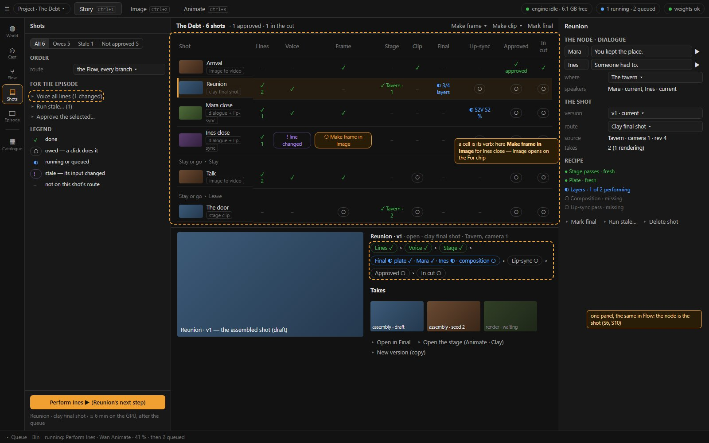
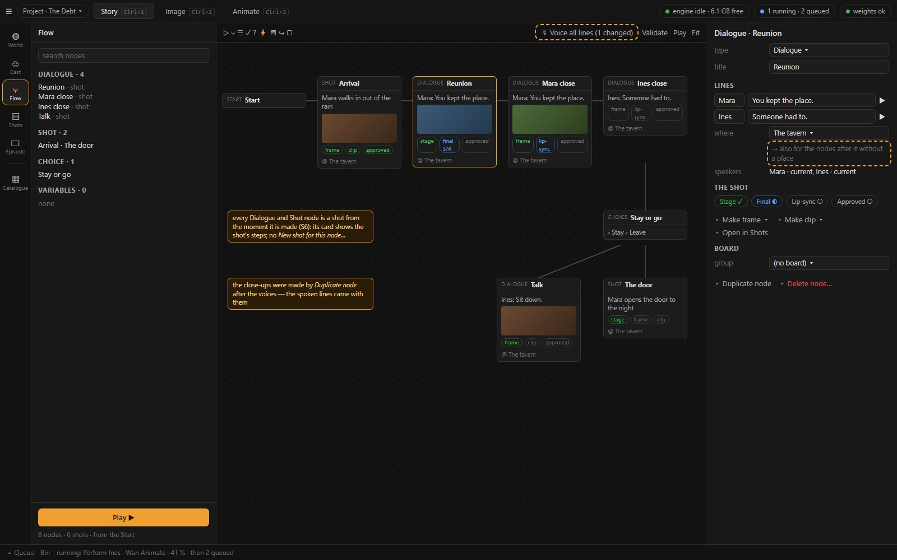
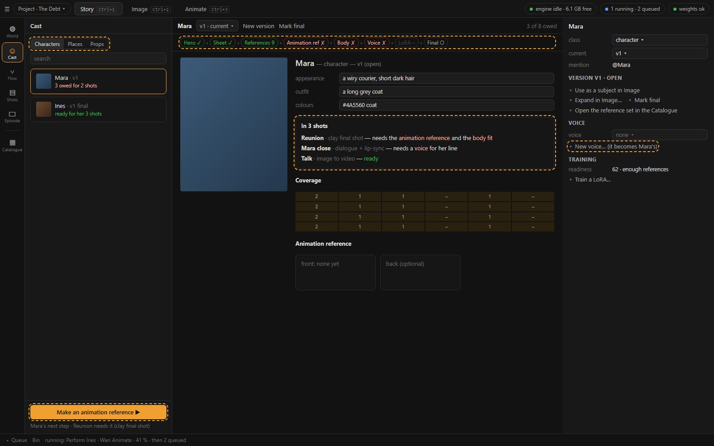
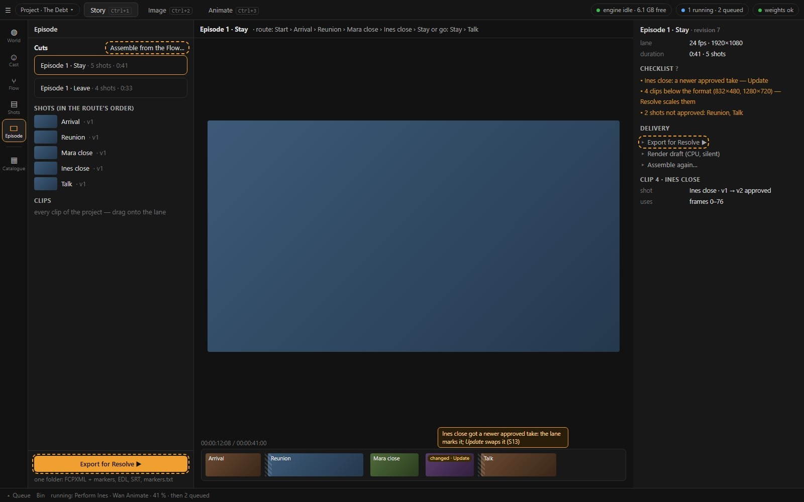
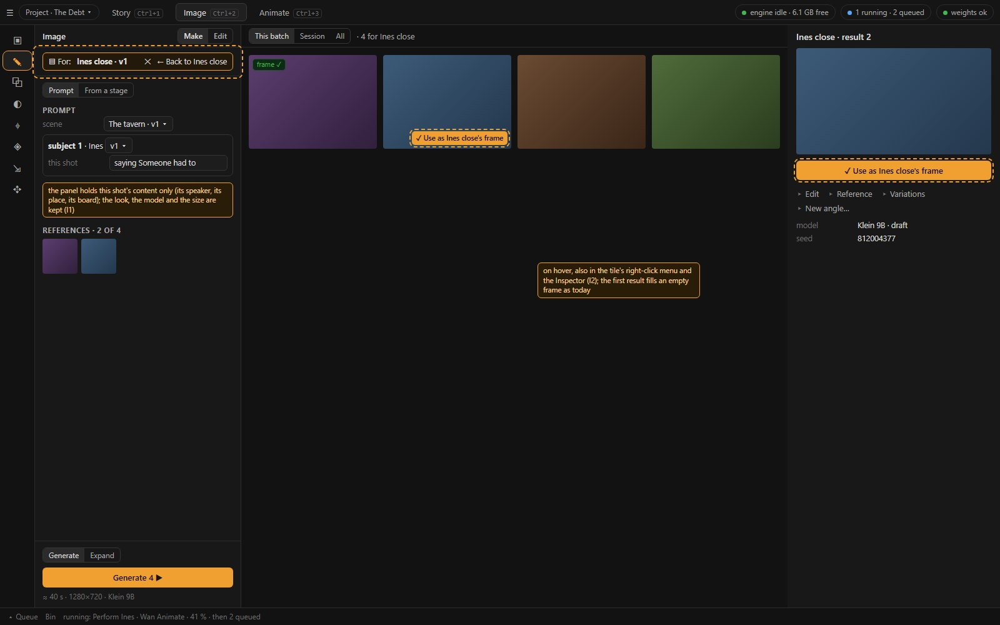

# 04 · Story: its structure and its UI

Status: **accepted by the author, 2026-10-23 → D125**, with one change: the Catalogue leaves Story and becomes the fourth top tab, after
Animate (§2.1, §9 #1). Built in waves SP0 → SP7 (§8). It turns the efficient workflow ([02](02-efficient-workflow.md))
and the comparison's requirements R1–R6 ([03](03-comparison.md) §4) into Story's structure and screens. The decisions to confirm are §9.

It builds on what is decided:

- **D95:** three tabs, Story · Image · Animate.
- **D96:** a Shot is a Flow node with a recipe, and Episode is the cut. RC1 (the recipe graph), RC2 (the Shot node) and RC3 (the cut from
  the Flow) are planned for "the Story pass" ([proto01_animate/07](../proto01_animate/07-build-order.md)).
- **D90:** Story first, the Catalogue under Story. **D110:** props made like characters.
- **D32:** every action has a mouse home. **D116:** help behind a ?. **D97:** one GPU job at a time. **D122:** no keep / reject.

This document is the UI side of the Story pass: it says what RC2 and RC3 look like and what comes before them.

## 1. Story's job

Story is where the episode is **organised**, and where every shot **starts and ends**. It holds the bible, the cast, the script, the shots
and the cut, and shows what each of them still owes. It never makes a picture or a clip itself. A making step is a trip to Image or
Animate that starts at a shot and comes back to it.

## 2. The structure

### 2.1 The rail

```
Top bar     Story · Image · Animate · Catalogue                (Ctrl+1–4; D125: the Catalogue is a tab of its own)
Story rail  World · Cast · Flow · Shots · Episode              (the order of the work)
```

| Workspace | The question it answers | Panel | Stage | Inspector | Foot (the primary verb) |
| --- | --- | --- | --- | --- | --- |
| **World** | What is the story, and how does it look? | the sections | the bible: Logline · Synopsis · Spine · Styles · Variables, then *Presets* (Library, Saved panels) | the selected style, beat, variable, preset | **Make the Flow from the spine ▸** |
| **Cast** | Who and where, and are they ready for their shots? | Characters · Places · Props, search; each row says what it owes | the version page with its readiness row and *In N shots* | the profile and the version (as today) | **the version's next owed step ▶** |
| **Flow** | What happens, in which order, and who says what? | the outline, the variables | the graph; every visual node shows its shot's steps | the node, which is its shot (one panel with Shots) | **Play ▶** |
| **Shots** | What does each shot have, and what does it still owe? | filters, the order, the episode verbs, the legend | **the board** (shots × steps), and the selected shot's page under it | the selected shot (one panel with Flow) | **the selected shot's next step ▶** |
| **Episode** | The cut, and the hand-off to Resolve | the cuts, the Shots bin in route order, the Clips bin | the preview and the lane | the checklist, delivery, the selected clip | **Export for Resolve ▶** |

What changes against today (01 §1):

- **Flow comes before Shots.** The script makes the shots.
- **The Catalogue leaves Story and becomes the fourth top tab** (the author's change to #1, D125). It keeps its suite, Places, keys and
  deep links; in the making suites it is the Bin drawer (C1), as today. *(The proposal had kept it under Story, after a divider.)*
- **Props become the third class of Cast**, next to Characters and Places, with their 3D model section unchanged. D110 put Props "beside
  Cast"; a class switch keeps that and gives one readiness view of everything the shots need (decision 2).
- **World is the bible first.** Image's Library and Saved panels move under one *Presets* heading at its end. They keep every verb and
  every route from Image (*Edit in Story · World*).
- **A new project opens on World.**

### 2.2 The shot is the unit

1. **A Dialogue or Shot node has its shot from the moment it is made** (S6). The shot takes the node's title. Deleting the node asks
   whether to delete its shot too or keep it unbound. *New shot for this node…* goes. *Bind* and *Unbind* stay, for a shot made
   elsewhere (*New shot from this camera…*, *Make a shot from this clip…*).
2. **One panel for a node and its shot.** The Flow's node Inspector and the Shots workspace's Inspector are the same component: the
   node's fields (title, lines, where, speakers, board), then the shot's (version, route, source, takes, recipe), then the verbs.
3. **RC2 merges the two records later** (D96: the Flow node and the Story shot become one Shot). The UI above does not change when it
   does: it already shows them as one.

### 2.3 The For context: the contract between Story and the makers

| Moment | What happens |
| --- | --- |
| **Entering** | from a board cell, the shot page, the node's menu or *Make frame ▾ / Make clip ▾*: the maker opens **at the section the cell names** — Image › Make on *Prompt* or *From a stage*; Animate on the right level and card. The For chip is the first thing in its column. The panel holds **this shot's content** (subjects, scene, references, the line), and keeps the production's settings (look, model, size) |
| **Inside** | every submission of the maker goes to the shot, including re-runs, variations and New angle. **Use as <shot>'s frame / clip** picks the result where it is seen. The first result fills an empty slot, as today |
| **Leaving** | **← Back to <shot>** returns to where the trip started (the board, the Flow) and **ends the context**. ✕ ends it without leaving. A reload ends it, as today |

### 2.4 States

**A step's state** is one of ✓ done · ○ owed (a click does it) · ◐ running or queued · ! stale (an input changed) · – not on this shot's
route. Every state comes from a record that exists:

| Step | Done when | Stale when | Source |
| --- | --- | --- | --- |
| Lines | the node has lines | — | `FlowNode.lines` |
| Voice | every line has audio | a line's words changed since it was voiced | `FlowLine.audio_asset_id`, `audio_text ≠ text` |
| Frame | the version has a frame | the recipe's frame step is stale | `ShotVersion.frame_asset_id`; RC0's recipe state |
| Stage | the version points at a stage camera | the stage moved after the take | `stage_id`, `camera_id`, `stage_revision` |
| Clip | the version has a clip | the recipe's clip step is stale | `ShotVersion.clip_id`; the recipe |
| Final | a final of this shot is rendered | its composition changed after the render | `Final.shot_id` (after A1), the composition's revision |
| Lip-sync | a lip-sync take is used, or the Final's lip-sync pass ran | its line changed | the takes; the final's passes |
| Approved | the version is final | — | `ShotVersion.state` |
| In cut | a cut's lane holds this shot | the lane's clip is not the approved take | the lane's shot stamps (P17) |

**A shot's route** decides which steps are owed. It is the RC0 recipe template (`shot_recipe.py`), set by the first making verb the author
picks, and editable in the Inspector as today:

| Route (template) | Owed steps |
| --- | --- |
| Image to video (`i2v`) | Frame, Clip |
| Stage clip (`stage`) | Stage, Frame (from the stage), Clip |
| Clay final shot (`clay1`, `clay2`) | Stage, Final; Lip-sync when the node has lines and the author wants it |
| Dialogue with voice (`dialogue`) | Voice, Frame, Clip, Lip-sync — the S2V take can be the clip, which settles both |

Every route also owes *Approved* and *In cut*. A Dialogue node's shot owes *Lines* and *Voice*.

The clay templates' steps are still listed as *planned* in RC0 (`shot_recipe.py:74-79`: waves CA0–AE5), although the waves that build them
are done (PS1–PS5, AE1–AE4). The board reads the final's record for them, and SP3 brings the template up to date.

## 3. The screens

The wireframes are a static mock in loom2's frame (`mock/story-mock.html`, rendered by headless Edge). **Dashed orange marks what is
new;** everything else is as today. Pictures are placeholders.

### 3.1 Shots: the board



- **The board** lists every shot in the Flow's order. A Choice's branches are groups (*Stay or go ▸ Stay*, *▸ Leave*). Each row has the
  shot's thumbnail, its name and route, and one cell per step (§2.4).
- **A cell is its verb.** Hovering shows it; a click does it (the screenshot's *Make frame in Image* on *Ines close*). The mapping:

  | Cell | Click |
  | --- | --- |
  | Frame | *Make frame in Image*, or *from the stage* when the shot has a stage camera |
  | Stage | *Link a stage camera…* (Stage clip route) or *Block it on a stage…* (Clay route); when linked, *Open the stage (Animate · Clay)* |
  | Clip | *Make clip in Animate* (Image to video), or the *Stage clip* card |
  | Final | Performance › *Final shot* for the shot; when made, *Open in Final* |
  | Lip-sync | *Lip-sync ▶ (experimental)* (S2V), or the Final's *Lip-sync* pass on the clay route |
  | Voice | *Voice all lines* for the node |
  | Approved | *Mark final* |
  | In cut | the cut that holds it; *Update* when it is changed |

  Right-click on a cell gives the same verb plus the step's alternates. Right-click on a row gives today's shot menu.
- **The panel:** filters (*All · Owes · Stale · Not approved*), the order (the Flow, every branch, or one route), the episode verbs
  (*Voice all lines*, *Run stale…*, *Approve the selected…*), and the legend. The legend is a list of states, not a paragraph (D116).
- **The shot page**, under the board for the selected row: the player, the **pipeline row** (the shot's steps with their states, the
  same as the row's cells but readable), the takes with *✓ use*, and the verbs that have no cell (*Open in Final*, *Open the stage*, *New
  version (copy)*).
- **The foot:** the selected shot's next owed step, with its cost (*Perform Ines ▶ — Reunion's next step, ≈ 6 min on the GPU, after the
  queue*). Ctrl+Enter runs it.
- **The Inspector:** the node and the shot in one panel (§2.2), the recipe with *Run stale…* (RC0, as today).

### 3.2 Flow



- **A visual node's card shows its shot's steps** as small pills (frame, clip, approved, …). There is no *New shot for this node…*.
- **The strip** adds *Voice all lines (N)*, where N counts the lines not voiced or changed since.
- **Where** offers *also for the nodes after it without a place*. A node added or connected later takes the place of the visual node
  before it.
- **The Inspector** is the shared node-and-shot panel. Its *Make frame ▾ / Make clip ▾* are today's, and *Open in Shots* selects the
  shot's row on the board.
- **The close-ups** in the screenshot were made by *Duplicate node* after the voices (02 §3.4). That is today's function, not a new one.

### 3.3 Cast



- **Characters · Places · Props** as one segmented switch.
- **Each row says what the profile owes** for its shots ("3 owed for 2 shots", "ready for her 3 shots").
- **The readiness row** under the strip: Hero · Sheet · References · Animation reference · Body · Voice · LoRA · Final. The items depend
  on the class: a place has no animation reference, body or voice; a prop has a 3D model instead of a body. Each item is its verb. It
  replaces the bootstrap strip (*Cast › Expand › Curate › Train › Final*), whose Expand and Curate are the *References* item.
- ***In N shots*** on the version page: the shots that use this profile (a Dialogue line's speaker, a node's place, a stage figure or
  mesh bound to it), each with its route and what that route needs from this profile.
- **The foot** is the version's next owed step (*Make an animation reference ▶*), with the shot that needs it.
- ***New voice…*** opened from a character gives the new voice to that character.

### 3.4 Episode



- **Assemble from the Flow…** opens a small sheet. It asks at each Choice which option this cut follows, then makes the cut: every shot
  of that route in order, at its approved take (else its current one), stamped as today. *Assemble again…* rebuilds it from the Flow and
  keeps its trims and dissolves where the same shots follow each other. A cut is named after its route (*Episode 1 · Stay*).
- **A changed shot is marked on the lane.** When a shot on the lane gets a newer approved take, its clip shows *changed · Update*, and the
  checklist lists it; *Update* swaps the clip and keeps the trims (RC3's rule).
- **The checklist** groups: changed takes, shots not approved, clips below the format (a delivery note — Resolve scales them).
- **Export for Resolve ▶** writes the FCPXML with markers and the voice lane, the EDL, the SRT and `markers.txt` into one folder named
  after the cut. The checklist asks once, only when something is listed. *Render draft* stays as it is (CPU, silent).
- **The Shots bin** lists the shots in the route's order. The Clips bin is unchanged.

### 3.5 Image, opened for a shot



- **The For chip sits in the column's head**, above the source switch, and does not scroll away.
- **The panel holds this shot's content**: the speaker as the subject, its line as "saying …", the place as the scene, the node's board
  as the references. The look, the model and the size are the author's last.
- **Use as <shot>'s frame:** on a result's hover, in its right-click menu and as the Inspector's first button. The current frame carries
  a *frame ✓* badge.
- Everything else of Image is unchanged.

### 3.6 World (no wireframe)

The sections become **Logline · Synopsis · Spine · Styles · Variables**, then a *Presets* heading over **Library** and **Saved panels**. The
panel's *Add* verbs stay. **Make the Flow from the spine…** (the foot, and the Spine section's header) makes a Start and one Shot node per
beat not yet made, laid out in a row and connected in the spine's order, each with its shot. It asks first with the count.

## 4. Commands (D32)

New and changed commands, each with its mouse homes. Accelerators are optional and remappable (D72). The last column is what each one
calls; nothing calls a job kind that does not exist.

| Command (proposed id) | Label | Mouse homes | Calls |
| --- | --- | --- | --- |
| `story.world.flowFromSpine` | Make the Flow from the spine… | World foot; Spine header; beat menu | `POST /story/flow/nodes`, `PUT /story/flow/graph` (today's `nodeFromBeat`, in a loop) |
| `story.cast.next` | (the next owed step) ▶ | Cast foot; the readiness row | the item's existing `story.cast.*` command |
| `story.flow.voiceEpisode` | Voice all lines (N) | Flow strip; Shots panel | `POST /story/flow/nodes/{nid}/voice` per node with unvoiced or changed lines |
| `story.flow.placeForward` | Also for the nodes after it | the *where* field's menu | `PATCH /story/flow/nodes/{nid}` per node |
| `story.shots.cell` | (the cell's verb) | the board's cells, their right-click | `story.shot.makeFrame`, `makeFrameStage`, `makeClip`, `makeClipStage`, `lipsync`, `finalize`, `openStage`, `story.flow.voiceAll` |
| `story.shot.linkStage` | Link a stage camera… | the Stage cell; the shot page; the shot's menu | a new route setting the version's source: `PATCH /story/shots/{sid}/versions/{vid}/source {stage_id, camera_id}` |
| `story.shot.blockOnStage` | Block it on a stage… | the Stage cell; the shot page | `POST /stages` (a stage named after the shot), its camera, `linkStage`, today's `prebindSpeakers` |
| `story.shot.next` | (the selected shot's next step) ▶ | Shots foot; Ctrl+Enter | the cell's verb |
| `story.shots.approve` | Approve the selected… | Shots panel; the board's right-click | `POST …/finalize` per shot (at any size, S12) |
| `story.episode.assemble` | Assemble from the Flow… | Episode panel; Cuts header; the lane's right-click | `play.ts`'s walker over the graph, then today's `addShot` |
| `story.episode.update` | Update | the lane's *changed* badge; the checklist row | swap the lane clip's source and stamp |
| `story.episode.exportAll` | Export for Resolve ▶ | Episode foot; Inspector | `POST /timelines/{id}/export` ×3 (`edl`, `fcpxml`, `srt`) into one folder |
| `gen.for.use` | Use as <shot>'s frame | a result's hover ✓; its right-click; the Inspector | `POST /story/shots/{sid}/versions/{vid}/take {use: true}` |
| `anim.for.useClip` | Use as <shot>'s clip | a clip row's editor; its right-click | the same route, kind `clip` |
| `stage.camera.useForShot` | Use this camera for <shot> | Clay › Camera; the camera's right-click (with a For chip) | `story.shot.linkStage`'s route |

**Removed:** `story.flow.newShot` (*New shot for this node…*; a visual node has its shot, S6) and the beat's single *Make a Flow node from
this beat* becomes a menu entry of the spine's verb. **Kept:** everything else in `storyCommands.ts`, including *Make frame ▾ / Make clip
▾*, which the cells call.

**Keys on the board:** ↑ ↓ move the selected row, ← → the selected cell, Enter runs the cell, Ctrl+Enter the foot. Each has its mouse home
above.

## 5. Image and Animate: the justified changes, and only those

Each change exists because the round trip of §2.3 cannot work without it. Each one is a verb or a fix on a section that exists; no section,
mode or card is added or moved.

| # | Where | Change | Without it |
| --- | --- | --- | --- |
| I1 | Image › Make | *Make frame ▸* opens on the For chip (pinned in the column's head) and on *Prompt* (or *From a stage* for the stage entry); the shot's own content replaces the last shot's; look, model and size are kept | the chip is off screen and the last shot's subjects, scene and references are sent with this one (WF10, WF11) |
| I2 | Image › Make results | **Use as <shot>'s frame** on a result (hover ✓, right-click, Inspector); a *frame ✓* badge on the current frame | picking the frame costs a trip to Story per shot, and the first image to finish wins (WF12) |
| I3 | Image, Animate | *← Back to <shot>* ends the For context | later work silently becomes takes of that shot (WF13) |
| I4 | Image › Make | Re-run, Variations and New angle honour the For chip | the chip says "every image made here" and they do not (WF14) |
| A1 | Animate › Performance › Final shot; the server | *Make the final shot…* carries the For shot and version; the assembly and the render record the take with the version | the finished shot never reaches its shot, and its *Lip-sync* pass can never find a line (WB1, WB2) |
| A2 | Story → Animate | *Make clip ▸ on the stage* opens Performance › *Stage clip* with the For chip and the shot's frame as the start | it lands in Clay, out of context (WF17) |
| A3 | Animate › Clay › Camera | with a For chip, **Use this camera for <shot>** (and *New shot from this camera…* only without one) | the only link makes a second shot, which is then rebound and deleted (WF16) |
| A4 | Animate › Performance › Clips | **Use as <shot>'s clip** on a clip's editor while the For chip is set; *Make a shot from this clip…* hidden then | the clip is not chosen where it is played; a second shot is made by mistake (WF20) |

**Not changed,** although 01 lists friction there: Animate's Shot head mixing the Story shot with a stage (WF21), the stage-only stepper
(WF22), Edit's and the stage's results missing from Make's grid (WF15), *Render clip* not opening its clip (WF19). They are not on the
round trip, and the board shows the Story shot's state. They belong to UX9's register for Animate and Image.

## 6. Open points this proposal does not settle

1. **Coverage of a dialogue** (a wide and its close-ups, WF7). Until RC2's scene groups (D96: "a dialogue in shot / reverse-shot is several
   Shots, shown in the Flow as one scene group"), the efficient path is *voice the master node, then Duplicate node* (02 §3.4). A *New
   coverage shot* verb on a Dialogue node that makes a sibling in the same scene group belongs with RC2.
2. **Batch making.** A *Make the missing frames…* on the board would queue one Generate per shot with each shot's pre-fill. Image's panel is
   one state, so this needs the pre-fill applied per job without the panel. It is not proposed now; the cells are enough to start.
3. **The recipe graph** (RC1) is unchanged. The board and the shot page show the recipe as states; the graph view comes as D96 planned.
4. **Templates and linked copies** (O2, O3 of 06) come with RC2. *Block it on a stage…* is their first user: a second shot of the same
   scene would *Link a stage camera…* to the same stage with a new camera.

## 7. Later: the delivery gaps

The user's goal is a *fully post-processed* episode. Within today's functions the end is an export to Resolve (01 §6). What is missing for
loom2 to deliver more of it itself belongs to RC3 / RC4 (FilmCraft), not to this proposal:

| Gap | Today | Where it would go |
| --- | --- | --- |
| Frame-rate conform | none at episode level; D27 planned RIFE at export | the export or the movie render (RC3) |
| Subtitle and voice timing | spaced evenly across the clip | the line's audio length, or its in / out on the lane (D118 already has them per final) |
| Masters in the exchange | the FCPXML points at H.264 proxies | the PNG masters or a ProRes intermediate (RC4) |
| A delivery size | approval at any size (S12); no video upscale | a Full re-render route, or a video upscale (a model question first) |
| The movie render | the draft is silent, CPU, nearest-frame | a backend render with the voice lane (RC3) |
| The Resolve round trip | unverified | the author's check, owed since 2026-10-15 |

## 8. A build plan

Sized like the other waves (days of work, each wave with its tests, screenshots and journal entry). Only SP0's A1 touches a GPU path, and a
rig run checks that one.

| Wave | Content | Items | Days |
| --- | --- | --- | --- |
| **SP0 · Fixes** ✓ built 2026-10-23 | the final shot reaches its shot (WB1, WB2), the refusal's wording (WB3), *← Back* ends the context, the chip honoured; *Mark final* at any size (S12, moved here from SP3) | A1, I3, I4, S12 | 1 |
| **SP1 · The rail and World** ✓ built 2026-10-23 | the rail's order, the Catalogue as the fourth top tab (D125's change to #1), Props as a class of Cast, World's sections, a new project on World, the Episode's ? | S1, S2, S3, S15 | 1 |
| **SP2 · The node is the shot** ✓ built 2026-10-23 | a visual node makes its shot; the shared node-and-shot panel; the place carried forward | S6, S7, S10 | 2–3 |
| **SP3 · The board** ✓ built 2026-10-23 | the board, its cells and states, the shot page under it, the next-step foot, the Flow cards' step pills; *Link a stage camera…*, *Block it on a stage…* and the stage routes opened in context (S11 and part of A2, moved here from SP4, because the board's Stage and Final cells need them) | S9, S11, A2 (part) | 3–4 |
| **SP4 · The round trip** ✓ built 2026-10-23 | Image's landing and *Use as … frame*; Animate's *Stage clip* landing (the rest of A2), *Use this camera*, *Use as … clip* | I1, I2, A2, A3, A4 | 3 |
| **SP5 · Cast readiness** ✓ built 2026-10-23 | the readiness row, *In N shots*, the next-step foot, the voice given to its character | S5 | 1–2 |
| **SP6 · Episode** ✓ built 2026-10-23 | *Assemble from the Flow…*, *changed · Update*, *Export for Resolve ▶* | S13, S14 | 2–3 |
| **SP7 · Episode verbs** | *Make the Flow from the spine…*, *Voice all lines (N)* | S4, S8 | 1 |
| | | | **≈ 14–18** |

**Order:** SP0 first, on its own (bugs). Then SP1 → SP2 → SP3, because the board needs the node-is-the-shot rule. SP4 and SP5 can follow in
either order, then SP6 and SP7.

**How it is checked:**

- Vitest for the board's state derivation (§2.4) and the route walker of *Assemble*.
- An e2e scenario per route of the reference episode on the fake engine, under both variants.
- Screenshots of every section touched.
- One rig run of the clay final shot to its take (A1).
- At the end, the reference episode made again through the app, its clicks counted against 02 §3.14.

**Against 07's plan:** SP2 is the UI of RC2 without the record merge, and SP6 is RC3 without the movie render. RC1 (the graph) and RC4
(FilmCraft) are unchanged.

## 9. Decisions to confirm, each with a recommendation

**Answered by the author, 2026-10-23 (D125):** every recommendation accepted, except #1, where the Catalogue becomes the fourth top tab.

| # | Question | Recommendation |
| --- | --- | --- |
| 1 | **The rail:** World · Cast · Flow · Shots · Episode, then the Catalogue after a divider? | **Yes.** It is the order of the work; the Catalogue stays under Story (D90). **The author: the rail yes, but the Catalogue moves out, as the fourth top tab after Animate** |
| 2 | **Props as the third class of Cast** (Characters · Places · Props), with its page and 3D model unchanged — or kept as its own workspace (D110)? | **A class of Cast.** One readiness view of everything the shots need. Keeping it separate costs nothing else in this plan |
| 3 | **World:** the bible first, Library and Saved panels under *Presets* at the end? | **Yes** |
| 4 | **A visual node has its shot from the start;** *New shot for this node…* goes? | **Yes** (RC2's first step) |
| 5 | **Shots becomes the board** (shots × steps, cells as verbs) with the shot page under the selected row? | **Yes** |
| 6 | ***Mark final* at any size,** the export's checklist listing clips below the format? Today no route reaches 1920×1080, so nothing can be marked final | **Yes.** Approval is the author's decision; the size is a delivery question (§7) |
| 7 | **The cut assembled from the Flow,** a cut per route, *changed · Update* for newer approved takes? | **Yes** (RC3's rule, without the movie render) |
| 8 | ***Export for Resolve ▶*** — one folder, one checklist — instead of three export verbs? | **Yes.** The three stay in the Inspector's menu |
| 9 | **Coverage:** voice the master node, then *Duplicate node*, until RC2's scene groups? | **Yes** |
| 10 | **Image's four changes** (I1–I4)? | **All four** |
| 11 | **Animate's four changes** (A1–A4)? | **All four** |
| 12 | **SP0 first,** as fixes on their own before any Story work? | **Yes:** WB1 and WB2 make the clay route's end unreachable today |
| 13 | **The board's next-step foot** queues on the GPU like any maker's verb (D97: the queue runs one job at a time)? | **Yes;** the cost and *after the queue* in its estimate |
| 14 | **Where the spine's nodes land:** a row, connected Start → beats in order? | **Yes;** a beat already made into a node is skipped |
