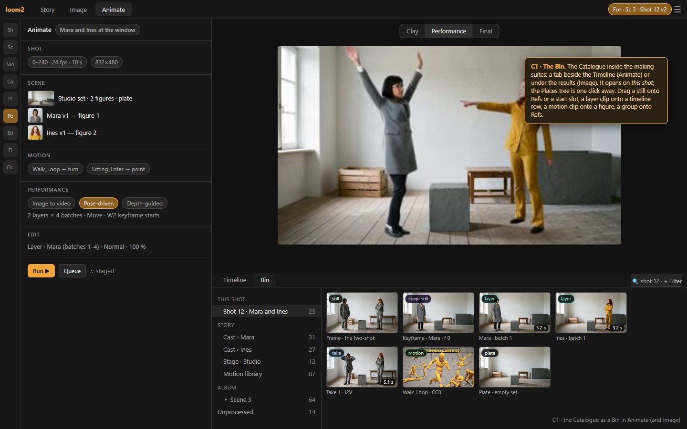
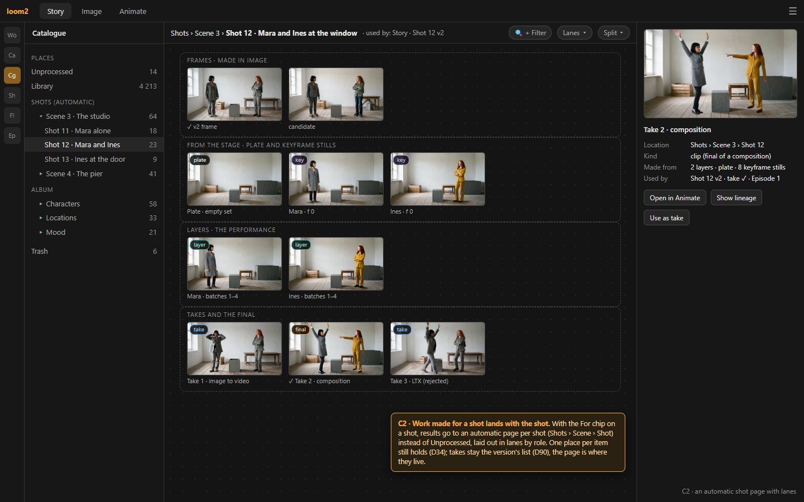
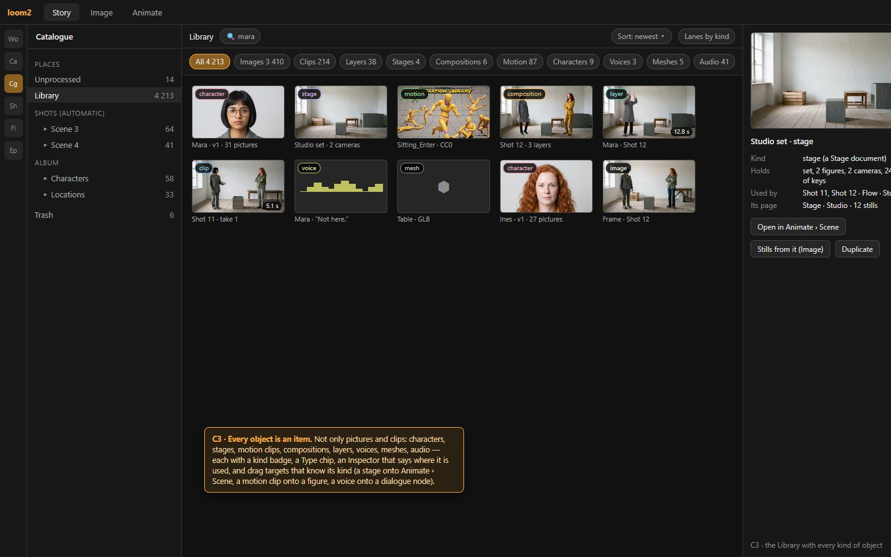
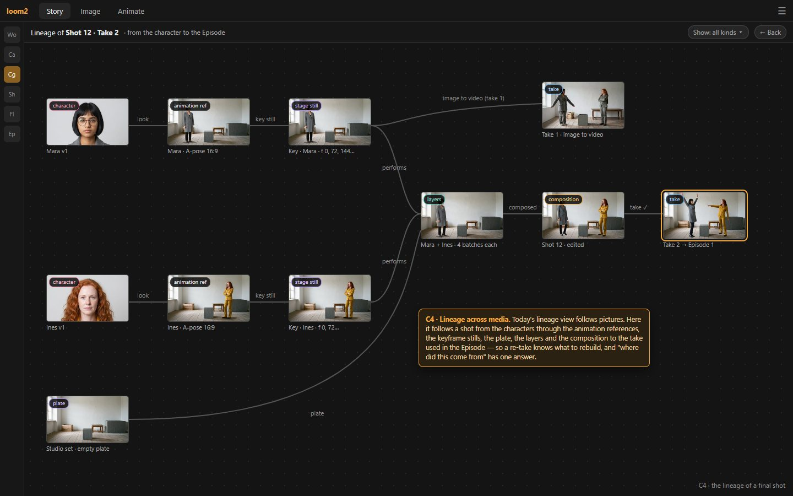

# 04 · The Catalogue for the making suites — ideas, mocked up

Status: **ideas for the author to choose from, 2026-10-18.** Nothing decided. They follow D95: three tabs, Story · Image · Animate.

The author (2026-10-18), on making stills from a stage in Image while the stage lives in Animate: *"This is where the Catalogue will
probably play a role, to efficiently group all images, videos and other objects. Maybe we should expand on this also — mock up a few
ideas for improvement."*

## 1. The Catalogue today

The album model of D34 (`.docs/proto01_design/01-catalogue-inventory.md`, built 2026-10-07):

- **Unprocessed** is the inbox: every new item lands here.
- **Library** is every asset of the project.
- **The Album** is a tree of **groups**; each group is a **page** where items sit freely.
- Each item has **one place only**; *Duplicate* makes a second.
- The Stage can **split** into two panes, to move items between two places.
- A **lineage view** shows how pictures derive from each other.
- Since D92 a group shows **who uses it** (a Cast version's references, a style's samples, a Flow node's board, a Stage's page, a Library
  entry). Since D90 the Catalogue lives in Story, after Cast.

**What is missing, seen from Image and Animate:**

1. **The Catalogue is somewhere else.** To use an asset while making, you leave the making suite, find it in Story › Catalogue and drag
   it to a tab. Image's results grid is a Catalogue view, but only of the latest results.
2. **Only media are items.** The asset kinds are image, video, mask, document render, mesh and audio
   (`orchestrator/loom2/catalogue.py`). Stages, compositions, motion clips, a figure's layer clips, characters and voices are not items,
   so they cannot be found, grouped or dragged like one.
3. **Work for a shot scatters.** Results made *for* a shot become takes on the shot version (D93), but the files themselves land in
   Unprocessed, or on the page they were made from. The clay pipeline adds many more pieces per shot: keyframe stills, a plate, layer
   clips per batch, a composition, takes.
4. **Lineage stops at pictures.** A final take's history runs through characters, references, stills, layers and a composition. Today
   that history is spread over several records.

## 2. Four ideas

### C1 · The Bin: the Catalogue inside Image and Animate

**What it is:**

- A **Bin** tab beside Animate's Timeline, and a Bin drawer under Image's results.
- It holds a compact Places tree (*This shot* first, then Story's Cast, stages, the motion library, the Album, Unprocessed) and a grid
  with the query bar's chips.
- It opens on the context: the For chip's shot, or the character or stage being worked on.

**What it does:** you drag from it to wherever the thing is used:

- a still onto Refs or a start slot;
- a layer clip onto a timeline row;
- a motion clip onto a figure;
- a stage onto Scene;
- a group onto Refs (as a group chip, D90).

**Fits D34:** it is the same Catalogue, with the same places, chips and menus, shown inside the making suites. It is not a second
collection.

**Needs:**

- the Catalogue's Places and grid as components that can live in a drawer (they already live in two stores: Catalogue and Generate);
- the drag targets per kind (§C3).

**Effort:** small to medium.

### C2 · Work made for a shot lands with the shot

**What it is:**

- With the For chip on a Story shot, results land on an **automatic page for that shot** (*Shots › Scene › Shot*) instead of
  Unprocessed.
- The page is laid out in **lanes by role**:
  - frames (made in Image);
  - from the stage (the plate, keyframe stills);
  - layers (the performance);
  - takes and the final.
- The *Shots* branch of the Places tree mirrors Story's scenes and shots, and its counts say how much exists per shot.

**Fits D34 and D90:**

- One place per item still holds: the shot page *is* the place.
- Takes stay the version's list (D90); the page is only where their files live.
- An item can still be moved or duplicated elsewhere.
- The *used by* line on the page says "Story · Shot 12 v2".

**Needs:**

- A group per shot, created when the shot is: a group record with a `shot_id`.
- Placement of for-shot results by the server's existing `for_shot` hook.
- **Lanes:** a page layout by role, either as a page template or as a *tidy as lanes* tool. D34 §12 g already wants tidy tools.

**Effort:** medium.

**The trade-off:** today results made for a shot from a casting page or a stage's page stay on that page. C2 moves them to the shot's
page. A setting could choose.

### C3 · Every object is an item

**What it is:**

- New item kinds beside image, video, mask, mesh and audio: **character** (a Cast version), **stage**, **motion** (a library clip),
  **composition**, **layer** (a figure's clip per shot) and **voice**.
- Each has a kind badge, a **Type** chip in the query bar, a thumbnail and an Inspector that says where it is used.
- Each has an action per kind: a stage opens in Animate › Scene, or makes stills in Image.

**What it does:** they can be grouped, searched, duplicated and dragged like pictures. The drag targets know the kind:

- a stage onto Scene;
- a motion clip onto a figure;
- a voice onto a dialogue node;
- a composition onto the Episode.

**Fits D34:** the album model is unchanged. The new kinds are items with one place each.

**Needs:**

- Catalogue entries for non-media records. The record stays where it is (a stage in `stages/`, a composition in the shot folder); the
  Catalogue item points at it with a thumbnail.
- The index learns the kinds, and *used by* is computed as today.

**Effort:** medium. It can be done kind by kind, as each one is built:

- stage, with AN1;
- motion, with CA1;
- composition and layer, with AE1;
- character and voice, with the Story pass.

### C4 · Lineage across media

**The author chose it, 2026-10-18, and took it further:** a Flow node's recipe *is* this graph, as a plan, not only a record. See
[05](05-flow-nodes-as-shot-recipes.md).

**What it is:** the lineage view follows a final take back through every kind:

1. the characters;
2. their animation references;
3. the keyframe stills;
4. the plate;
5. the layer clips per batch;
6. the composition;
7. the take used in the Episode.

The edges are labelled by how each piece was made (*look*, *key still*, *performs*, *composed*, *take ✓*). Earlier takes branch off the
same tree.

**What it does:**

- "Where did this come from" has one answer.
- A re-take knows what it rebuilds: change Mara's animation reference, and the tree shows which keyframe stills, layers and takes
  depend on it.

**Needs:**

- lineage edges for the new kinds, written at creation time (house rule 4: lineage is stamped at write time);
- the existing `GET /lineage/tree/{root}` extended to non-media items.

**Effort:** medium. It depends on C3.

### Smaller ideas

- **C5 · Gather for a shot.** One command on a shot (or its page) that collects everything the shot uses into its page: the references,
  the stage's stills, the motion clips. It duplicates what lives elsewhere, as D34 asks for a second place. It is useful before handing a
  shot over, or before archiving.
- **C6 · Group chips everywhere.** D90 planned the group chip (cover, name, count) wherever a group is referenced. In Animate it is also
  the way to give a layer a *set* of references (a character's look group).
- **C7 · Stills from a stage land on the stage's page.** Stage already has an album page (D92 *used by* "Stage · …"). Image's *From a
  stage* (D95) puts its results there, or on the shot's page with C2.

## 3. A suggested order

| Idea | With | Why then |
| --- | --- | --- |
| **C1** Bin | IM1 (Image) and AN1 (Animate) | the making suites are being rebuilt anyway; the Bin is where they pick their material |
| **C3** kinds | stage with AN1, motion with CA1, composition and layer with AE1; character and voice later | each kind becomes an item when it is built, not in one big pass |
| **C2** shot pages | AN1, if the author wants for-shot results to land with the shot from the start; otherwise the Story pass | it decides where Animate's many per-shot files land |
| **C4** lineage | AE1 / CA6 (the composition), then the Story pass for the view | the edges must be written when the items are made; the view can come later |
| C5–C7 | the Story pass | Story comes after Animate (D95) |

## 4. Questions for the author

1. **Which ideas to keep**: C1, C2, C3, C4 (and C5–C7)?
2. **C2:** should for-shot results land on the shot's page by default, or stay on the page they were made from (today's behaviour)?
3. **C3:** which kinds matter most to you as items: stages, motion clips, compositions, layers, characters, voices?
4. **The Bin's place in Image:** a drawer under the results, or a section at the end of the Make column?
