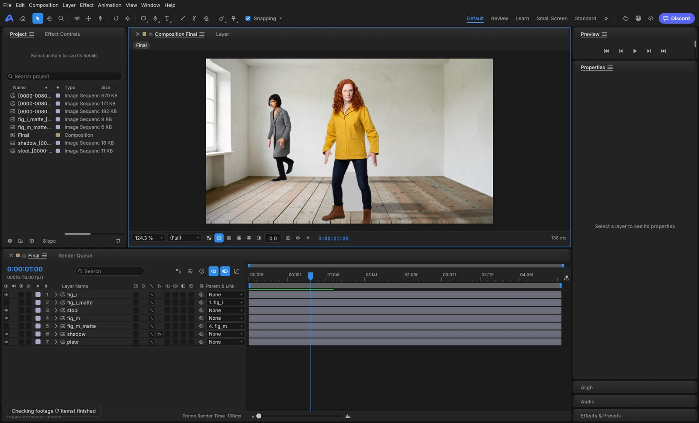

# 19 · Looking at E27: finishing the shot in EffectCraft (for the author)

About 10 minutes. E27 asked whether EffectCraft can take over the hand finishing of the final shot (D112). It opened the shot from
doc 18 as an EffectCraft composition, edited it and rendered it back. The files are local, under `engine/spikes/out/e27/` (not in git).

## What was made

- **The composition:** the final shot's layers as 7 EffectCraft layers:
  - the plate;
  - the shadows (Multiply);
  - the stool;
  - Mara and Ines, each over her matte, at her contact offset. She and her matte move together.
- **Same picture:** as assembled, it matches loom2's own assembly to within 1 of 255 levels.
- **Three hand edits:** the shadows softened, the shadows kept to the floor by a soft-edged mask, Mara moved 4 px left.
- **Rendered back:** the whole shot (81 frames) in 2 s. Identical to what the viewer shows.

## 1. The window (≈ 4 min)

- **Open it yourself:** `F:\source\repos\effectcraft\target\release\effectcraft.exe`, then File ▸ Open
  `engine\spikes\out\e27\final.ecproj`.
- Close it before starting a generation: it draws on the GPU (one GPU job at a time).
- **Check:** is this where you would like to do the hand finishing (layers on a timeline, masks, effects, keyframes, as in After
  Effects)?

## 2. assembled_vs_finished.jpg (≈ 1 min)

Left: loom2's assembly. Right: after the three edits.

- **Check:** are the shadows better or worse when softened?

## 3. The question (Q24)

Where should the hand finishing happen?

- **(a) In EffectCraft's own window.**
  - A *Finish in EffectCraft* button on the final's panel opens the shot there. You edit it and save.
  - *Render the finished shot* makes it the final's clip.
  - Small to build (about 2–3 days). It leaves loom2's window.
- **(b) Inside Animate.**
  - loom2's own viewer and editing controls, running on EffectCraft's engine (AP1 and the Edit section).
  - 4–5 days for the viewer alone, more for the controls. It stays in one window.
- **(a) now, (b) later** also works: both use the same composition file and the same final render.

**Known:**

- The window takes about 8 s to appear.
- While a generation runs, EffectCraft must stay off the GPU and must not play nonstop: that slows a generated image by 14–23 %.
  It would switch to its CPU renderer then, and fill its playback cache only when the queue is idle.

## Notes

| Check | Answer |
| --- | --- |
| Finish in EffectCraft's window? | |
| The shadows, softened? | |
| Q24: (a), (b), or (a) then (b)? | |
