# 25 · The Clay level's coherence — the author's notes of 2026-10-22 and the plan (D119)

Status: **proposed 2026-10-22; D119 recorded; SC1, SC2, E30 (→ D120), SC3, SC3b, SC3c (D123), SC3d, SC3e, D124 (E31) and SC3f built by
2026-10-23 (§3b).** The author's notes, what each meets in the app, and the plan: SC1 the scene outliner with the camera as an object, SC2
the preset panel behind the +, E30 → SC3 a set from an image (its lens, its things and their shadows, laid level both ways, its picture as
the final's plate, its made things following a rebuild). What is left waits on the author's checks (§4).

## 1 · The notes (the author, 2026-10-22, after AE4)

1. "We need to make the stage assembly a bit more coherent. I create a stage in my own project, but I only have presets (like room and
   stage) — we should be able to create 3D scenes from images."
2. "I'm struggling to find out how to move the camera in the 3D scene — I found the selection section in the bottom of the menu, and
   nowhere to select it as an object on the 3D view main panel."
3. "We need to clean up the Animate menus on Clay — there should be the same structure for templates like what we have in Image (the +
   sign next to the item — although this also needs upgrading, as it only saves presets, and they are still piling up as icons under the
   corresponding item). Best: keep the + sign, which expands into a small panel when clicked on, containing all presets as small icons and
   all functions related to presets (save, edit, delete, create new icon image …)."
4. "We also need a comprehensive outliner, where every object can be selected and all their properties are easily accessed (like how we
   did it with the layers in Final)."

5. (The evening, after SC3's first slice.) "When selecting any object from the Bin, there should be a small icon on the top right corner
   (based on the original selection criteria) that will action the image selection. This top-right icon should only appear when the
   selection was initiated from the main panel and should correspond to the exact response as the origin of the action — when clicked on
   Sets: From an image…, the icon should correspond to *Add to the stage (a set from an image)*; when clicked on Image planes: Add image
   plane…, then *Add to the stage (image plane)*, etc. The right-clicks should remain also!"
6. "The rotate button on the 3D view is moving and not rotating the object."

7. (Later still.) "We should merge Scene and Outliner — they are essentially the same."
8. "When trying to edit a detailed pose on the mannequin, the rotate still don't work."
9. "Every time I click on something else the focus reverts back from the selected joint to the whole mannequin."

## 2 · What each meets today

| Note | Today | The gap |
| --- | --- | --- |
| 1 · a set from an image | The Scene's Library adds a **set** as architecture only (`room`, `street`, `deck`, `empty`: boxes, D108), **props** from the Cast library (a 3D model made from an image by Pixal3D, P18) or the five block presets, an **image plane** (a Catalogue image standing in the scene, facing the camera), lights and mannequins. The plate of a final shot is a Klein still of the bare set projected along the camera path (PS5b). | No way to turn an image of a place into a set the camera can move in. MoGe (the scene-depth model Pixal3D already carries, MIT) can give an image its relief; Pixal3D can cut free-standing things out of it. Unmeasured: spike E30. |
| 2 · moving the camera | A camera is a row in the Camera section (add, rename, delete, *Look through*, *Set from view*, *To shot*) and in the Outliner's camera list; its position and target are two vectors in the **Selection** section at the bottom of the column, shown when nothing is selected; in the viewport the camera has no body, so it cannot be clicked or dragged. The way to place it is to move the free view and *Set from view*. | The camera is not an object: not in the view, not under the outliner's selection, its numbers far from its row. |
| 3 · the Clay menus and the + | The Library is four grids of text buttons (mannequins, sets, props, lights, the plane) with no icons and no user templates. In Image every preset is an icon tile under its field (D90 R3) and the field's **+** saves the current text as one more tile; the tiles row grows with every save. Panel presets are a list (Saved panels), Animate's presets a list, Edit's brushes a list, Stage's poses a list. | One mechanism for all of them: the + opens a panel with the tiles and the verbs; under the item only the + and the chosen one. The Clay library joins it with icons and the author's own templates. |
| 4 · the outliner | The Outliner lists the objects (swatch, kind, name, bound tag, hide, lock; double-click frames) and, under it, the cameras; the properties of the selected thing are in the Selection section at the bottom (transform, the kind's fields, parent, the verbs). | Everything in one list with the editor under the selected row, as the Final level's Layers (UX9 U1): the stage itself, the set, the cameras, the lights, the figures, the props, the planes. |

## 3 · The plan

| Step | What | Where | GPU | Days |
| --- | --- | --- | --- | --- |
| **SC1 · the scene outliner, the camera as an object** | One outliner in the Scene section with a row for everything — the stage (the root: the frame, the ambient, rename / delete), the set, each camera (★ the active one; focal, roll, position, target; Look through, Set from view, To shot, Key camera, rename, delete), each light (LightControls), figure (character, pose, path), prop / mesh (MeshProp), plane (faces camera), with the transform, the parent and the object verbs under the selected row (UX9 U1's pattern). The Selection section goes at the Clay level; the Camera section's verbs move to the rows (its head keeps *Add camera*). In the viewport every camera has a **body** (a small frustum with a handle at its position) that is picked and dragged like an object: dragging moves the camera and its target together; double-click looks through it. | `StageParts.tsx`, `engine.ts`, `stageStore.ts`, `stageCommands.ts`, `AnimateSuite.tsx` | no | 1 |
| **SC2 · the preset panel** | One component behind the **+** of any item: a small panel with the presets as icon tiles (frame/PresetIcons), the chosen one marked, and the verbs — *Save the current as a preset…*, *Rename…*, *Delete* (asks), *Set as default*, *Make its picture* (the swatch / sample job, D91), *Show the words*. Under the item only the + and the chosen one's tile stay. Used by Image's field presets and Saved panels, the styles, Animate's presets, Edit's brushes, Stage's poses, and the **Clay library**: sets, props, mannequins and lights as templates with icons, plus the author's own templates — an arrangement saved from the outliner (the set with its props and lights, D108's "sets are architecture" kept: a template is a recipe of objects, not a mesh). | `frame/PresetPanel.tsx` (new), `PresetIcons`, `fieldPresets`, `GenerateColumn`, `AnimateSuite`, `EditSuite`, `StageParts`, `preset_icons` | the picture jobs only | 1–2 |
| **E30 · a set from an image** (spike) | Two set images (a room, a street) through (a) **MoGe's relief**: the depth as a displaced grid textured by the image, the camera moving within a parallax budget; (c) **cut and relief**: SAM 3 cuts the free-standing things, Pixal3D makes each a model, MoGe's relief carries the rest. Measured: how far the camera moves before the relief tears (±10° / ±0.5 m at the Draft size), whether the passes the pipeline wants (depth, clay, mask) come out of it, and the plate: an image set projects *itself* along the camera path — the relief has the depth PS5b lacks. Time and VRAM. | `engine/spikes/e30_set_from_image.py`, `frontend/src/spikes/e30Set.ts` | yes | 1 — **ran 2026-10-22, §3b** |
| **SC3 · a set from an image** (after E30's decision; the first slice built 2026-10-22, §3b) | *Set from an image…* in the Library (a Catalogue image or a Klein still of a place): the relief as a set object (its depth and clay passes from the relief, its plate the image), the cut-out things as props; the camera free within the budget E30 found (±0.25 m / ±5° / orbit ±10° for a Draft shot), the outliner saying when it leaves it. After E30 (D120): the lens shown and editable (MoGe's wobbles), the masked pixels (the sky) a backdrop at the far depth, the sheet for a smooth place and the cut where things stay (both from one MoGe run), the things' models scaled by the width of their front edge and stood on the fitted floor plane, the picture itself as the plate at every camera. | `stages.py`, `engine.ts`, `graphs.py`, `StageParts` | yes | 2 |

| **SC3c · the lens first, the things one by one** (D123, after the author's answers to §4) | **SC3c-1** *From an image…* asks for the lens before the job (prefilled from a Stage still's camera or the prompt's lens; empty = MoGe reads it). **SC3c-2** *Things in the picture…* on the set's row: the picture in a sheet, a click finds a thing (SAM 3 points on the set's own document, a right-click or − marks what is not it), its mask drawn on the picture, kept under a name; the list on the row. **SC3c-3** *Make the things*: the clean plate (Fill under the union of the masks, grown), the relief rebuilt from it at the set's lens, a cut-out per thing → Pixal3D → the model stood on the relief at its footprint (E30's placement on the first relief), each a prop on the stage | `StageParts`, `stageStore`, `stages.py` (the set's things, its document), a `set_things` module (the masks, the cut-outs, the placement), the segment / inpaint / image_to_mesh / image_to_set finishers by origin | SAM 3 seconds a click; the clean plate ≈ 1 min (E28b's Fill); Pixal3D ≈ 4–6 min a thing | 3–4 |
| **SC3d · a picture set laid level** (what SC3c's rig found) | The floor fitted to the picture's lowest rows the robust way (a seeded RANSAC over near-level planes only, then least squares in a band narrowed to the floor's own noise: the walls, the baseboards and the things in those rows are vertical and never the floor); the set turned about x and raised so that floor is the stage floor, its picture camera pitched to match (the picture still lines up through it); the things stood by the same fit on the set's relief as it is when they land (the clean plate's), through the set's transform; the row says *laid level · the camera 1.9° down* or *as it came* (too little floor, or steeper than 25°) | `relief.py`, `stages.py`, `set_things.py`, the set finisher, `StageParts` | no new job | ½ |
| **SC3e · the final's plate is the picture** (D120's "the relief re-projected is the plate", unbuilt till now) | A final made on a stage with a visible picture set takes that picture as its plate: the server marks the plate layer `picture`, Stage renders the relief textured with the (clean) picture and the picture behind it through each frame's camera with every actor hidden, right after the layers' passes — no Klein still, no GPU job; the frames carry the set's picture as the plate's still (the assembled shot's lineage). Found on the way: the picture camera looks at the distance whose depth pass holds the picture's depths (a target 1 m ahead saturated the room and the assembly could not tell a prop from the set), the picture behind the relief is carried past its edge (a frame a little taller than the picture showed black bands), and every Stage render waits for what it loads | `finals.py`, `routes/finals.py`, `finalShot.ts`, `FinalPanel.tsx`, `engine.ts`, `relief.py`, `stages.py` | none | 1 |
| **D124 · the clean takes the things' shadows** (the author's answer to §4, after SC3e) | *Make the things* cleans the plate under each thing and under the shadow it casts: found beside the thing, darker than the same surface lit around it and of its colour, grown out from the thing, below its top, on the side away from the light (all the things weighed together: one light, one side); the things sheet shows them violet before the Make. E31 measured SAM 3's *shadow* concept against this search first | `set_things.py` (`shadows_of`), the things routes, `thingsStore`, `ThingsSheet` | none (CPU, ≈ 1.4 s for four things) | ½ |
| **SC3f · made things follow their set; the sideways tilt** (built 2026-10-23, §3b) | A rebuild (a corrected lens, a second *Make*) re-stands the things already made — the front edge's pixel cast onto the new relief's floor (a lens change needs more than the height ratio), the props the author moved by hand left where they are; the set levelled sideways too (the fit's `a`) | `set_things.py`, `stages.py`, the set finisher | none | ½ |

Order: SC1 (the usability the author hit first; no GPU), SC2, E30 → SC3. Each step: its tests, a commit, a rig or headed check, and a
check row here.

## 3b · Status

- **2026-10-22 15:16 — SC1 built.** The Scene's outliner lists the stage (its row: the frame, the contents, the ambient, Frame all / rename / delete),
  every object (its row: the transform, the kind's fields, the parent, the verbs — the Selection section's contents of before) and every
  camera (★ the active one; its row: position, target, focal, sensor, roll, Look through / Set from view / Key camera / To shot / rename /
  delete). Clicking a row opens its editor under it; again closes it. A camera's row selects the camera as an object and makes it the
  active one; in the free view every camera has a body (the glyph) that is clicked to select and dragged with the translate gizmo — its
  target follows by the same move — and double-clicked to look through; right-click gives the camera menu. The Selection section is gone
  at the Clay level (it stays for the clip levels); the Camera section keeps Add camera, the active camera at a glance (its name jumps
  to its row) and the shot's verbs. Checks below.

- **2026-10-22 15:36 — SC2 built.** `frame/PresetPanel.tsx`: one panel behind an item's + — beside the + only the tiles in use; the panel holds every
  tile (PresetIcons: glyphs or pictures), the words toggle, *Save the current as a preset…* (a name typed in place) and the host's verbs for
  the tile last clicked (a CommandRow of its commands). Hosts: Image's prompt fields (the World library's entries; save = add to the
  library; picture / edit in World / move / remove) and Saved panels (apply, rename, show in World, delete); Edit's brushes (save, delete
  yours); Animate's saved panels (save, apply, delete); the Clay level's poses (the built-in and the project's saved ones; Save this pose…,
  delete a saved one) and its **Library**: Figures, Sets and Stand-ins behind a + each, and **Templates** — the author's own: the stage's
  set, props, meshes, planes and lights saved under a name (`/project/stage-templates`, `stages/templates.json`), added to any stage by a
  click with new ids (a parent inside the template kept), deleted from the panel. Lights and image planes stay single buttons; Cast props
  and meshes keep their picture cards.

- **2026-10-22 17:51 — E30 run → D120.** `engine/spikes/e30_set_from_image.py` (the engine half) and `frontend/src/spikes/e30Set.ts` (Edge, WebGL): four
  set images frozen in `bench/sets/` (E22's room with its things, E28b's clean room, PS5b's bare room, a new Klein alley at night), each a
  MoGe relief two ways (cut at depth jumps / one sheet), the room also as D109's pipeline (the clean room's relief + E28c's models at the
  footprints the point map gives E28b's masks) and as the picture cut without a clean plate; 28 camera moves each, the holes inside the
  picture and the smear counted apart from the picture's own edge; sheets `engine/spikes/out/e30/sheet_*.jpg` (beauty · clay · depth).
  Found: MoGe is quick (under a second an image, 1.4 GB) and its relief **does not tear inside an empty picture** for any move tried; the
  picture's edge is the limit (dolly in free, truck ±0.25 m 5 %, pan ±5° 10 %, orbit ±10° 3–6 %); things left in the picture tear
  behind themselves (2–7 %), cut out without a clean plate 14 %; on the clean plate with the things as models the room moves like an
  empty one (≤ 0.1 %). The lens MoGe recovers wobbles (75° from the PNG, 69° from its JPEG) — SC3 shows it and lets the author set it.

- **2026-10-22 18:23 — SC3 built, the first slice: a set from an image.** The Library's Sets row has *From an image…* (and the Bin's right-click
  on a picture *Add to the stage (a set from this image)*): the `image_to_set` job runs MoGe-2 on the engine (E30's graph, seconds), the
  relief lands in the Catalogue as a `mesh` asset (lineage `image-to-set` ← the picture, MoGe's depth render its thumbnail, the lens / floor
  / depth read back from its vertices) and on the stage as a locked **Picture set** standing on the stage floor, with a **Picture camera**
  — where the picture was taken, at the height of its floor, with the lens — made the active one. The set's row shows the lens, the
  camera, and whether the active camera is still **within the picture's budget** (E30: ±0.25 m / ±5°, or an orbit of ±10°) with a ? on
  what happens beyond; *Look through the picture's camera* is its verb. The viewport shows the relief unlit (the picture is the plate).
  Rig (`engine/spikes/sc3_rig.py`, the real engine through the app): bench/sets/room.jpg (1280×720) → the job done in 18 s with the engine's start inside it (22 s the first time), the relief 227,775 vertices / 449,624 faces, 10.4 MiB, lens 69.16° × 42.36°, the floor 0.938 m under the camera, median depth 4.67 m; on the stage the locked Picture set and the Picture camera at [0, 0.938, 0] looking down −Z at 26.1 mm, active; the asset of kind mesh with lineage image-to-set and its thumbnail; the engine stopped with the orchestrator (8188 free). Not in this slice (the next): the things cut out and stood
  on the clean plate as models (D109's path, measured in E30 — today they are made by hand: the mask job, the remove, *Make a 3D prop…*,
  the model placed), the masked pixels (the sky) as a backdrop, a lens field before the job, figures' shadows on the relief (it is unlit).

- **2026-10-22 19:03 — notes 5 and 6 answered.** The Bin has a **pick**: a panel button that wants a picture (*Add image plane…*, *From an image…*)
  starts one (`session.ui.pick`: the Bin verb it names, the command whose icon it carries, its label); while it lasts every tile that has
  that verb shows a small accent button top right with the command's icon — a click runs exactly that verb (the plane, the set) and ends
  the pick; the Bin's bar says *picking for: …* with a ✕ to stop; a double-click runs the pick's verb too; the right-click keeps every verb;
  a suite change drops the pick. The rotate tool: an object selected after a camera's body (translate whatever the tool, SC1) or after a
  joint (rotate, local) kept their gizmo mode — now the object takes the gizmo in the tool's mode every time.

- **2026-10-22 19:21 — the follow-ups to notes 5 and 6** ("the pick button works — add a cancel when a right click or the escape button is pressed";
  "camera still don't rotate"): Escape and a right-click end the pick (the right-click on a tile still opens every verb; the ✕ in the bar
  stays the mouse placement). The camera's body takes the **rotate** gizmo under Rotate (translate under Move and Scale): a turn is a new
  target at the old distance and the roll about it (`onCameraTurned` → `updateCamera {target, roll}`); the glyph shows the roll now.

- **2026-10-22 20:50 — notes 7–9.** **One Scene:** the Library and the Outliner are one list (`SceneTab`): the stage's row, then every kind as a
  group — its words and count, its + (the SC2 panel of presets: figures, sets with *From an image…*, the Cast props, the stand-ins, the
  Catalogue meshes) or its add button (lights, image planes), then the rows of what is on the stage of that kind — the cameras last with
  *Add camera*, the templates at the end. Nothing is listed twice and nothing is added far from where it shows. **The joint:** the tool
  buttons took the gizmo away from a selected joint (`setTool` attached the whole figure) — now a joint keeps its rotate gizmo and a hand
  its handle under Move / Rotate / Scale (Select hides the gizmo); a click that starts on a gizmo handle is the gizmo's, never a pick (it
  picked the figure's body and dropped the joint); selecting the same figure again keeps its joint.

- **2026-10-23 09:45 — SC3b built: the lens corrected in place, the figures' shadows on the relief, the picture behind it.** The set's row
  has the lens as a field and *Rebuild with this lens*: the job names the set it rebuilds (`replace_set_id`), the same set takes the new
  relief, lens and floor, its picture camera goes back to where the picture was taken with the new focal, and the old relief stays in
  the Catalogue (the relief kind kept). The relief catches the figures' shadows — in the lit passes (the clay takes its shape) and through a
  shadow-only copy over the picture in the viewport and the beauty pass — and the picture stands as a backdrop just behind the relief's
  farthest point (what MoGe masked, the sky, and the seams a move opens show the picture); the clay, depth, normal and mask passes leave
  the backdrop out. Rig (`engine/spikes/sc3b_rig.py`, the real engine): the room 36.1 s with the engine's start, the rebuild at 75° 2.0 s;
  the street 18.1 s, the rebuild at 70° 3.0 s; the light's shadow darkens 3.9 % of the room's picture-camera view. Left, waiting for the
  checks below: SC3c, the things cut out and modelled in one job (and whether the lens is asked for before the job).

  | The room through the picture camera (a figure, the light's shadow) | Inside the budget | Beyond it |
  | --- | --- | --- |
  | 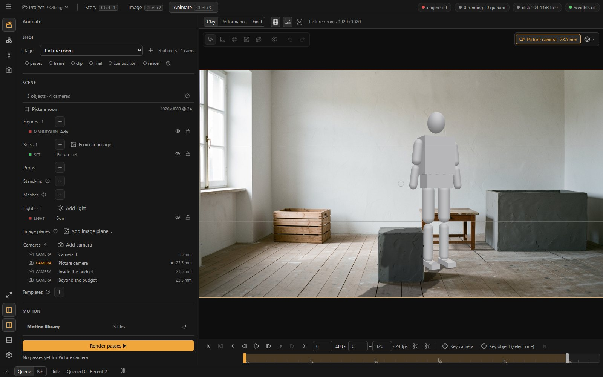 | 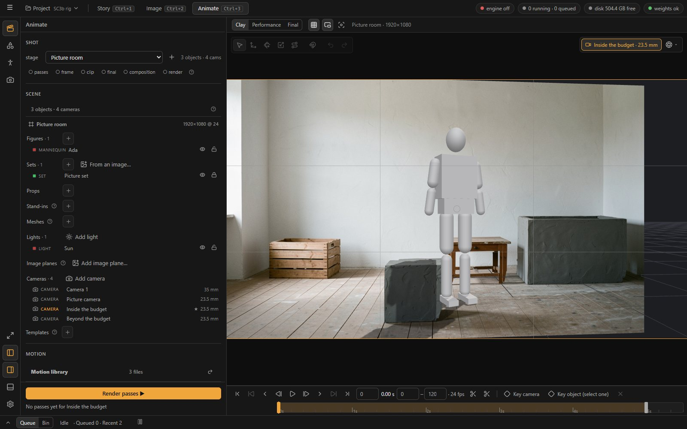 | 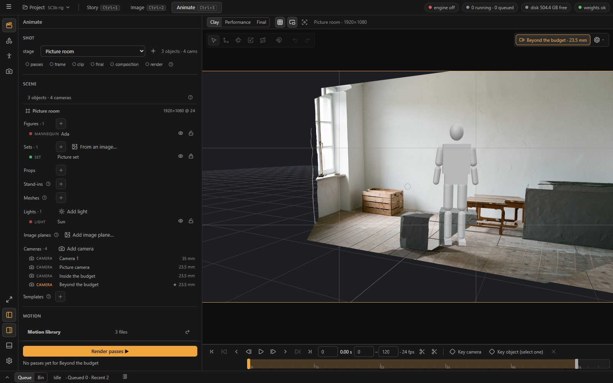 |
  | **The street, the free view** (the picture behind the relief) | **The street beyond the budget** | **The lens row** |
  | 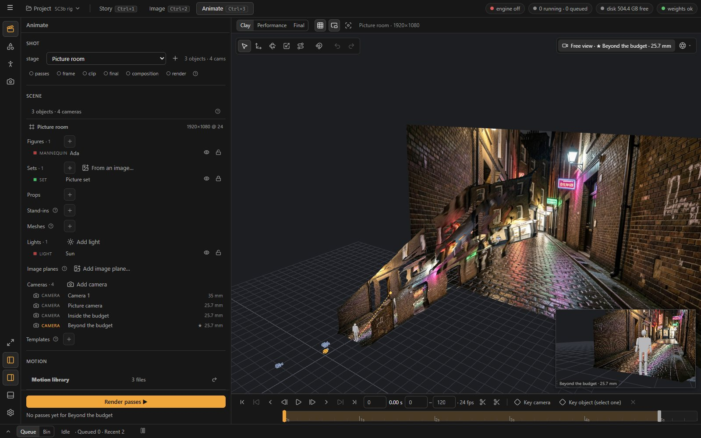 | 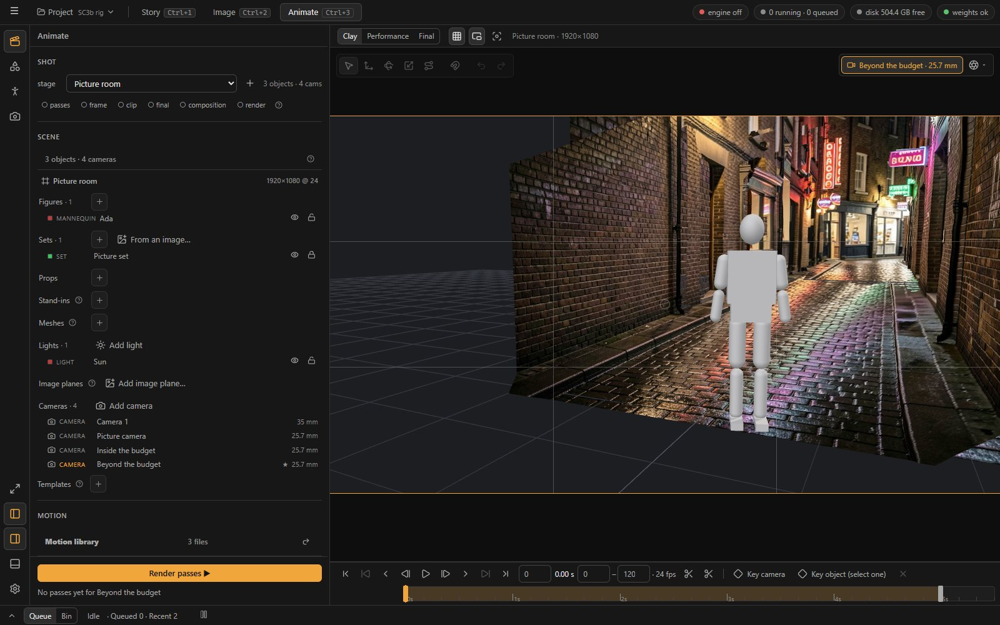 | 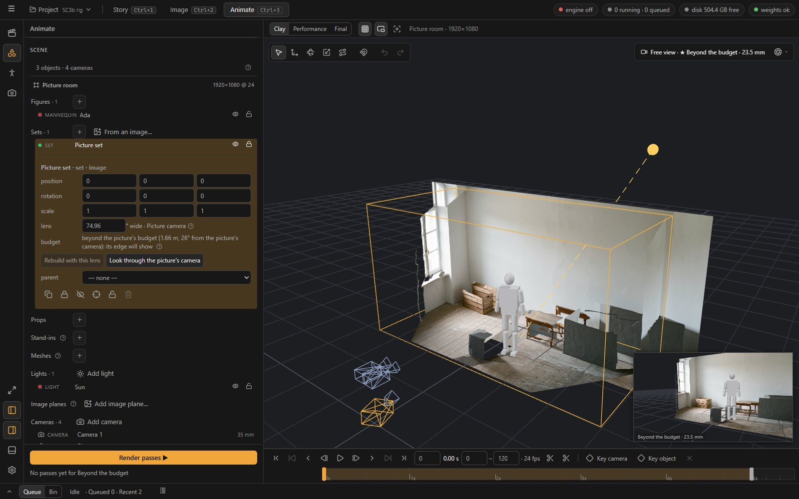 |

- **2026-10-23 14:51 — SC3c-2 and SC3c-3 built (D123): the things picked one by one, made into models where they stood.** The set's row lists
  its things (rename, remove), *Things in the picture…* and *Make the things ▶*. The sheet shows the picture large: a click finds a thing
  (SAM 3's point prompt on the set's own document; a right-click or *− Not it* marks what is not), the mask is drawn over the picture, *Keep
  as a thing* keeps it by name (a `mask` asset); kept things stay tinted. *Make* cleans the plate under them all (the Fill, the masks grown
  14 px), rebuilds the relief from the clean plate at the set's lens (the set's picture becomes the clean plate), then models each thing's
  cut-out with Pixal3D and stands it on the relief it was picked on (E30's footprint: the mask's front edge on the floor fitted to the
  picture's lowest rows, scaled to that edge's width). Rig (`engine/spikes/sc3c_rig.py`, the real engine): the room at 69.2°, four
  things found in 2–6 s each (the crate 2.0 %, the table 1.35 %, the small block 2.74 %, the big block 6.58 % of the picture), the clean
  plate 67 s, four Pixal3D models 267–370 s each, all four stood on the relief. Found: the fitted floor rises 0.12 m a metre into the room
  (the photograph's camera looked down ≈ 7°), so the things stand 0–0.19 m above the stage floor where the figures stand — levelling a
  picture set by its floor (the picture camera pitched to match) is the next step. *(SC3d, below, corrects the reading: the plain
  least-squares fit was pulled up by the walls and baseboards in those rows — the photograph's camera looked down ≈ 2°, not 7°.)*

  | Through the picture camera (the clean plate, the four models) | Beyond the budget (the models in 3D) | The things over the clean picture |
  | --- | --- | --- |
  | 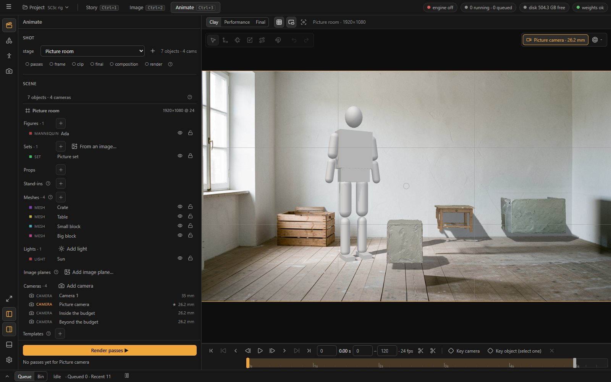 | 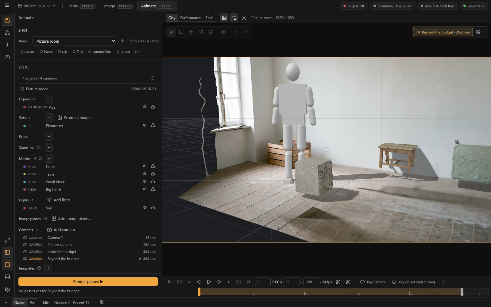 | 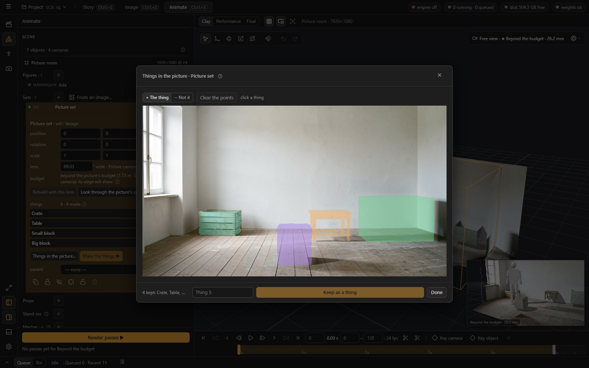 |

- **2026-10-23 15:55 — SC3d built: a picture set laid level by its floor; the things stand where, and as large as, they stood.** The floor is
  fitted to the picture's lowest rows the robust way (only near-level planes, then a band narrowed to the floor's own noise), so the
  walls, the baseboards and the things there no longer pull it; the set is turned about x and raised so that floor is the stage floor,
  and its picture camera pitched to match (the picture lines up through it as before). The set's row says *laid level · the camera
  1.2° down*, or *as it came* when the picture shows too little floor or a slope steeper than 25°. Two older errors went with it: a thing's
  footprint is read on the picture it was picked on and carried to the clean plate's relief (read on the clean plate it went back to
  the wall — the crate by 0.45 m), and a model is measured by its vertices, not by its box turned upright (that box made turned models
  float 4–7 cm and stand smaller and further back). Rig (`engine/spikes/sc3d_rig.py`, the real engine): the room at 69.2° laid level
  at −1.9° in 19 s; two things found in 4 and 2 s; the clean plate 52 s, its relief laid level at −1.21° in 4 s; the crate and the
  small block modelled in 329 and 308 s; the floor on the stage at 0.000, −0.002, 0.000 and +0.017 m from 2.5 to 5.5 m deep; each prop
  within 2 mm of the relief's floor under it, the crate at its own 0.80 m width.

  | Through the picture camera (the clean plate, the two models, figures near and deep) | From the side (the relief's floor meets the stage's) | The set's row |
  | --- | --- | --- |
  | 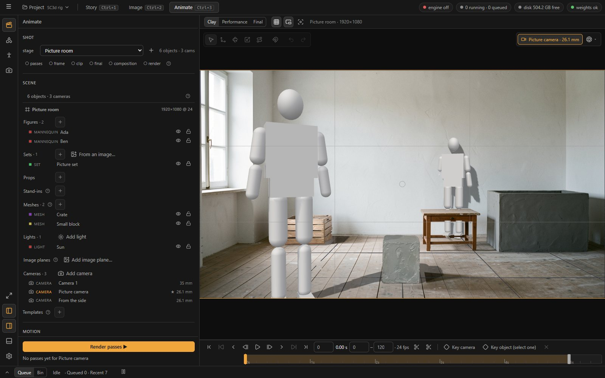 | 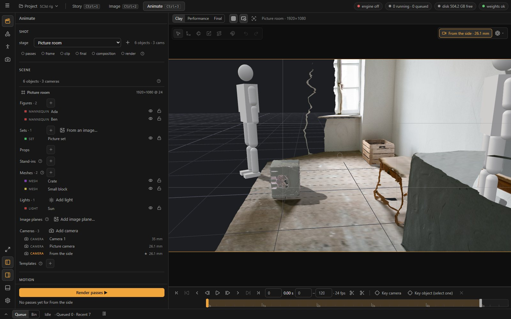 | 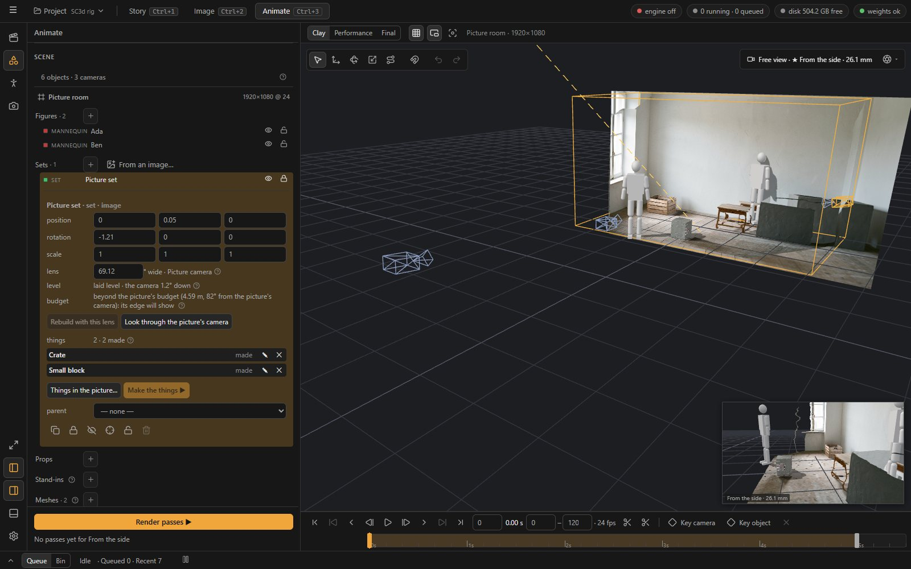 |

- **2026-10-23 17:18 — SC3e built: the final shot of a picture set takes its picture as the plate.** *Make the final shot…* on a stage with a
  picture set says so in its question, splits the layers and then renders the plate itself — the clean picture through its relief along the
  camera path, a few seconds in Stage — so the Final shot card shows the plate *done* with the picture as its thumbnail and *Assemble* (or
  *Perform*) as the next step; the plate's row keeps *Render the plate* (again). No Klein still is made for it (the Klein plate route
  refuses it with the reason). Three things the rig showed were fixed with it: the picture camera now looks at the distance whose depth
  pass holds the picture's depths (looking 1 m ahead, the depth passes of the room were black, and the assembly showed the crate half
  see-through), the picture behind the relief carries on past its edge (the final's 832×480 is a little taller than a 16:9 picture: 2.5 %
  of the first frame was black bands), and Stage waits for its models before it renders. Rig (`engine/spikes/sc3e_rig.py`, SC3d's room
  with its two models, the figures hidden, a dolly 0.45 m in and 0.15 m across over two seconds): 33 frames at 832×480 in four layers, the
  plate's first frame within 2.69 / 255 of the clean picture with no black, its last 18.6 from its first (the move); the shot assembled on
  the CPU in 9 s (conformed to 49 frames at 24 fps); ComfyUI never started.

  | The plate (top) and the assembled shot (below) at the start, the middle and the end of the dolly | The assembled shot in Animate | The card after the split |
  | --- | --- | --- |
  | 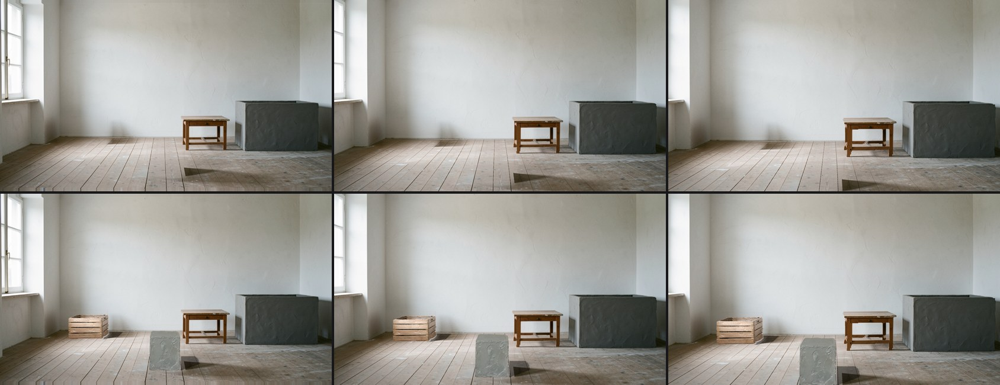 | 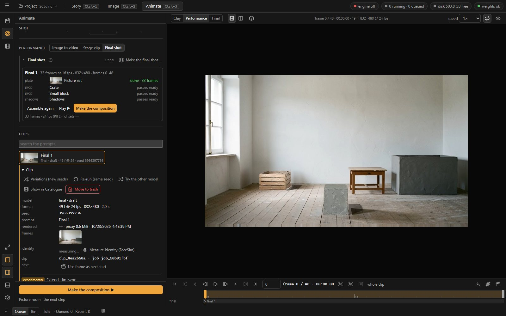 | 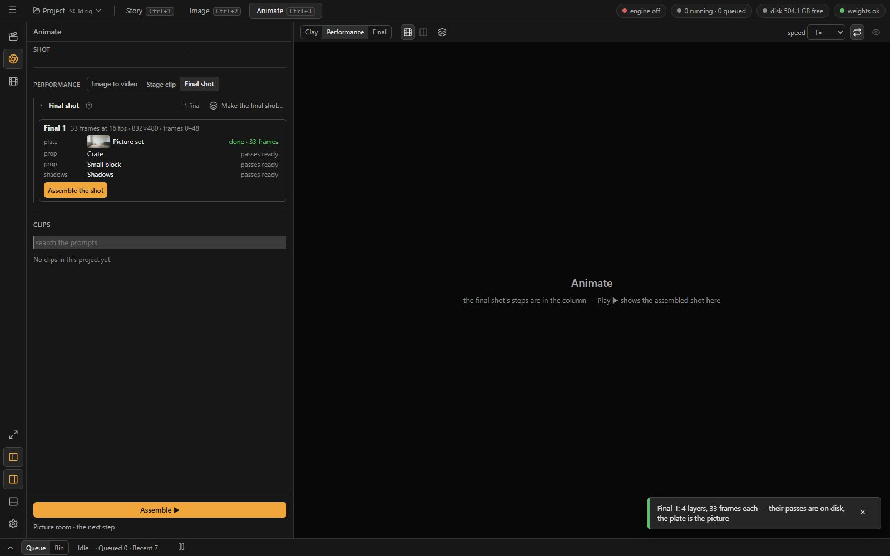 |

- **2026-10-23 18:09 — E31 run, D124 built: the clean takes the things' shadows.** E31 (`engine/spikes/e31_shadows.py`, `e31_seeds.py`, the real
  engine) on the room with its four things: SAM 3 asked for *shadow* (at 0.5 and 0.3, and as *shadow on the floor*) finds one shadow of the
  four — the small block's sharp wedge, 0.27 % of the picture — and none of the crate's, the table's or the big block's; the photometric
  search finds all four (0.23–0.96 % each, 1.4 s on the CPU for the four). Building it took four rules the picture taught: a shadow keeps
  its surface's colour (warmed by the floor's bounce: the block's 0.074 off the lit floor; the dark table 0.40 off the wall — no shadow); it
  is measured against the brighter of a near and a wide surround (inside the big block's shadow on the wall the near mean is the shadow
  itself); it lies below its thing; and one light casts every shadow to one side — the dark beside the things to their left and to their
  right is weighed, and the side the light comes from is shade, not shadow (the corner under the window). The clean plates: the things
  alone (SC3c) leave the wedge, the marks at the walls' foot and the big block's shadow on the right wall; with the shadows taken the room
  is clean — inside the shadows it is 2.03× as bright as the photograph was. The room's own dark patch in the front right stays (no picked
  thing casts it). Found too: the Fill can paint a thing back (once in five here — the crate, at the same seed that came out empty in the
  four reruns); E28b saw it. Built: `set_things.shadows_of`; *Make the things* cleans the things and their shadows grown 14 px; `GET
  …/things/shadows` gives the sheet the shadows the clean will take, shown violet.

  | The shadows the clean will take (violet) | The picture and its clean plate (D124 rig) | E31: the masks (SAM 3's shadow, red; the search, green) |
  | --- | --- | --- |
  | 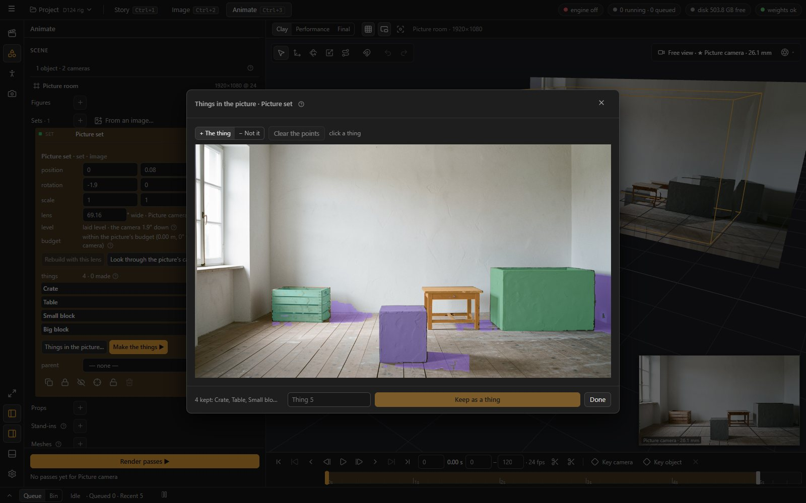 | 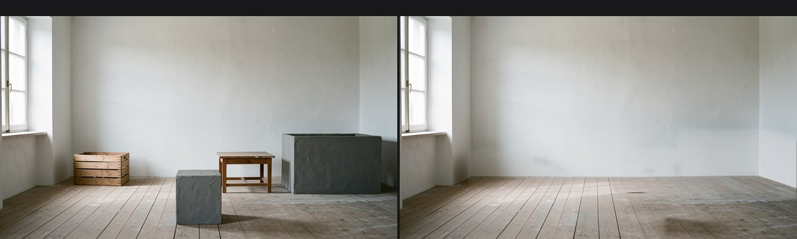 | 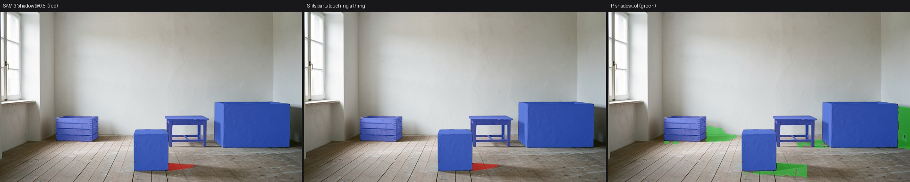 |

- **2026-10-23 18:27 — SC3f built: the made things follow their set; laid level sideways too.** A rebuild — *Rebuild with this lens*, or a clean
  plate's — stands every made thing again on the new relief, unless you moved its prop (each thing remembers the transform it was stood
  with; a moved prop stays where you put it, and the job's log says so). A thing is carried by its pixel: the point where it met the floor is
  found in the picture with the old relief's lens and cast with the new lens onto the new relief's floor — the height ratio SC3d used holds
  only for one lens. The set is also turned for a camera held askew (the floor's sideways slope), the picture camera rolled to match; the
  set's row says *laid level · the camera 2.8° down, 0.1° askew*. Rig (`engine/spikes/sc3f_rig.py`, SC3d's room with its crate and small
  block, the real engine): through the picture camera each prop's front edge lands on the pixel where its thing touched the floor in the
  picture — 13.7 and 5.8 px before; rebuilt at 62° (MoGe reads the room 4.3° down at that lens, not 1.2°) 14.3 and 6.0 px, both on the
  floor; the crate then moved by hand and the set rebuilt at 66°: the crate stays where it was put, the small block follows (5.7 px).

  | Through the picture camera after the 66° rebuild (the block followed; the crate where it was moved) | From the side | The set's row |
  | --- | --- | --- |
  | 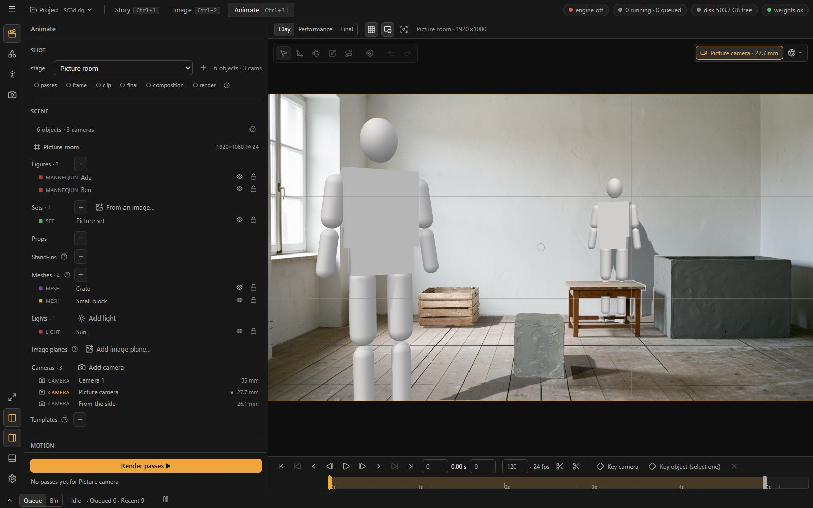 | 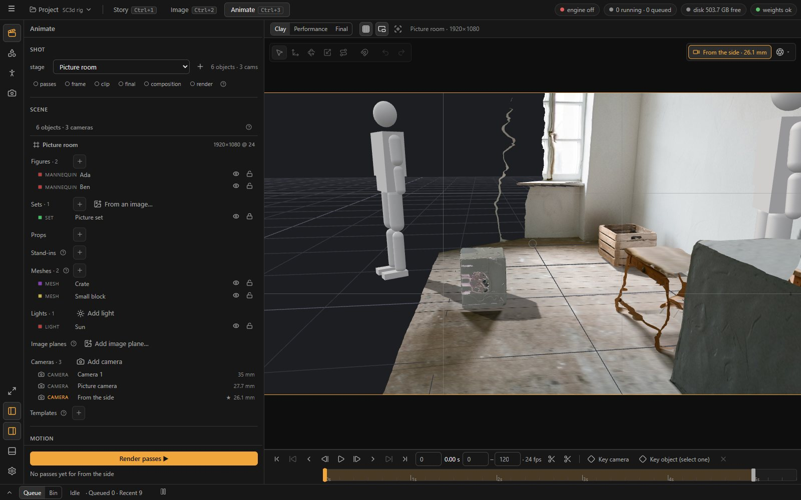 | 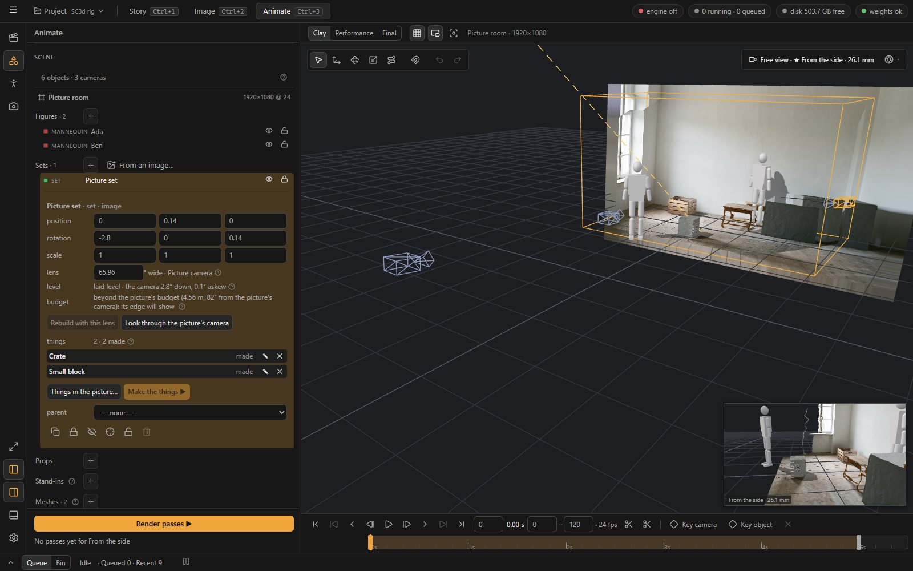 |

## 4 · Checks for the author

| Check | Your note |
| --- | --- |
| SC1: is the camera's body in the view the right thing to grab? Dragging moves camera and target together — right, or should the target have its own handle? | |
| SC1: the editor under the row — is anything you need still far from the thing? | |
| SC2: the + panel — which verbs are missing? Should the chosen preset's tile stay beside the +, or the + alone? | |
| E30 / SC3: how far should the camera move in an image set before it is a different shot? E30 says the picture's edge is the limit (10 % of the frame at truck ±0.5 m or pan ±5°) — is 10 % the bar, or should the edge be filled (a Klein outpaint of the plate before the relief)? | |
| E30: `engine/spikes/out/e30/sheet_room_props.jpg` — the clean room with the things as models: do they sit where the picture had them? `sheet_room_cut.jpg` and `sheet_room_sheet.jpg` — the picture with its things left in: the holes behind them (cut) or the skirts (sheet) — which do you prefer when a thing is not worth a model? | |
| One Scene: does the grouping (figures, sets, props, stand-ins, meshes, lights, planes, cameras) read better than the flat list did, or should a kind with nothing on the stage hide its header? | |
| SC3: *From an image…* on one of your own pictures of a place (a Klein still or an import): does the relief read as the place in the viewport, and does the Picture camera frame it as the picture did? Move the camera a little — is the budget line's warning early enough, or too fussy? | |
| SC3: should the things in the picture be cut out and modelled automatically (one job: the cut, the clean plate, the models), or stay a choice per thing? | 2026-10-23: chosen one by one (D123, SC3c) |
| SC3e: *Make the final shot…* on a picture set of yours, then *Assemble* — does the shot read as the place? The clean plate keeps a thing's own photographed shadow (the Fill takes the thing only): in the rig's shot it reads as the model's shadow — keep it, or take the shadow too when cleaning? | 2026-10-23: take it too (D124) |
| SC3f: correct the lens of one of your picture sets after its things are made — do they stay on their spots in the picture? Move one first: does it stay where you put it? | |
| D124: *Things in the picture…* on one of yours — are the violet shadows the ones each thing casts? Is anything shaded that is not a thing's shadow, or a shadow missed? | |
| SC3d: a picture set of yours taken looking up or down — do the figures stand on its floor through the picture camera and beside it? |  |
| SC3c: *Things in the picture…* on one of your pictures — does a click find the thing you meant? Are the models (Pixal3D from one view) close enough to stand in for the things, and do they stand where the things stood? | |
| SC3b: the figure's shadow on the relief (the room's picture-camera view) — dark enough, too dark? And the picture behind the street: does what shows through the sky and the seams read as the place, or should it be plain? | |
| E30: the lens — MoGe read 75° from the PNG and 69° from its JPEG. Should a set from an image ask you for the lens (the Klein recipe's camera when the picture is the app's own)? | 2026-10-23: ask before the first job (D123, SC3c-1) |
