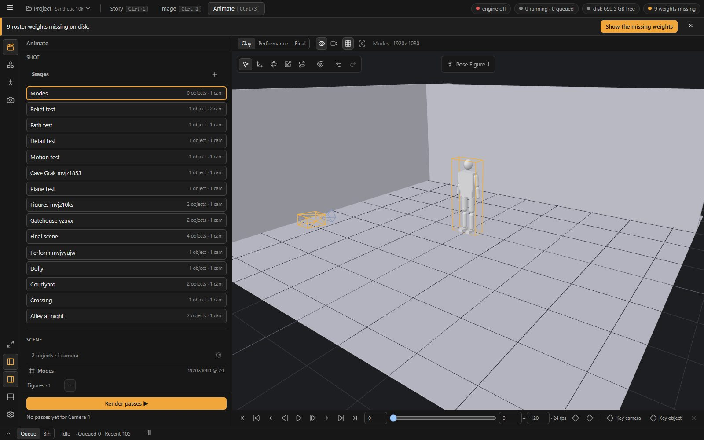
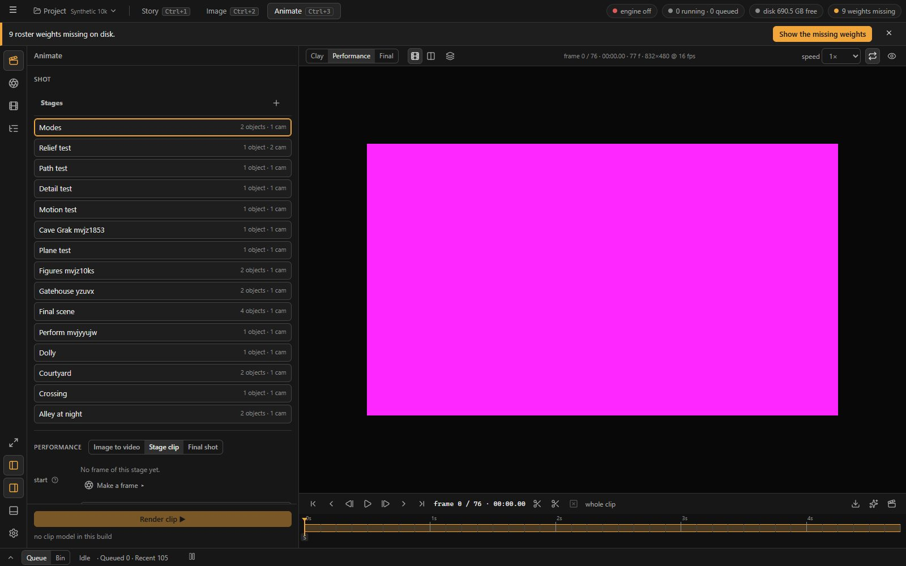
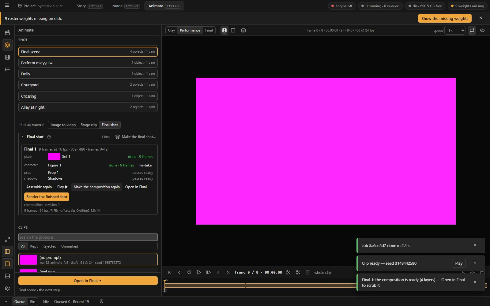
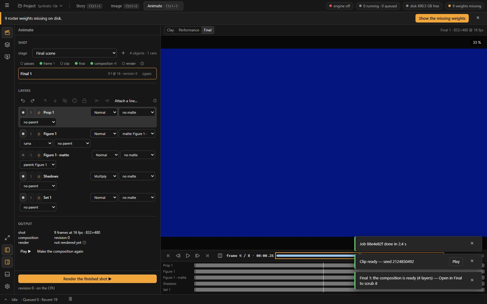
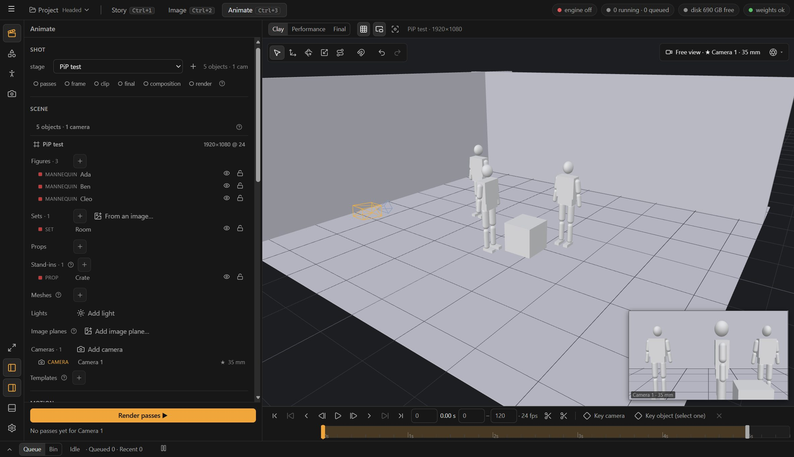
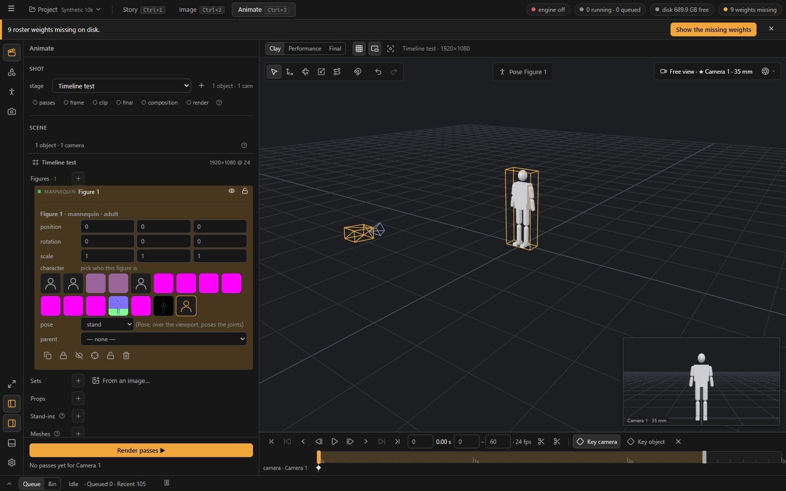

# 26 · Animate as three modes — ArtCraft's workflow discipline on loom2's pipeline

Status: **accepted as D121, 2026-10-22** (the author: "I like your proposal, let's start"); the build follows §7 without AW0's mock
(screenshots of the built app instead). Revised at the decision: each level is a suite under the Animate tab (§5.1 rule 1), and the
Performance cards keep the words of what they make (§5.3). The review as written follows. The author's question: *"Animate has a lot of built-in
functionality, but the UI is not coherent — we used to do a comparison with ArtCraft, where this is worked out much better; could we
create a similar workflow, with a cleaner UI?"* Read for it: the ArtCraft study (`.docs/artcraft` 00–08, 2026-10-08) and ArtCraft's 3D
stage as code (`F:\source\repos\artcraft\frontend\libs\components\pagescene`: `Stage3DBody`, `Controls3D`, `SceneModePill`, `Outliner`,
`ControlPanelSceneObject`, `CameraStatusPill`, `TimelineBar`, `RecordControls`) and its video page (`PageVideo/ImageToVideo`,
`DesktopCreatePageShell`); D90, D95, D114, D116, D119, D120; the UX0 wireframes W3–W5 (proto01_UI 03) and the inventory's Animate and
Stage rows; the suites as they are at 735adcb (`AnimateSuite.tsx`, `StageParts.tsx`, `FinalViewer.tsx`, `FinalEditor.tsx`,
`FinalPanel.tsx`, `stageCommands.ts`, `animateCommands.ts`, the journal's AN1 entries of 2026-10-18). A change of this shape is a decision
(13) written before any work; §8 lists what it would settle. ArtCraft's licence allows ideas, not files (artcraft 05 §7): nothing below
copies code.

## 1 · The short answer

**Yes — and most of it is already decided.** D95 asked for the shape ArtCraft's stage has: one place for one shot, a viewer with modes, one
timeline and one transport under it, no right Inspector. What AN1 built on 2026-10-18 **re-housed** five old rail tabs into one column; the
*mode discipline* that makes ArtCraft read as one tool was not built. The three levels still share one column that shows every section at
every level; there are three transports and three timelines; the foot's primary verb changes with a switch inside a section; the pipeline's
steps are spread over a tree, a strip and two sections; pose mode is a side effect of scrolling. Today's notes in 25 (the camera nowhere to
grab, the menus, the outliner, Scene = Outliner) are symptoms of that, and they are being patched one at a time.

ArtCraft's lesson for Animate is **not its feature set** — it has no passes, no layers from a scene, no final composition, FK posing only;
loom2 is ahead there (artcraft 07 §3) — and not its floating panels. It is four rules (§2): **a mode owns its chrome · the viewport carries
the mode's tools · one selected thing, one small editor · the output step is its own mode with almost nothing on screen.** On loom2's
pipeline that becomes **three modes = the three levels**, each with its own column sections, viewport chrome, timeline rows and foot verb,
and one Shot section that shows the pipeline's steps once (§5). About two weeks, no new GPU work (§7).

## 2 · ArtCraft's workflow, and why its UI reads as one tool

The workflow (artcraft 01 §2, 04 §2, the code at 3e5793b6):

| Step | Where | What the user does |
| --- | --- | --- |
| 1 · a picture | Create Image | prompt + references → image; the feed above, the prompt box fixed at the foot (`DesktopCreatePageShell`) |
| 2 · a scene | 3D Stage · **Build** | **+** opens the library modal (characters, objects, sets, animations, image planes); drag with a raycast drop; Move / Rotate / Scale; pose (FK pickers) in a *pose mode*; keys on a timeline; frame the render camera by focal length |
| 3 · the output | 3D Stage · **Record** | every editing control disappears; a read-only bar + **Capture** (a still) / **Record** (the timeline to video) |
| 4 · the hand-off | the completion modal → the Lightbox | the result lands in the library; the lightbox owns the verbs: *Edit on Canvas*, *Make Video*, *Video editor* |
| 5 · the moving picture | Create Video | the still → video, the same page shape as 1; or the video editor (an OpenCut port) |

What the 3D page has on screen — and only this (`Stage3DBody.tsx`):

| Place | Chrome | Shown when |
| --- | --- | --- |
| top centre | the mode pill **Build \| Record**; under it one toolbar: **+** (add) · Move / Rotate / Scale · World / Local | Build |
| top left | File (new / load / save scene), the outliner toggle, shortcuts | Build |
| top right | the **camera pill** (*Viewport* ↔ *Camera 2*: a click looks through) · the aspect menu | Build |
| left, centred | the **Scene** panel (the outliner): one row per object — icon, name, kind, look-through for cameras, skeleton, lock, eye | Build, toggled |
| bottom right | the **selected object's panel**: colour, location, rotation, scale, Delete; collapsible | an object is selected |
| bottom left | a **picture-in-picture of the render camera** while the free view is used; the model picker | Build |
| bottom centre | the **timeline bar**: play, time, scrubber, duration, a chevron that expands it to tracks | Build; collapsed unless the scene has keys |
| centre, over the figure | **Enter Pose Mode / Done** | a character is selected |
| bottom centre | the read-only bar + **Capture** / **Record** | Record |

The four rules that fall out of it:

1. **A mode owns its chrome.** Build and Record share the viewport and nothing else. Switching the pill changes what is on screen, what the
   keys do (`when(ctx)` gates) and what the viewport allows (Record locks the camera).
2. **The viewport carries the mode's tools.** The toolbar, the camera pill, the pose pill and the object panel sit on the picture; the
   outliner is a panel beside it, not a page of controls.
3. **One selected thing, one small editor.** Select an object and its panel appears; select nothing and it is gone. Pose mode is entered
   from the selected character, not from a tab.
4. **The output step is nearly empty.** Capture / Record, a scrubber, done. The result goes to the library, and the *library* offers the
   next steps, so every maker hands off the same way.

ArtCraft also makes the same mistakes D90 found in loom2 (three state paradigms, the 3D page serialised on every tab switch, no project
reopen in the video editor) — none of that is the model here.

## 3 · Animate today — eight findings

What is built (D95 → AN1, D114, D116, D119, D120): the Animate tab holds **two suites** — `stage` (the Clay level) and `animate` (the
Performance level, and the Final level as a flag in `compositionStore`). Both render one column, `AnimateColumn`, with eight sections —
**Shot · Scene · Motion · Camera · Performance · Clips · Layers · Selection** — a jump rail (`columnSync`), a foot (`AnimateFoot`) and the
level switch at the start of the strip (`AnimateLevels`).

| # | Finding | Where | Why it reads as incoherent |
| --- | --- | --- | --- |
| **F1** | **The column is the same at every level.** Scene, Motion and Camera (the 3D scene) show at Performance and Final; the *Image to video* form (model, length, presets) and Layers show at Clay; only Selection hides at Clay (SC1). | `AnimateColumnBody` | at every level the user scrolls past the other two levels' controls; the rail has eight stops at all times |
| **F2** | **Three transports, three timelines.** `stage.anim.*` (9 transport commands + keys and range), `anim.*` (7 + shuttle, in / out, pins, beats, the frames track) and `anim.final.*` (5 + the lanes) — three implementations under three viewers. D95 §4.1 asked for one playhead and one transport; AN1 step 3 moved them under the viewer but did not merge them. The W3 wireframe's timeline (a row per camera and figure with its motion clips and keys) was never built: Clay's is one scrubber with key diamonds. | `StageParts.Timeline`, `AnimateSuite.Timeline` / `Transport`, `FinalViewer.Lanes` | 21 transport commands where one set would do; the keys, the work area and the playhead mean different things per level |
| **F3** | **The pipeline's steps are in four places.** *Render passes* is in Scene (`PassesRow`), on the Frame step's title and in the foot's rig strip; the steps are a `<details>` tree inside Performance (*From the stage*), the rig strip above the primary (D116 U7, "the builder's reading"), the Final step's rows with their own verbs, and the finals' verbs again in a right-click menu. | `ShotTab`, `RigStrip`, `FinalSection`, `PassesRow` | the author asked where the rig belongs (21 §4b) because it has no one home |
| **F4** | **The mode is implicit.** Pose mode = "the Motion section is the active rail tab" (`useSuiteRail().active === 'motion'`): scrolling the column changes what a click in the viewport does. The Performance *route* (Image to video \| From the stage) is a segmented switch inside a section that swaps the foot's primary verb (*Animate ▶* ↔ *Render frame ▶*) and the whole foot (the rig strip appears). | `Viewport`, `RouteSwitch`, `AnimateFoot` | the primary action changes without the user having chosen a mode; the viewport's behaviour depends on scroll position |
| **F5** | **The selected thing's properties follow three patterns.** At Clay under its row (SC1); at Performance a *Selection* section with three folds; at Final under the layer's row (UX9 U1). | `SceneTab`, `ClipSelection`, `LayersSection` | the author's note 4 asked for "like the layers in Final" — Final's pattern is the right one and the other two are leftovers |
| **F6** | **The strip's player controls stay on screen at Final** — Player / Compare, the frames track, speed, loop, onion skin act on the clip player, which is not shown there; the Final viewer has a transport of its own under the frame. | `AnimateSuite.Strip` | controls that do nothing visible |
| **F7** | **The results land in four places.** Stills in the Frame step's strip (and Image's *From a stage*), clips in the Clips section (and the Bin), finals in the Final step's rows, takes on the Story shot; the Camera section repeats the camera row's verbs; the Shot section lists every stage of the project. | `ShotTab`, `ClipsTab`, `FinalSection`, `CamerasTab`, `StageList` | "where did it go, and how do I take it to the next step" is answered differently per step; ArtCraft answers it once (the library and its verbs) |
| **F8** | **The viewport lacks the camera's chrome.** The camera is an object now (SC1: a body, dragged and turned), but which camera the view looks through, its lens, and what the shot's camera sees while the free view is used are in the column (the Camera section, the row's editor) and in a corner tag. | `Viewport`, `CamerasTab` | note 2 of 25 ("nowhere to select it on the 3D view") was the first symptom |

**What is right and stays** (nothing below removes it): every action a registry command with a mouse placement (D32); the one column at
30 % with the jump rail (D90 / D95); the Bin with its pick and its right-click verbs (04 C1, 25 §3b); the preset panel behind the + (SC2);
the Scene outliner with the editor under the row and the camera as a body (SC1, One Scene); a set from an image (SC3); help behind a ?
(D116); the viewport kept alive (D69); stages as files; the passes, the layers and the composition, which ArtCraft does not have.

## 4 · The map: ArtCraft's workflow on loom2

| ArtCraft | loom2 today | In this proposal |
| --- | --- | --- |
| Create Image | Image · Make (one column, results grid) | unchanged |
| 3D Stage · Build | Animate · Clay: the column's Scene · Motion · Camera + the viewport | **Clay mode**: the same three sections only; the viewport with the gizmo bar, the camera pill, the pose pill; the timeline with a row per camera and figure |
| the library modal (+) | the outliner's + per kind (SC2), the Bin, drops on the viewport | unchanged (better than the modal: mouse-first, in place) |
| Capture (a still) | Image · *From a stage*; the Frame step in Animate › Performance | **the Shot stepper's *Frame* step** → Image › From a stage, as D95 said; the Frame step leaves Animate's column |
| Record (the timeline to video) | the Clip step (IC-LoRA / Wan Animate), the Final shot's layers (PS5), *Image to video* | **Performance mode**: the method cards (Image to video · Pose-driven · Depth-guided), the takes under Shot, the batches on the timeline rows |
| the Lightbox's verbs | the loupe's bar (D71), the Bin's right-click, *Go to origin*, the Shot's takes | unchanged; the takes under Shot gain the editor under the row (F5) |
| Video editor | Animate · Final (EffectCraft) | **Final mode**: as built (AE2–AE4), with the one timeline's rows and the one transport |
| Record's read-only bar | — | the Final mode's foot: *Render the finished shot ▶* and nothing else |

## 5 · The proposal: three modes

### 5.1 · The rules

1. **A level is a mode, and a mode owns its chrome.** The level switch (Clay · Performance · Final, the segmented control at the strip's
   start — ArtCraft's pill) changes together: the column's sections and the rail's stops, the strip, the viewport's chrome, the timeline's
   rows, the foot's primary. *(D121:)* each level is a suite under the Animate tab — `stage` (Clay), `animate` (Performance) and a new
   `final` (Final) — as Image holds `generate` and `edit` as Make and Edit: the frame already gives a suite its own rail, column, strip,
   viewer and foot. The panel's width stays one for the tab. The viewport (three.js) and the player stay mounted and hidden across levels
   (D69, as Edit does), so a switch costs a frame.
2. **One Shot section at every level**, at the top: the For chip, the shot's stage (a picker: the stage this shot uses; *Open another…*),
   and **the stepper** — the pipeline's steps in one row with a state each (§5.5). It replaces the rig strip, `PassesRow`, the Step tree's
   title verbs and the finals' duplicate menu. D96's recipe graph (RC1) is its long form later; the stepper is the linear view.
3. **One timeline, one transport.** One `Timeline` component: a ruler, the work area (the range), the playhead, **rows** — the rows differ by
   level (§5.2–5.4); one command set `anim.*` (play, step, ±10, first / last, in / out, key, remove key) whose `run` reads the level. The
   three sets collapse into one (21 → ≈ 10 commands); the one key set of D99 stays as it is.
4. **One selected thing, one editor, under its row.** Scene at Clay, the takes at Performance, Layers at Final — the Final pattern (UX9 U1)
   everywhere. The Selection section goes; D95's "on trial" ends with the trial's answer.
5. **The viewport carries the mode's tools** — the gizmo bar (exists), the **camera pill**, the **pose pill**, the **PiP** of the shot's camera
   (§5.6); the strip keeps only what is about the view (guides, frame all, Compare, the frames track).
6. **Every result lands as a take under Shot and in the Bin** — stills, clips, finals, renders — and the take's row (its editor under it)
   carries keep / reject, the facts, the harvested frames, the lineage and *Open in ▸*. The Clips section goes (D90 §9 said so; the Bin's
   clip filter does the project-wide list).

### 5.2 · Clay — compose the scene and its motion

```
┌ column ───────────────────────┬ viewer ──────────────────────────────────────────────────┐
│ SHOT  For: Shot 12 · v3  ✕    │ [Clay | Performance | Final]      guides ▢  frame all ⌖   │
│  stage: Studio ▾  ·  stepper: │ ┌ gizmo bar ───────────┐          ┌ camera pill ──────────┐│
│  passes ● frame ○ clip ○ …    │ │ ↖ ✥ ⟳ ⤢ ⟋ · snap · ↶ ↷│          │ ★ cam 2 · 35 mm  ▾ ◉ ││
│ SCENE (One Scene, SC1 / SC2)  │ └──────────────────────┘          └──────────────────────┘│
│  the stage · figures + · sets │                                                           │
│  + · props + · … · cameras +  │                 the viewport (three.js)                   │
│  the selected row's editor    │                                                           │
│ MOTION (for the selected      │      ┌ Pose · Done ┐  (a figure is selected)             │
│  figure)  library · poses +   │      └─────────────┘                          ┌ PiP ────┐ │
│  · joint                      │                                               │ cam 2   │ │
│ CAMERA  the active camera:    │                                               └─────────┘ │
│  lens · Set from view · Key   ├───────────────────────────────────────────────────────────┤
│                               │ ⏮ ◀ ▶ ▶ ⏭  0048 / 0240 · 24 fps        [ ] work area ◆ key│
│                               │ cam 2   ◆────────────────◆                                │
│                               │ Mara    [Walk_Loop        ][Turn][Point        ]  ◆       │
│                               │ Ines          [Sitting_Enter      ] ◆     ◆               │
├───────────────────────────────┤ Cup     parented to Ines · hand_r                         │
│ Render passes ▶   ≈ 2 s       │                                                           │
└───────────────────────────────┴───────────────────────────────────────────────────────────┘
```

- **Column:** Shot · Scene · Motion · Camera — four stops on the rail. Motion shows the selected figure's library, poses and joint; with no
  figure selected it says so in a line (D116) and the library stays usable.
- **Viewport:** the gizmo bar as today; the **camera pill** top right (§5.6); the **pose pill** over the selected figure — *Pose* enters pose
  mode (the pickers), *Done* leaves it (F4: no longer the Motion tab). Right-click menus as today.
- **Timeline:** W3's rows — the active camera's keys, each figure's motion clips (CA1) and keys, parented props, the plate when one exists;
  the work area is the clip's range; **collapsed to the bar** (transport, playhead, range) while nothing is keyed, as ArtCraft's.
- **Foot:** *Render passes ▶* with its estimate. The frame (a still) is made in Image › From a stage — the stepper's *Frame* step jumps there
  (D95 settled this; today the Frame step is still in Animate's column).

### 5.3 · Performance — make the moving picture

```
┌ column ───────────────────────┬ viewer ──────────────────────────────────────────────────┐
│ SHOT  … stepper: passes ● frame ● clip ◐ …                                               │
│ PERFORMANCE                   │ [Clay | Performance | Final]   Player | Compare · frames  │
│  [Image to video][Pose-driven]│                                                           │
│  [Depth-guided]               │                  the clip, or Clay | clip side by side    │
│  the card's fields: model ·   │                                                           │
│  preset · length · seed ·     │                                                           │
│  count · Advanced ▸           │                                                           │
│ TAKES                         ├───────────────────────────────────────────────────────────┤
│  ▶ take 3 · Wan Animate · ✓   │ ⏮ ◀ ▶ ▶ ⏭  0096 / 0240          in · out · ♦ beats · ▼ pins│
│    the editor under the row:  │ Mara · layer   [B1 ✓     ][B2 rendering ][B3    ][B4    ]  │
│    keep · reject · facts ·    │ Ines · layer   [B1       ][B2           ][B3    ][B4    ]  │
│    frames · lineage · Open in │ Plate          [projection · fresh                      ]  │
├───────────────────────────────┤                                                           │
│ Run ▶   Queue   ≈ 17 min      │                                                           │
└───────────────────────────────┴───────────────────────────────────────────────────────────┘
```

- **Column:** Shot · Performance · Takes — three stops. The **method cards** replace the route switch: *Image to video* (today's form, its
  Model / Length / Presets as the card's fields with an Advanced fold — UX0 #11), *Pose-driven* (Wan Animate: the final shot's layers of
  PS5, Move / Replace, the batches), *Depth-guided* (IC-LoRA with the guide sequence). The card chosen is the method; the foot's primary is
  always **Run ▶** (UX0 A13) — no more *Animate ▶* ↔ *Render frame ▶*.
  *(D121:)* the cards are **Image to video · Stage clip · Final shot** — named after what they make: the stage clip carries both the
  depth-guided IC-LoRA and the one-figure Wan Animate (CN4), the final shot is the layered, pose-driven route (PS5). Each card's foot says
  its own word: *Animate ▶*, *Render clip ▶*, the final shot's next step (*Make the final shot…*, *Make the plate*, *Perform <name>*,
  *Assemble*, *Make the composition*, *Open in Final*).
- **Takes:** the clips and finals of this shot, newest first, each a row with keep / reject and its editor under it (the facts, the frames,
  the lineage, Extend and lip-sync in the experimental fold, *Open in ▸*). The project-wide list is the Bin filtered to clips.
- **Viewer:** the player, or Compare (Clay | clip, or two takes); onion skin and speed on the transport, not the strip (F6).
- **Timeline:** the clip's scrubber with in / out, beats and pins; a row per layer with its batches (W4) when the method is Pose-driven; the
  frames track toggled.

### 5.4 · Final — finish the composition

As built (AE1–AE4), with three changes: the column is **Shot · Layers · Output** (three stops; the Passes part stays under the layer's
row); the transport and the lanes are the one timeline's rows (rule 3) instead of `FinalViewer`'s own; the strip shows the viewer's own
controls only (the quality chip, Before, Compare) — the player's go. The foot: **Render the finished shot ▶** and its state. ArtCraft's
Record mode is the model: nearly nothing on screen but the picture, the lanes and the verb.

### 5.5 · The Shot section: the stepper

```
SHOT   For: Shot 12 · v3  ✕  ← back        stage  Studio ▾ (2 cams · 4 figures)   ?
       passes ●  ·  frame ●  ·  sequence ○  ·  clip ◐ 2/4  ·  final ○  ·  composition ○  ·  render ○
```

One row, every step of the pipeline (01 §2; D96's recipe steps) with a state dot — fresh · stale · running n/m · none — and a tooltip with
the step's words (D116). **A click goes to the step**: *passes* → Clay with the foot's verb; *frame* → Image › From a stage for this
stage and camera; *sequence* and *clip* → Performance with the card chosen; *final* → Performance's Pose-driven card (the layers); *composition*
and *render* → Final. The step's verb is in that mode's foot — one primary per mode, never two. A stale step is marked, as the graph (W6)
will do; *Run stale* comes with RC1. This replaces: the rig strip (`RigStrip`), `PassesRow`, the `<details>` tree's title verbs, the
finals' right-click duplicates and the stage list (`StageList` becomes the picker).

### 5.6 · The viewport's camera chrome (from ArtCraft's camera pill and PiP)

- **The camera pill** (top right of the viewport): *Free view* ↔ *★ cam 2 · 35 mm*. A click toggles the look-through (`stage.view.camera`);
  the ▾ lists the cameras (pick one: it becomes the active camera and the selection, its row opens in Scene); the lens is editable in the
  pill's menu (the 24 · 35 · 50 · 85 presets). The Camera section keeps *Set from view*, *Key camera*, *Make a Shot from this camera…* and
  the guides, and loses the duplicate look-through and the name button.
- **The PiP:** while the free view is used, a small picture-in-picture of the active camera's view (bottom right of the viewport; a second
  render of the same scene into a small canvas at ≤ 320 px, toggled, hidden while the viewport is hidden). What ArtCraft's
  `PreviewEngineCamera` does: you move a figure in the free view and see the shot change. Cheap in three.js; measured in AW4.
- **The lens readout:** while the camera's body is turned or its lens dragged, the focal length in large type over the viewport, as
  ArtCraft's `FocalLengthDisplay` — gone when the drag ends.

### 5.7 · What goes or folds

| Today | Becomes |
| --- | --- |
| the `stage` suite as a second suite under the Animate tab (`sharedKeyOf`, `ui.animateLast`) | one suite, `level` in the store; `?suite=stage` an alias |
| the Selection section (Performance) and `ClipSelection`'s three folds | the take's editor under its row |
| the Clips section | Takes under Shot (this shot's); the Bin's clip filter (the project's) |
| the Performance route switch and the foot that follows it | the method cards; one *Run ▶* |
| Model · Length & size · Presets as sub-sections | the card's fields, Advanced folded, the saved panels behind a + (SC2, exists) |
| the rig strip, `PassesRow`, the Step tree's title verbs, the finals' menu duplicates | the stepper (§5.5) |
| `StageList` (every stage of the project) | the shot's stage picker with *Open another…* |
| the Frame step inside Animate's Performance | the stepper's *frame* → Image › From a stage (D95) |
| three transports and timelines | one `Timeline` with rows per level; `anim.*` commands only |
| pose mode = the Motion rail tab | the pose pill on the selected figure |
| the strip's player controls at every level | per level: view controls only; the player's on the transport |
| the Camera section's look-through and name button | the camera pill |

Nothing in the function inventory (proto01_UI 03, rows A1–A33, S1–S28, NEW-A/S) loses its home: each row keeps a place in a mode; AW0
lists them.

## 6 · Not copied from ArtCraft

| ArtCraft | Why not |
| --- | --- |
| panels floating over the viewport for the outliner and the object's properties | 07 §1: every control has a named home; the column is loom2's; the viewport carries only the mode's *tools* |
| the library as a modal (characters · objects · sets · animations) | the outliner's + with the preset panel and the Bin's pick do it in place, mouse-first (SC2, 25 §3b) |
| Capture → a completion modal → the cloud lightbox | the result is a take under Shot and a Bin tile; *Open in ▸* and *Go to origin* exist (D66, D71) |
| a 3D page serialised and rebuilt on every tab switch | D69 keep-alive; the proposal keeps both viewers mounted across levels |
| FK only, Mixamo names, no control passes | loom2's IK, the Detailed level (CA1), the passes and layers stay |
| `when(ctx)` key gates with user presets | D72's remappable registry is enough; the one key set of D99 stays |

## 7 · The build

Each wave: Vitest, the command audit, the e2e smoke under both variants, a journal entry; AW4 a headed check (WebGL). No new engine or
model work: the only GPU runs are the existing rig checks that AN1 re-ran (the stage still, the clip, CN4, PS5), once at the end.

| Wave | Content | Days | Acceptance |
| --- | --- | --- | --- |
| **AW0 · the inventory and the mock** | every Animate and Stage row of proto01_UI 03 §3–§4 re-homed per mode; an HTML mock of the three modes at 1440 × 900 and 1280 × 800 (as UX0 did), screenshots for the author; the author's corrections | 1 | every row has a mode and a place; the author signs the mock |
| **AW1 · a level is a mode** | one suite with `level`; the column's sections, the rail's stops, the strip, the viewport chrome and the foot per level; both viewers kept alive across levels; the pose pill; the method cards and one *Run ▶*; `?suite=stage` alias; the e2e helpers (`openSection`, `stageRoute`, `openAnimate`) rewritten | 2–3 | the three levels show only their own sections; the command audit clean; e2e green (the ≈ 20 Stage / Animate scenarios) |
| **AW2 · one timeline, one transport** | the `Timeline` component with rows (the track model a pure module with Vitest); Clay's rows (camera keys, each figure's motion clips and keys, parented props, the plate), Performance's (the clip, in / out, beats, pins, the layers' batches), Final's (the lanes); the bar when nothing is keyed; `anim.*` as the one transport, `stage.anim.*` and `anim.final.*` retired; the one key set kept | 3–4 | keys set, moved and removed from the rows at Clay; in / out at Performance; a lane trimmed at Final — all through one component; e2e (the clip, the final shot) green |
| **AW3 · the Shot section and the takes** | the stepper with its states and jumps; the stage picker; Takes under Shot with the editor under the row (keep / reject, facts, frames, lineage, experimental, Open in ▸); the Clips and Selection sections, the rig strip, `PassesRow`, the step tree's verbs and the finals' menu duplicates removed | 2–3 | every step reachable from the stepper by mouse; no verb in two sections; the e2e final-shot and Animate scenarios green |
| **AW4 · the viewport's camera chrome** | the camera pill, the lens readout, the PiP (a second render into a small canvas; measured: frame time with and without it on the rig's room stage) | 1–2 | the headed check shows the PiP following a drag; the viewport's frame time within 20 % of today's |
| **UX9 · the click-through** | the three canonical paths (UX0 §2: P2 the shot from clay to the cut, P3 the quick shot, P5 change one motion and re-take) counted again in the built app; the author's notes; fixes | 1 | the register fixed |

**Total ≈ 10–14 working days.** Order: AW0 → AW1 → AW3 → AW2 → AW4 → UX9 (AW3 before AW2 so the stepper exists when the timeline's rows
are built; AW4 last, it is the only wave with a measurement).

**Risks.** The e2e smoke drives the Clay level through the column's sections and the route switch (`openSection`, `stageRoute`); AW1 changes
that navigation, so those scenarios are rewritten, not patched. Two viewers kept alive in one suite (three.js and the Mediabunny player)
share the release policy of D69 — the viewport already does. The PiP is a second render each frame while the free view moves: if it costs
more than the bar, it becomes a snapshot refreshed on drag end (ArtCraft redraws it live).

## 8 · What a decision would settle

1. **A level is a mode with its own column, chrome, timeline rows and foot** — a revision of D95 §4.2's "the same column at both levels" and
   of AN1's shared column; the Clay · Performance · Final switch is the mode pill.
2. **The Selection section goes**; the editor under the row is the one pattern (D95's trial answered as D119 and UX9 U1 already did).
3. **The Clips section goes** into Takes under Shot and the Bin's clip filter (D90 §9, kept from AN1 step 4 "for now").
4. **One transport, one timeline** with rows per level (D95 §4.1 confirmed and built); the three command sets become one.
5. **The method cards replace the route switch**, and the foot has one primary per mode (*Render passes ▶* · *Run ▶* · *Render the finished
   shot ▶*); the Frame step leaves Animate for Image › From a stage (D95).
6. **The stepper is the Shot section's one view of the pipeline**, the rig strip's and the step tree's replacement (D116 U6–U7 revised), the
   linear stand-in for RC1's graph.
7. **Pose mode by the pose pill on the selected figure**, not by the Motion rail tab.
8. **The camera pill and the PiP** on the viewport (new; AW4 measures the PiP).

## 9 · Checks for the author

| Check | Your note |
| --- | --- |
| The three modes (§5.2–5.4): is Clay · Performance · Final the right cut, or should *Performance* be split (a mode for the quick image-to-video shot, a mode for the clay route)? | |
| The stepper (§5.5): one row of states and jumps at the top of every mode — is that the rig you asked for in 21 §4b, or do you want the verbs there too (two primaries on screen)? | |
| The Frame step leaving Animate for Image › From a stage (D95): still right, now that the stepper jumps there in one click? | |
| The takes under Shot with the editor under the row, and the Clips section gone: do you lose anything you use in the Clips list (search, the state filter) that the Bin's clip filter does not give? | |
| The timeline's rows at Clay (a row per camera and figure, the motion clips as bars): W3 as drawn, or fewer rows? Collapsed to a bar while nothing is keyed — right? | |
| The pose pill over the selected figure instead of the Motion tab: right? Should pose mode also start from the figure's right-click? | |
| The camera pill and the PiP (§5.6): is a live picture-in-picture of the shot's camera worth a second render, or a snapshot on drag end? | |
| Names: keep *Performance* for the middle mode, or *Perform* / *Clip*? *Run ▶* as the one primary there (UX0 A13), or the method's own word? | |
| Order (§7): the mock first (AW0, one day), or straight to AW1 on this document? | |

## 10 · Status

- **2026-10-22 22:06 — AW1 built: a level is a mode** (journal of that time). Clay, Performance and Final are three suites under the Animate
  tab, each with its own rail, column, strip, viewer and foot; the pose pill; the cards Image to video · Stage clip · Final shot with their
  own verbs in the foot; the Frame step in Image › From a stage; the Final level's Shot (the finals to open) and Output sections. e2e 51/51
  under both variants.

  | Clay | Performance · Stage clip |
  | --- | --- |
  |  |  |
  | **Performance · Final shot** | **Final** |
  |  |  |

- **2026-10-22 — AW3 built: the Shot head** (journal of the same evening). The stage picker and the stepper head every level (the stage's
  cards only, at Performance); a step's dot is its state and a click opens the level and card where its verb is; one poll for the finals;
  the clip's editor under its row in Clips, the Selection section gone. The screenshots above show it. e2e 51/51 under both variants.
- **2026-10-22 — AW2 built: one timeline, one transport** (journal of the same evening). Each level registers its transport; one command set
  (play, step, ±10, first / last, in / out, previous / next key) runs the level on screen — 26 transport commands down to 12, the keys
  unchanged. One Timeline component under every viewer: Clay's range and its camera's and objects' keys on rows (drag a key, right-click to
  remove it, a motion clip's bake as a bar), Performance's in / out and the clip's markers, Final's lanes. e2e 52/52 under both variants.
- **2026-10-22 23:08 — AW4 built: the viewport's camera chrome** (journal of that time). The camera pill (look through, pick a camera, set the
  lens), the lens readout, the picture-in-picture of the active camera in the free view (on by default; +0.078 ms a frame, +15 %, measured in
  a visible Edge on the rig). The chrome reads the camera at the playhead (a keyed camera's lens is its key's).

  | Clay with the PiP (the rig, a visible window) | The timeline at Clay (AW2) |
  | --- | --- |
  |  |  |

- **2026-10-22 23:31 — each mode's keys, one list** (journal of that time). `?` and Ctrl+K took the suite's id for a command scope: at Final
  they listed no Animate command, at Clay not the one transport. A mode now registers its *reach* (the scopes and which of their commands
  its keys answer with); its key hook, the help overlay, the palette and the audit read it. The stage's own mode keys (2, 3) retired for the
  shared `anim.level.*`; the help's gestures follow the modes; a key dragged on Clay's timeline has its right-click twin (*Move this key to
  the playhead*).
- **Owed:** the author's click-through (UX9) — [27 · Trying Animate's three modes](27-testing-modes.md). The other checks of §9 are in it.

