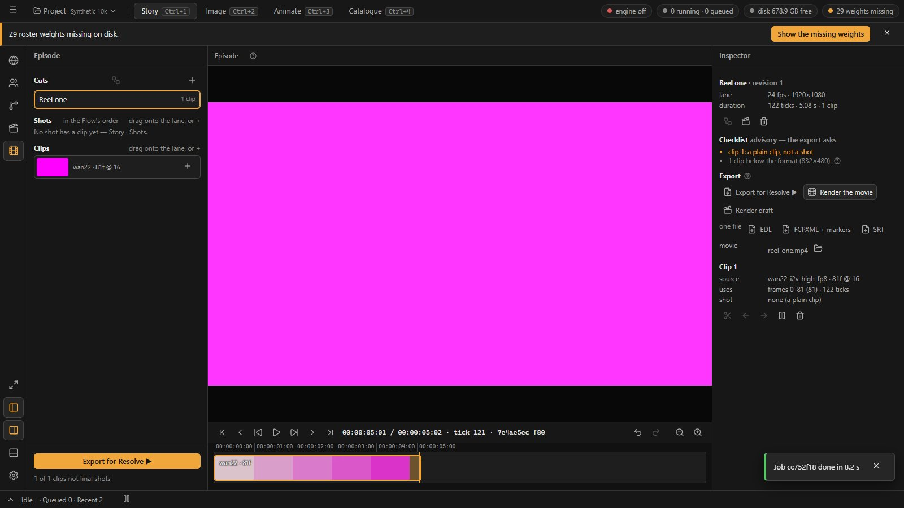
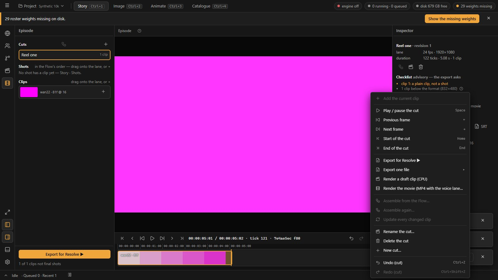

# 29 · RC3's rest — the movie render

Status: **built, 2026-10-24** (journal 06:39; §5). D96 accepted RC3 on 2026-10-18 ([05](05-flow-nodes-as-shot-recipes.md) §6: "each Shot's used
take placed on a video lane in route order, one cut per route; the lane follows a Shot's new take, with a *changed* mark; **the movie
render as a backend job**"). D125's SP6 built all of it but the render (proto01_UIcomp 04 §8: "SP6 is RC3 without the movie render"),
and 04 §7 lists what the episode still lacks to be delivered by loom2 itself.

## 1. What the Episode renders today

*Render draft* (P17, D83) is a CPU job: every lane tick from the clips' PNG masters, dissolves blended, a clip at another rate mapped by
the nearest frame (no conform), at the first clip's size, **silent**; the result is a clip in the Clips bin. The spoken lines exist only in
the exports (the FCPXML's and the EDL's audio lane).

## 2. The movie

**Render the movie ▶** (the Episode's Inspector, the lane's right-click) — the same CPU job with `movie: true`:

| | Draft | Movie |
| --- | --- | --- |
| Frames | the PNG masters | the same |
| A clip at 16 fps on a 24 fps lane | nearest frame | **RIFE v4.6 to 24** (D27, D102: F16 then RIFE) when the local tool is there, else the nearest frame (the job's log says which) |
| Size | the first clip's | **the cut's** (the project format, D18), each clip fitted and letterboxed (no crop) |
| Sound | none | **the voice lane**: each spoken line where the exports place it (laid evenly across its clip, 04 §7 keeps that rule for now), mixed to one track |
| Result | a clip (PNG master, proxy) in the Clips bin | **an MP4** (H.264 + AAC) in the cut's folder beside the Resolve export (`timelines/<id>/<cut>/<cut>.mp4`) and a Catalogue video with lineage to every clip |

The movie is not a clip: clips are silent frame sequences the lane and the players read. It is the finished file, played by any player and
by the Catalogue.

## 3. Not in it

- **A delivery size above the shots'** (04 §7: a Full re-render route or a video upscale — a model question first); the movie scales up
  with Lanczos.
- **Voice timing by the line's audio length** and **subtitles burned in** (the SRT stays a sidecar).
- **The cut editor** (RC4: FilmCraft studied first).

## 4. Checks

- pytest: a lane with a 24 fps clip, a 16 fps clip and a dissolve, a voiced line on the first — the MP4's size is the cut's, its length
  the lane's, the line's audio sits where the exports place it and silence after it; the Catalogue video's lineage.
- e2e: *Render the movie* from the Inspector on the fake engine; the job ends with the file named after the cut.

## 5. As built

- `Render.movie` and `run_movie` (engine/finishers.py); the route takes `{movie}`; the job's result: `path`, `file` (absolute), `lines`,
  `revision`, `asset_ids`. The Catalogue holds a copy, so deleting the cut's folder (the Resolve export's delete) keeps it.
- The client: *Render the movie* (`story.episode.renderMovie`) in the Inspector and the lane's right-click; the Inspector's **movie** row
  (the newest movie job of the cut: rendering, the file with *the cut changed since*, *Reveal the movie in its folder*, failed).
- RIFE runs inside the CPU job as the final's assembly does (one job at a time on the queue, D97); the test fakes it.
- On the A1 rig's records: 225 frames at 1920×1080 with two lines in 10.7 s, RIFE included.

