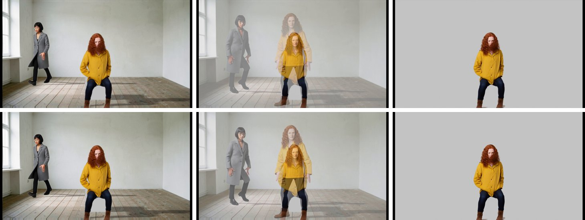
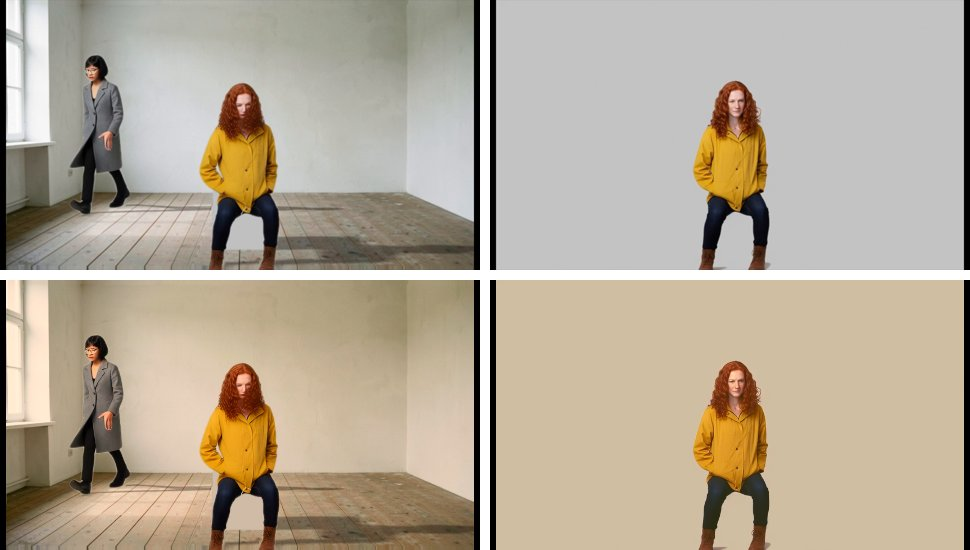

# 30 · RC4's study — FilmCraft for the cut editor

Status: **study, 2026-10-24; answered the same day → D126 (§10); building CE1.** D96 planned RC4 as "FilmCraft reviewed as 03 reviewed EffectCraft
(what to reuse, how), then the multi-track cut editor that replaces the single-lane Episode" ([05](05-flow-nodes-as-shot-recipes.md)
§6), with O6 (a scene grade and shot-match in the cut, [06](06-continuity-across-shots.md)) attached. RC1–RC3 are built
([28](28-recipe-graph.md), [29](29-movie-render.md)); this is the study, measured where it could be (§3, the probe E32).

## 1. Where the Episode is

The Episode is the cut: about 1,240 lines of client code over `timelines/<id>.json` (D83, SY4, D125's SP6, RC3).

| It has | It lacks for a finished episode |
| --- | --- |
| one video lane; clips by their source frames; a dissolve as an overlap | more tracks: an insert, a title, an overlay over the shots |
| the cut assembled from a Flow route, a *changed* mark, *Update* | trims beyond in/out: roll, slip, slide, razor, ripple delete |
| the exports for Resolve (FCPXML with the voice lane, EDL, SRT, markers) | sound in the preview at all; music and effects; gain, ducking, loudness |
| the draft render and the movie (RC3: RIFE, the voice lane, an MP4) | the lines placed by hand (they are laid evenly across their clip) |
| a checklist | colour: a grade per scene, a shot matched to its neighbour (O6) |
| | captions styled or burned in; titles |

## 2. What FilmCraft is

Reviewed 2026-10-24 at `F:\source\repos\filmcraft` (v0.5.0, `764723f`, 2026-10-10):

- **A clean-room Premiere Pro in pure Rust**, EffectCraft's sibling in the ArtCraft family: 43 crates and 3 apps, about 322k lines,
  2,228 tests. 848 commits in 10 days (2026-09-30 → 10-10), mostly the owner's.
- **Licence:** MIT OR Apache-2.0. The ArtCraft marks in `docs/brand/` must not ship; fonts are OFL-1.1; symphonia (MPL-2.0, unmodified)
  decodes MP3 / FLAC. No GPL, no FFmpeg, no git dependencies. Its own H.264 and AAC encoders carry no note on codec patents.
- **Maturity: alpha.** Its ROADMAP gives ≈ 87 % of the feature list and ≈ 50–60 % "ready for real work" (correctness 60–70 %,
  performance 35–40 %). Pull requests are **not** gated by tests (CI only packages); the gates run locally.
- **The model is Premiere's:** a project of bins and items (media, sequences, subclips, adjustment layers, graphics); a sequence of
  video and audio **tracks** (any number), each of items with start, duration, source in, speed, link, effects, markers and gain;
  transitions between items (84 video, 3 audio); effects with keyframes; markers (comment, chapter …). Time is an integer tick
  (254,016,000,000 a second, exact for every frame and sample rate). Projects are `.fcproj` (versioned JSON, schema 13, migrated on load).
- **Every edit is a command** (`Session::execute(id, json)`, ≈ 650; undo by project snapshot): `timeline.place / trim / roll / slip /
  slide / razor`, `edit.rippleDelete`, `sequence.applyVideoTransition`, `clip.speedDuration`, `markers.addChapter`, `mixer.*`,
  `lumetri.*`, `captions.*` …
- **The engine is layered** like EffectCraft's (`cargo xtask layers`: no egui / winit below the UI); the engine crates build for
  wasm32, and a web build exists.
- **Rendering:** a CPU reference renderer (premultiplied linear f32) and a wgpu compositor for the app's monitors only, checked against
  it. **Every headless path (CLI, MCP, export) is CPU.** Playback in the app: quality steps full to ¹⁄₁₆, render previews in to out.
- **Export:** H.264 (its own encoder; CBR / VBR, not CRF), ProRes, DNxHR, APV, MXF, image sequences, WAV; AAC or PCM; loudness
  normalisation (R128, −23 LUFS by default); captions burned in or as SRT / VTT; reproducible byte for byte. No AV1 / VP9; HEVC only
  through NVENC or VideoToolbox (none on AMD).
- **Colour:** Lumetri (basic, creative, curves, wheels, HSL, vignette, input and look LUTs, 18 presets), **shot match**
  (`lumetri.applyMatch`: Oklab statistics with skin protection, solved into an editable grade), **adjustment layers** (a grade over the
  tracks beneath: a scene grade), scopes. Rec.709 / Rec.2100; no OCIO. CPU only.
- **Audio:** track mixer with automation, sends, submixes; clip gain and volume keys; ≈ 40 effects; R128 metering; **ducking**
  (`essentialSound.generateDucking`); constant-power crossfades. Resampling is linear only.
- **Captions:** SRT, WebVTT, SCC, TTML … in and out; caption tracks with styles; burn-in at export. Whisper transcription is an optional
  build feature (CPU, models fetched on first use).
- **Interchange:** FCPXML 1.9–1.11, EDL, FCP7 XML, OTIO, AAF / OMF, in and out.
- **Interfaces:** `filmcraft-cli` (`exec`, `run` a JSON-lines script, `import`, `export`, `render` one frame, `inspect`, `mcp`), an MCP
  server over stdio (headless) or bridged to the running app, and the app's loopback control port.
- **Its limits that matter here:**
  - **a 16 fps clip on a 24 fps sequence repeats frames** (frame sampling; "optical flow" is frame blending, and only when the speed
    changes): loom2 keeps RIFE (D27) and hands FilmCraft conformed media;
  - time remapping is stored but not rendered (constant speed and reverse work);
  - its FCPXML import ignores FCP's spatial conform (§3);
  - undo deep-clones the project (fine for an episode).
- **EffectCraft already uses FilmCraft's crates** (codecs, media, frame, colour, H.264 / ProRes / AAC encoders, interchange) pinned at
  `2c5ba7a` (10-03). The two are separate binaries; there is no dynamic link between them.
- **The user interface is egui.** As with EffectCraft, none of it can live in loom2's React app; its timeline, Lumetri panel and mixer
  are design references.

## 3. The probe (E32, measured 2026-10-24)

`filmcraft-cli` built in release from the checkout into a scratch target (2 min 31 s, 34.6 MB), hardware decoding off, a scratch data
folder. The input is the A1 rig's cut from RC3's measurement: the composition (121 f @ 24) dissolving over 12 ticks into Mara's
performance (77 f @ 16), two voiced lines on the first, at 1920×1080 @ 24.

**a · loom2's Resolve FCPXML, imported.** One sequence, 4 media linked, nothing offline, no warnings; the lines on A1 at 0 and 60 as
exported, the marker kept. But:

- **the dissolve is lost** — loom2 writes the next clip *overlapping* the previous one on the spine; FCPXML lays spine clips end to end
  and a transition straddles the cut on the clips' handles. FilmCraft put the second clip on V2 and made the dissolve a fade-out of the
  first. Resolve reads the same file (the author's Resolve check is still owed). **A defect in loom2's exporter: FC1**, fixed with this
  study (§7): the cut now sits in the overlap's middle, each clip trimmed to it and the rest its handle under the transition, a line
  in a given-up head riding the clip before. Re-exported, the A1 cut imports as **one track** — the clips 0–115 and 115–225, the
  Cross Dissolve from 109 for 12 frames between them, the lines on A1 — the same structure as the cut built by commands (b);
- the 832×480 proxies sit at native size in the 1920×1080 frame: FCP's default conform is *fit*, which FilmCraft's importer does not
  apply.

**b · the same cut built by commands** (a new sequence, `file.import`, `timeline.place` ×4, `sequence.applyVideoTransition` 12 frames on
the second clip's head, `clip.scaleToFrameSize`): 225 frames, the dissolve from 109 for 12 frames on the cut at 115 — **loom2's lane
exactly**. Exported (`filmcraft-cli export --format h264`) it **matches loom2's own movie**: mean difference 1.5 / 4.1 / 0.4 levels on
frames 48 / 114 / 160 (the 16 fps clip frame-sampled there, RIFE-conformed in loom2's), the sound identical (both lines where RC3 puts
them, the same level).

| | loom2's movie (RC3) | FilmCraft export |
| --- | --- | --- |
| H.264 + AAC, 225 frames at 1080p | 10.7 s (RIFE conform + x264 CRF 18) | **3.1–3.8 s** (7.8 MB) |
| ProRes 422 + PCM | — | 3.2 s (66 MB) |
| with a shot-match and a graded adjustment layer | — | 6.6 s |

**c · frames for the viewer.** One process a frame (cold): 100–160 ms at any size. **One warm `filmcraft-cli mcp` session** (the way
`effectcraft.py` drives EffectCraft), `render_frame` as PNG:

| | ½ (960×540) scrub | ½ play | ¼ scrub | ¼ play |
| --- | --- | --- | --- | --- |
| the plain cut | 10 ms (p90 25) | 10 ms → 100 fps | 4 ms | 4 ms |
| + shot-match on one clip + a scene grade (adjustment layer, *Golden Dusk*) | 15 ms (p90 29) | 15 ms → 68 fps | 6 ms | 5 ms |

**d · O6 headless.** `lumetri.applyMatch` on Mara's clip against frame 48 of the composition: 0.24 s for the whole run, distance
0.052 → 0.036, an editable grade. An adjustment layer over the cut with a preset grades both shots.

Not measured: memory beside ComfyUI (FilmCraft's own figure: ≈ 1.4 GB RSS exporting 1080p), an episode-length cut, PNG-sequence masters
as the media.

## 4. How loom2 would use it

The EffectCraft precedent (D113, D114) is the pattern: **loom2 keeps its mouse-first React UI**; the sibling's engine runs as a pinned,
prebuilt `filmcraft-cli` beside the orchestrator — a session for the edits and the viewer's frames, the CLI for the render as a job.

| Route | What | Verdict |
| --- | --- | --- |
| **F1 · its own window** | loom2 writes the cut as a `.fcproj` (conformed media), *Finish in FilmCraft* opens the app on it; the movie comes back as a render | a working escape hatch, ≈ 2 days; the author edits outside loom2 in a keyboard-and-mouse Premiere UI, and nothing comes back but the file. **Later, optional** |
| **F2 · inside Story's Episode, on FilmCraft's engine** | loom2's multi-track editor (React); every edit a FilmCraft command in a warm session; the viewer's frames from it over loopback HTTP (§3c); the movie by `file.exportMedia` as a CPU job | **proposed** — D114's shape for the cut; the probe shows the commands reproduce loom2's lane and its movie |
| F3 · loom2's own editor, FilmCraft only for the export | the lane grown to tracks in TypeScript; FilmCraft renders at the end | not proposed: the grade, the match and the mix would show only after a render |
| F4 · the wasm build in the page | `filmcraft-web` (single-threaded, WebCodecs) as the viewer | not proposed now: 03 §5.2's R1 verdict holds (memory, CPU-side speed); kept open |

**What stays loom2's** under F2:

- **the cut's document** — `timelines/<id>.json` grows from one lane to tracks (a schema step), keeping the route, the shots' stamps,
  the *changed* mark and the lines' link to the Flow. The `.fcproj` is **built from it** by commands, like an index (rule 4: files are
  truth, indexes are rebuildable), and every edit goes to both: the document, and the same command to the warm session so the viewer
  follows without a rebuild. A FilmCraft result loom2 keeps (a shot-match's solved grade) is written back into the document as values;
- **RIFE** — a 16 fps shot is conformed once (D27) and FilmCraft gets the 24 fps frames;
- the masters, the Catalogue, lineage, the queue (D97), the mouse-first commands (D32).

## 5. What the cut editor does (first version)

- **Tracks:** V1 the shots (assembled from a route as today, *changed* / *Update*), V2 inserts and titles; A1 the dialogue (each spoken
  line its own clip, placed as today and then moved by hand — the line keeps its place), A2 music, A3 effects. More tracks by `+`.
- **Edits** (each a loom2 command with its mouse placement, running FilmCraft's): select, move, trim, roll, slip, slide, razor, ripple
  delete, dissolve / dip to black, constant speed, a freeze frame; snapping; undo by the document's stack.
- **Sound:** clip gain and volume keys on the clip; track volume; *Duck the music under the dialogue*; the movie's loudness at export.
- **Colour (O6):** *Grade the scene* — an adjustment layer over a scene group's shots with a preset or a LUT look; *Match to…* — a shot
  matched to a reference shot (FilmCraft's solve, editable).
- **Captions:** a caption track from the Dialogue lines (the SRT's text and timing); *Burn in* at export.
- **The viewer:** FilmCraft's frames at ½ (¼ while playing fast), sound in the page from the document's audio clips (Web Audio).
- **The movie:** FilmCraft's export as the queue's CPU job — H.264 for viewing, ProRes for Resolve, with loudness; the Catalogue video as
  RC3. RC3's `run_movie` stays as the fallback when FilmCraft is not built (like the composition render without EffectCraft).

Not in it: speed ramps (not rendered by FilmCraft), multicam, the audio mixer's automation modes, effects beyond the grade, F1.

## 6. The GPU rule and memory

- Every headless FilmCraft path is CPU (§2), so the session never takes the card. **Hardware decoding is switched off** at the
  session's start (`playback.hardwareDecoding = off`; Media Foundation decode would hold VRAM beside ComfyUI).
- As for EffectCraft (D113): while the queue runs a GPU job, the viewer renders on demand only; the movie is a queued CPU job (one job at
  a time, D97). The RIFE conform stays a short Vulkan step inside a queued job, as the final's assembly does.

## 7. A build plan

| Wave | Content | Days |
| --- | --- | --- |
| **FC1 · the FCPXML dissolve** ✓ with this study | spine clips end to end, the transition on the cut over the handles (§3a) | 0.5 |
| **CE1 · the engine** | `engine/filmcraft.pin.json` + `scripts/build_filmcraft.py` (`--check` in CI), `loom2/filmcraft.py` (the session, as `effectcraft.py`), a fake for the tests; the cut's `.fcproj` built by commands from the document, with conformed media; the movie by `file.exportMedia`; a rig check (memory beside ComfyUI, an episode-length cut) | 3 |
| **CE2 · tracks** | the document's schema step to tracks; the multi-track timeline in Story · Episode (V1–V2, A1–A3, `+`); the edits as commands; the viewer's frames from the session | 4–5 |
| **CE3 · sound** | the lines as A1 clips, music and effects from the Catalogue's audio, gain and volume keys, ducking, loudness at export; sound in the page | 2 |
| **CE4 · colour (O6)** | *Grade the scene* (adjustment layer per scene group), *Match to…*, presets and LUT looks | 2 |
| **CE5 · captions and delivery** | the caption track from the lines, burn-in, H.264 / ProRes presets; the Resolve folder kept | 1–2 |

**≈ 12–15 days**, each wave with its tests (offline on the fake, e2e on the fake, a rig check on the pinned binary), screenshots and
journal entry.

## 8. Risks

- **Alpha and moving fast:** 10 days of history, schema 13, no CI test gate. The pin, a fake in loom2's tests, the document as loom2's
  truth (a FilmCraft schema change costs a rebuild of the `.fcproj`, not the author's work) and a rig check per pin move.
- **Interchange gaps:** FCPXML import ignores spatial conform, so loom2 builds the cut by commands (§3b), not by import.
- **Frame rates:** FilmCraft repeats frames for a 16 fps clip; loom2 conforms first.
- **Codec patents:** FilmCraft's own H.264 / AAC encoders come without a licensing note. loom2 is the author's tool on one machine;
  noted, not a blocker for this use.
- **Build cost:** 2.5 min for the CLI in release on this machine (FilmCraft quotes 6–7 GB a full build); rebuilt only when the pin moves.
- **FC1 was a live defect** in the Resolve export since P17 (D83): any cut with a dissolve. Fixed now; the author's Resolve check owed
  since 2026-10-15 should use a fresh export.

## 9. Questions for the author — answered 2026-10-24 (D126)

The answers: **1 (a), 2 (b), 3 all, 4 yes in the first version, 5 FilmCraft's export, run inside loom2** ("not by using filmcraft itself": the author never opens FilmCraft's app). §10 is the plan as decided.

1. **Where is the cut edited?** **(a) inside Story · Episode on FilmCraft's engine (F2, recommended)**, as D114 did for the composition
   with EffectCraft; or (b) in FilmCraft's own window (F1), opened on the cut and rendered back.
2. **Which file is the cut's truth?** **(a) loom2's cut document, grown to tracks, with the FilmCraft project built from it
   (recommended)**; or (b) the `.fcproj` itself (every FilmCraft feature persists, but loom2 follows FilmCraft's schema).
3. **The first version's tracks:** **V1 shots, V2 inserts and titles, A1 dialogue, A2 music, A3 effects (recommended)** — or fewer?
4. **Colour in the first version** (O6: a grade per scene, a shot matched to another): **yes (recommended)**, or after sound?
5. **The movie:** **FilmCraft's export once it is built, RC3's render as the fallback (recommended)**; or keep RC3's as the only one.

## 10. As decided (D126)

**The cut is a FilmCraft project.** Each cut is `timelines/<id>/cut.fcproj`, written by FilmCraft (atomic saves, its own migrations).
Everything about the cut lives in it, loom2's links included, as item metadata (verified with the probe's build: `metadata.set` keeps any
field through a save):

| loom2's link | where in the project |
| --- | --- |
| a take's Story shot, version, Flow node, loom2 clip | the media item's `loom2.shot`, `loom2.version`, `loom2.node`, `loom2.clip` |
| a spoken line's Flow node and index | the audio item's `loom2.node`, `loom2.line` |
| the cut's route (D125 S13) | the sequence item's `loom2.route` (JSON) |

`timelines/<id>.json` stays as the cut's registry record (id, name, the file, the format, a revision for the client's 409s); the lanes
loom2 shows, assembles, marks *changed*, checks and exports are **read from the project** (V1's items and transitions → today's lane).
Today's cuts are converted once by commands. A 16 fps take enters conformed by RIFE (cached beside its master); the masters go in as PNG
sequences, not the proxies.

**The engine** is the pinned `filmcraft-cli` (`engine/filmcraft.pin.json`, built by `scripts/build_filmcraft.py` from the checkout
beside this repository; `--check` in CI), driven as one warm MCP session by `loom2/filmcraft.py` (as `effectcraft.py`), hardware decoding
off; a fake (`tests/fake_filmcraft.py`) for CI and the e2e; the real binary on the rig.

**The movie** is FilmCraft's `file.exportMedia` run as loom2's queued CPU job (H.264 or ProRes, loudness, captions burned in when asked),
into the cut's folder and the Catalogue as RC3. RC3's render stays where FilmCraft is not built.

| Wave | Content | Days |
| --- | --- | --- |
| **CE1 · the engine and the cut file** | pin, build script, CI check, Settings › FilmCraft; the session and its fake; `cut.fcproj` per cut (made and converted by commands, conformed masters, the links as metadata); the lane read from it, every existing Episode verb on it (assemble, *changed*, update, exports, checklist, RC3's movie by FilmCraft's export); a rig check (the real binary, an episode-length cut, memory beside ComfyUI) | 4 |
| **CE2 · tracks** | the five tracks (V1 shots, V2 inserts and titles, A1 dialogue, A2 music, A3 effects; more by `+`); the edits as commands (move, trim, roll, slip, slide, razor, ripple delete, transitions, speed, freeze); the viewer's frames from the session | 4–5 |
| **CE3 · sound** | the lines as A1 clips (placed as today, then moved by hand), music and effects from the Catalogue, gain and volume keys, ducking, loudness; sound in the page | 2 |
| **CE4 · colour** | *Grade the scene* (an adjustment layer over a scene group's shots), *Match to…*, presets and looks | 2 |
| **CE5 · captions and delivery** | the caption track from the lines, burn-in, H.264 / ProRes presets, the Resolve folder from the project | 1–2 |
