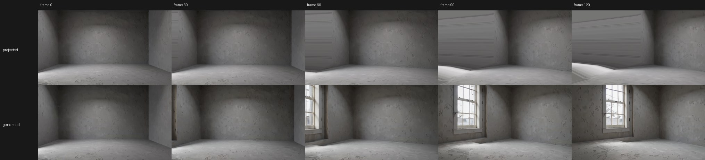

# 31 · Props as models, the Shot node and the pipeline's rest

Status: **the plan, 2026-10-24.** The author, after D126 was built: *"Q22: all props have to have a 3D model / Q23: I don't like a prop
that is a part of the character, we should scrub that / Let's build the remaining two items"*. The two answers are **D128** and **D129**;
the two items are **RC2** (the Shot node, [05](05-flow-nodes-as-shot-recipes.md) §6 with [06](06-continuity-across-shots.md)'s O2 and O3)
and **phase 5b** ([07](07-build-order.md): the clay pipeline's rest). This document holds their waves and their order.

## 1. D128 — every prop has a 3D model, in both builds

A prop is never a cut-out, a depth-guided picture or a clay stand-in in a shot. Two ways give a Cast prop's version its model:

| Way | Build | What it is |
| --- | --- | --- |
| **Import a GLB** | both | the author's own 3D work, or a store's model whose licence the author vouches for: a binary glTF 2.0 file into the Catalogue as a mesh (as it is: its orientation and scale), set on the version |
| **Image → 3D** | `full`: Pixal3D (D84) · `open`: spike **E33** | made from the version's animation reference (else its hero), stood upright (D110) |

**PM1 · the import** ✓ built 2026-10-24: `POST /story/profiles/{pid}/versions/{vid}/model/import` (the header checked: `glTF` magic,
version 2; a character or a place refused), the Catalogue's own *Import* takes `.glb` as a mesh (its thumbnail drawn by the client's 3D
view, P18), *Import a 3D model (GLB)…* on the prop's 3D model block, its right-click and the readiness row; the readiness row owes a
prop's model in **any** shot it is in (it was only a prop bound in Stage). The `open` build's refusal of *Make the 3D model* now points to
the import.

**E33 · open image → 3D** (a spike, its downloads asked for when it runs): candidates, their licences read against D17 / D26 first — **TRELLIS**
(Microsoft; MIT as last read, a textured mesh) and **TripoSR** (Stability AI + Tripo; MIT as last read, a fast mesh with vertex colours).
Stable Fast 3D's community licence and Hunyuan3D's EU exclusion keep them out. Measured on the
rig on the props of the A1 project against Pixal3D's results (silhouette IoU from six views, the texture's colour error, seconds, peak
VRAM). The winner becomes `open`'s image → 3D, the losers' weights deleted (house rule 1).

## 2. D129 — a held prop is its own model in the hand

E28's P3 (a prop drawn inside its holder's Wan Animate layer from a reference holding it) is dropped. A held prop is D109's 3D model
**parented to the holder's hand** in Stage:

**HP1 · in the hand** ✓ built 2026-10-24 (§2a) (Stage, no GPU but the rig check):

- `StageObject.parent_joint` (`r_hand` | `l_hand`) beside `parent` (the figure): a bound mesh parented to a figure follows the hand's
  world transform every frame, with the offset the author sets (the transform is local to the hand). The Simple figure's hand is the
  wrist marker past the elbow; the Detailed figure's `hand_r` / `hand_l` bone.
- *Put it in the hand ▸ right / left* on a prop's right-click and in its Inspector, with the figure picked from the stage's figures;
  *Take it out of the hand* (the prop stays where it is in the world). The outliner shows it under its figure.
- The final's layers (PS5a) treat it as any prop: its own layer from Stage's passes, rendered in the hand's motion; its depth order per
  frame as for every layer (PS5e), so a cup in front of the body sits in front of it.
- Rig: a figure walking a library clip with a cup in its right hand → the cup's layer follows the wrist within 2 px per frame at Draft;
  the final's composite holds it in the hand.

Generate's still-image wording (*holding …*, D93 C6) is a picture's prompt, not a layer, and stays.

### 2a. HP1 as built (2026-10-24)

- `StageObject.parent_joint` (`r_hand` / `l_hand`) with `parent` the figure: a prop (a 3D model, a stand-in, an image plane) held by a
  figure — the server refuses anything else (a set or a light held, a figure held, a hand without its figure). Its transform is local to the
  hand: the figure's wrist marker (COCO-18's wrist at the forearm's end, turning with it; `held.ts`), re-placed by the engine after every
  pose, so the passes, the final's prop layer and every render see it in the hand; the gizmo moves it on the hand.
- *Hold in a hand ▸ <figure> · right hand / left hand* on a prop's right-click (the viewport or the outliner), *Take it out of the hand*
  there and in the Inspector's *held* row (it stays where it is). A figure deleted lets its held things go where they stand.
- Rig (`scripts/hp1_acceptance.cjs`, 3/3, the A1 stage in a visible Edge, Mara walking her library clip with a cup in her right hand, Stage's
  own passes every 8th frame at 832 × 468): the cup in every sampled mask (16/16, ≈ 238 px), within 7.8 px of her right-wrist keypoint at
  worst, travelling 117 px with her.

## 3. RC2 — the Shot node

D96: *a Shot is a Flow node with a recipe*. D125 built the interface (a visual node has its shot from the start, one panel for both, the
board) without merging the records. RC2 merges them and adds what the merge makes possible.

The waves are in §3a; the model they change is mapped in §3b.

### 3a. The waves

| Wave | Content | Days |
| --- | --- | --- |
| **RC2a · one record** ✓ built 2026-10-24 (§3c) | the Flow node and its Story shot as one Shot (the record, the migration, the API kept for one release); a node without a shot stays a story node | 2 |
| **RC2b · Shot cards** ✓ built 2026-10-24 | the Flow's card shows the used take (its first frame), the length, the stale count; the 30 s warning (a guideline: nothing is blocked) | 1 |
| **RC2c · scene groups** ✓ built 2026-10-24 (§3d) | a frame around Shots in the Flow (made from a selection, named, moved together); *New coverage shot* on a Shot makes a sibling in its group; CE4's *Grade the scene* takes the group (the place's run stays the fallback) | 2 |
| **RC2d · the Shots list** ✓ built 2026-10-24 (§3d) | the Shots tab's board rows are the Shot nodes, grouped by scene, with search, sort and the state filters | 1 |
| **RC2e · templates (O2)** ✓ built 2026-10-24 (§3d) | *New Shot from this Shot* (the scene's parts linked, the Shot's own copied); *Save as a template…* into the World Library; *New Shot from a template…* | 2 |
| **RC2f · linked copies (O3)** ✓ built 2026-10-24 (§3e) | within a scene the shared parts (set, plate, light, cast versions, props, grade) are linked by default: one item, several users, a badge; *Make independent* breaks a part away (an independent copy is the Catalogue's *Duplicate*) | 2–3 |

### 3b. The model today and the merge

**Today** (the code map of 2026-10-24): two records in two id spaces, written separately. A node (`story/flow/nodes/node_*.json`)
points at its shot by `shot_id` + `shot_version`; the shot (`story/shots/sht_*.json`) back by `owner_node`. Ownership is checked only in
`bind_shot`, so the two pointers can disagree: *Release* patches `owner_node` alone, a deleted shot leaves its node pointing at nothing, a
node turned into a Choice keeps its shot, and lookups try one pointer and fall back to the other. A node *shows* a version
(`shot_version`) besides the shot's `current`. Both kinds of id are saved far outside Story: finals, legacy timelines, the FilmCraft cut's
item metadata (`loom2.shot`, `loom2.node`), job origins in the queue and in Catalogue manifests, voice and audio-layer records.

**The merge (RC2a):**

- **One file per Shot: the node's.** A visual node's file holds its shot (`FlowNode.shot`: the versions, `current`, its own revision); the
  shot files go. The two pointers become one containment, so they cannot disagree.
- **Both ids stay.** The shot keeps its `sht_*` id inside the node, so every saved reference (finals, cuts, origins, manifests) still
  resolves; `story/flow/shots.json` is a rebuildable index from a shot id to its node (checked on use, rebuilt when wrong).
- **One name, one shown version.** The shot's name is the node's title; the version the node shows is the shot's `current`.
- **Every shot has a node.** A shot made elsewhere (*New shot from this camera…*, *Make a shot from this clip…*) is a Shot node outside
  any route, placed beside the graph; the board lists it under *Not on a route*. *Bind* moves a shot from such a node into another
  (the bare node goes; the receiving node's own shot, if it has takes, moves out to a node of its own); *Unbind* and *Release* move the
  shot out to a node of its own and leave a fresh shot behind. Nothing is lost by either.
- **Deleting:** a node's shot is deleted with it or moved out to a node of its own (the question as today); *Delete shot* on a routed
  node empties its shot (the lines and the place stay), on a bare node outside the routes deletes the node.
- **A node turned into a non-visual type** keeps nothing it cannot show: refused while its shot has takes or a source, else its empty
  shot is dropped.
- **The API is kept for one release:** `/story/shots…` reads and writes the shot inside its node (`owner_node` and the node's
  `shot_id` / `shot_version` computed), so the clients and the external references go on working; both `story.changed` kinds are sent.
- **The migration** runs once when the project opens, with a recovery note: each node's shot joins it (the owner wins where two nodes
  point at one shot; the other gets a fresh shot); a shot without a node becomes a Shot node outside the routes; a pointer to nothing is
  cleared; the old shot files are moved to `story/shots-rc2/` (not deleted). Flow schema 2.

**The scene (RC2c):** `story/flow/scenes.json` (schema 1) holds the scene groups (id, name, colour, and the parts the scene shares:
§RC2f); a node names its scene (`FlowNode.scene_id`). The frame around a scene is drawn from its nodes' positions and moves them together.

**Linked parts (RC2f), part by part:**

| Part | Linked (the default within a scene) | *Make independent* |
| --- | --- | --- |
| **Set, props, lights** | one stage, several cameras: the new Shot points at the scene's stage with a camera of its own | the stage duplicated with this Shot's camera; the Shot points at the copy |
| **Cast versions** | the scene's pins (`Scene.cast_versions`); a Shot without its own pins uses them, and setting one on a linked Shot sets the scene's | the scene's pins copied into the node (`speaker_versions`) |
| **Plate** | on a picture set the plate is the set's (one stage); a Klein plate is the camera's, so a Shot on a copied camera keeps the first plate as its reference (O4) | the plate made again from this Shot's camera alone |
| **Grade** | the scene's grade (CE4's adjustment layer over the scene's run) — the scene record keeps it, so a re-assembled cut grades the scene again | the Shot leaves the scene's layer: its clip gets the scene's grade as its own Lumetri and the layer is split around it |

A part shows a *linked · N Shots* badge with its users; the Catalogue's *Duplicate* stays the independent copy of an item.

### 3c. RC2a as built (2026-10-24)

- **The record** (`story.py`): `NodeRecord` = the node + `ShotPart` (id, current, versions, revision, timestamps); `FlowNode` and `Shot`
  stay the API's views (`as_node()` without the shot's body, so `GET /story/flow` stays light; `as_shot()` with the node's title as its
  name and the node as `owner_node`). Flow schema 2, shot schema 2. `story/flow/shots.json` maps a shot id to its node, rebuilt when it
  is missing or wrong. One lock (`_LOCK`) holds every read-modify-write of a node's file: a node's edit and its shot's take can no longer
  lose each other (a test races 40 takes against 40 title edits).
- **The verbs:** a shot made elsewhere is a Shot node outside the routes, in a column right of the graph; *Take a shot made elsewhere*
  (the shot panel's *take* select) moves it into a node, the bare node goes and the node's own shot moves out if it has work in it;
  *Move to a node of its own* (was *Unbind* / *Release*) moves the shot out beside the node and leaves a fresh one; *Delete shot* empties a
  node in the story, removes a bare node; deleting a node keeps its shot as a node of its own unless asked, an empty shot simply goes; a
  node turned into a logic node refuses a shot with work in it. Renaming the shot renames the node (one name); the shot's current version
  is the one the node shows.
- **The migration** runs in `StoryStore` when `story/shots/` exists (and its notes join the open's recovery list): the owner the shot
  names first, then a node pointing at an unowned shot; the loser of a doubly-pointed shot and a node pointing at nothing get fresh shots
  (a note each); shots without a node become bare Shot nodes; the old files go to `story/shots-rc2/`.
- Tests: `test_shot_node_rc2a.py` (the migration on a hand-written old project, the race, type changes, delete, the API's light nodes);
  the D85 / D125 / AE4 tests moved to the one-record verbs; `board.test.ts` (`bareNode`, `hasWork`); the flow e2e takes a shot made
  elsewhere from the panel.

## 4. Phase 5b — the clay pipeline's rest

| Wave | Content | GPU | Days |
| --- | --- | --- | --- |
| **AE5 · the output** ✓ built 2026-10-24 (§4a) | the finished shot's **render settings** (quality, resolution, frame rate, motion blur, frame blending, colour depth; proxy use off) and **output modules** (the PNG master always; ProRes 4444 with alpha beside it; the H.264 proxy) on the final, shown in the Final mode's foot and the render's Inspector; `comp_render` runs EffectCraft's render queue with them (`renderQueue.add` takes every one) | no (CPU, D113) | 1–2 |
| **CA4 · the plan with its cost** ✓ built 2026-10-24 (§4b) | each character layer's batches (77 frames, 5 carried) with the frames each covers and its minutes from the measured runs; the shot's total; *Stage the runs* (the queue's *staged* jobs, released by *Run staged*) for an overnight start | no | 1 |
| **CA5 · re-take from a batch** ✓ built 2026-10-24 (§4b) | *Re-take from this batch* on a layer's batch: that batch and the ones after it again with a new seed, the batches before kept (the carried frames come from the kept batch) | yes (rig) | 1–2 |
| **HP1 · in the hand** ✓ built 2026-10-24 (§2a) | D129, §2 | rig check | 2 |
| **CA3 · the plate for large moves** | spike **E34** first: the depth-guided plate video — LTX-2.3's IC-LoRA union control (Stage's guided method already loads it) with the plate still as the first frame and the bare set's depth along the camera path as the control; measured on an orbit and a long dolly against the projection (stretch, the still's match at frame 1, seconds, VRAM). If it holds: the final's plate gets a method (*projected* for small moves, *generated along the path* for large ones, chosen by the camera's travel), its frames a plate layer like the projection's; and O4 (RC2f's plate): a Shot's Klein plate made with its scene's first plate as a reference, so the room reads the same from another camera | yes (spike, then rig) | 3–4 |
| **E33** | D128's open image → 3D (§1), downloads asked for first | yes | 1–2 |

D102 retired CA5's W3 (a per-frame refine at a seam made the hold worse); A6's healing patch stays for regions.

## 5. The order

1. **PM1** (built) → **RC2a → RC2f** (no GPU: tests, the e2e, screenshots).
2. **AE5 → CA4 → CA5 → HP1** (CPU and short rig checks, one GPU job at a time, D97).
3. **E34 → CA3** (GPU), then **E33** (GPU; downloads asked for first).

Each wave: offline tests, Vitest, the e2e under both variants, the rig where a GPU path changes, screenshots of every section it
touches, a journal entry and a local commit.

### 3d. RC2c, RC2d and RC2e as built (2026-10-24)

- **Scene groups** (`story/flow/scenes.json`, schema 1; a node names its scene, `FlowNode.scene_id`): *Make a scene of it…* on a node's
  right-click or the Inspector (with the nodes selected with it — Ctrl-click or Shift-drag), *Into the scene ▸*, *Take it out of its
  scene*, the node's *scene* select; a scene no node names goes. On the canvas each scene is a frame around its nodes, drawn in a
  ViewportPortal behind the edges (frames as React Flow nodes measured by its ResizeObserver looped: their size follows the nodes'), its
  name tab picks the scene, shows *Rename* / *Dissolve* on a right-click and moves its nodes by a drag.
- ***New Shot from this Shot*** (O2's verb, also the coverage shot): a sibling below the source in its scene — one is made around the
  two, named after the place, when the source has none; the stage, the place and the board shared; the lines (with their voice), a camera
  of its own on the stage (the source's copied with its keys, *Camera 2*) and the route copied; no takes.
- **CE4's *Grade the scene*** takes the scene group (`scene:<id>` keys), the place's run only for a node in none.
- **The Shots list:** a search (a name, a line, the shot's line, the scene) and an order — the story's (the Flow's walk, its branches as
  headings), by scene (the scenes as headings in the story order of their first Shot, *No scene* last), by name, longest first, most stale
  first; each row's length, stale count and scene after its route.
- **Shot templates** (`story/shot_templates.json`, World › Presets › *Shot templates*): *Save as a template…* keeps the node's kind, its
  lines (the words, not the voice), its line, its route and its camera with its keys; *New Shot from a template ▸* on the Flow's
  right-click places one there, on a node's right-click beside it (in its scene and place, the template's camera added to its stage);
  the World Inspector shows what a template keeps, *New Shot from it*, *Rename*, *Delete*.

### 3e. RC2f as built (2026-10-24) — RC2 done

- **The cast:** a scene keeps its Cast pins (`Scene.cast_versions`); a Shot in it wears them (the API's node shows the scene's pins) and a
  change of a pin on it is the scene's, merged as a change (a key set or taken away), so a title edit or another Shot's edit is not undone
  (the client sends a node's pins only when they were changed). *Make its cast independent* keeps the pins as the node's own
  (`FlowNode.own`), *Use the scene's cast* drops them. A node joining with no pins is linked; one whose pins differ keeps them as its own
  (nothing chosen is lost); a scene with none takes the first node's; a node leaving keeps the scene's as its own. A sibling (*New Shot
  from this Shot*) is linked.
- **The stage:** a stage shared by Shots is linked (the Inspector's *stage · linked · N Shots* with their names); *Make its stage
  independent* copies it for that version (objects, cameras, keys, range, ambient — not its passes) and points the version at the copy with
  the same camera; the other Shots keep the shared one.
- **The grade:** in the cut, a take under its scene's grade can *Make its grade independent* — the scene's adjustment layer is razored at
  the take's edges and the piece over it lifted, and the take gets the layer's Lumetri (copied whole with FilmCraft's *paste attributes*,
  its own Lumetri replaced). Rig (`scripts/rc2f_acceptance.py`, 6/6, the real FilmCraft on the A1 project): the scene graded (Golden
  Dusk, exposure +1: warmth +35 / +29, mean +41 / +46); Mara's shot independent — the layer covers the composition alone, her Lumetri the
  layer's (exposure 1.0, temperature 35), her frame within 0.05 levels of before; the scene's exposure set back moves the composition
  (−44.7 levels) and not her (0.00).
- **The plate:** a picture set's plate is the stage's (linked with it); a Klein plate is its camera's, so linking it across cameras means
  using the scene's first plate as a reference — O4, built with CA3 (§4).

### 4a. AE5 as built (2026-10-24)

- **The settings** (`RenderSettings`, kept on the final — `PUT /finals/{fid}/render`, its revision unmoved — and copied into the render
  job's recipe): quality (Best / Draft), resolution (Full, Half, Third, Quarter), motion blur and frame blending (the composition's own
  switches, or off for every layer), the working colour depth (8, 16 or 32 bits); proxies never used. The defaults are AE1's render.
- **The outputs:** the PNG master always (the take, its H.264 proxy beside it); *keep the alpha* (straight; at F16 RIFE conforms the colour
  and the alpha as a grey picture apart — an opaque sequence keeps 255 without the second run, RIFE's drift at the ends snapped back); *a
  ProRes 4444 beside the master* (`master_4444.mov` in the clip's folder, PyAV's `prores_ks` 4444, 10-bit 4:4:4, with the alpha when kept, at
  the master's rate — 24 fps after the conform). EffectCraft's own ProRes module would write the composition's rate (16 fps at F16), so
  the file is made from the conformed master instead.
- **The render** goes through EffectCraft's render queue (`effectcraft-cli run renderQueue.add … renderQueue.render`, which waits), the
  only way to its motion-blur, frame-blending and depth switches (the `render` command has no flags for them).
- **Where:** Animate › Final › *Output*: *Render settings* and *Output* under the render state; the foot renders with them.
- **Rig** (`scripts/ae5_acceptance.py`, 7/7, the real EffectCraft on the A1 final): the default render equals AE1's `render` frame for frame
  (0 levels; 121 f @ 24 after RIFE, 5.0 s); Draft at half with the alpha and a ProRes: 416×240, an RGBA master opaque 255…255 through the
  conform, a ProRes 4444 with alpha of 121 frames (16.8 MB), 6.5 s.

### 4b. CA4 and CA5 as built (2026-10-24)

- **The plan** (`GET /finals/{fid}/plan`): each character layer's batches — the final's frames each adds (a later batch's carried 5 come
  before its offset), its state (done, running, queued, staged, failed, owed), its time when done, else its cost: the mean of this final's
  measured batches by frames, else the queue's estimate (D60: what the job would run) — and the shot's total owed. In Animate's final row
  each character layer shows a chip a batch (its state; the tooltip its frames and time) and the minutes it still owes; the final's line says
  what the performances owe on the GPU.
- ***Stage the performances*** (the final's line): every character layer not performed yet is staged in the queue (`RunBody.stage`), so the
  queue's *Run staged* starts them one at a time — an overnight start. A later batch is queued by its predecessor's finisher, as before.
- ***Re-take from batch N*** (a batch chip's right-click; `RunBody.from_batch`): the batches before it kept, batch N made again with a new
  seed continuing the kept batch's clip (W1's carried 5 frames) on the layer's placed reference and pose guide, the rest chained, the layer
  stitched and matted again. *Re-take the whole layer* stays beside it. D102 retired W3 (a per-frame refine at a seam); A6's healing patch
  stays for regions.

### 4c. E34 — the plate for a large camera move (2026-10-24) → D130

`engine/spikes/e34_plate.py` (with `e34_browser.cjs`): the A1 room as a bare stage (the set and its light), the camera orbiting 50° about its
target and closing in a quarter over 5 s (121 frames at 24 fps); Stage makes the final, the plate's Klein still (PS5b) is projected along
the path, and the depth sequence of the same path guides an LTX-2.3 clip that starts from the same still (Stage's guided method).

| | projected (PS5b) | generated along the path (CA3) |
| --- | --- | --- |
| frame 0 against the still | the still itself | 1.9 levels apart |
| sharpness (Laplacian variance) start → end | 26.5 → 24.0 | 28.1 → 176.7 |
| step frame to frame (median) | 1.37 | 2.82 |
| the walls the still never saw | smeared into streaks from frame 60 | drawn: the set's window comes into view |
| cost | Stage, seconds, no GPU job | 186 s at 1024 × 576 (LTX-2.3, Draft) |

**→ D130:** a large move's plate is generated along the path; a small move keeps the projection. CA3 builds it (the plate's method chosen by
the camera's travel, switchable on the plate's row) with O4 (the scene's first plate as the still's reference).
