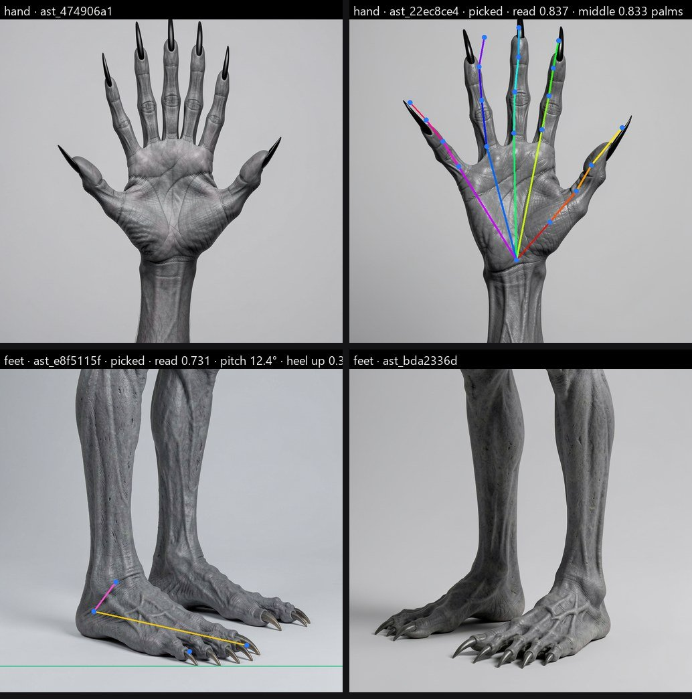
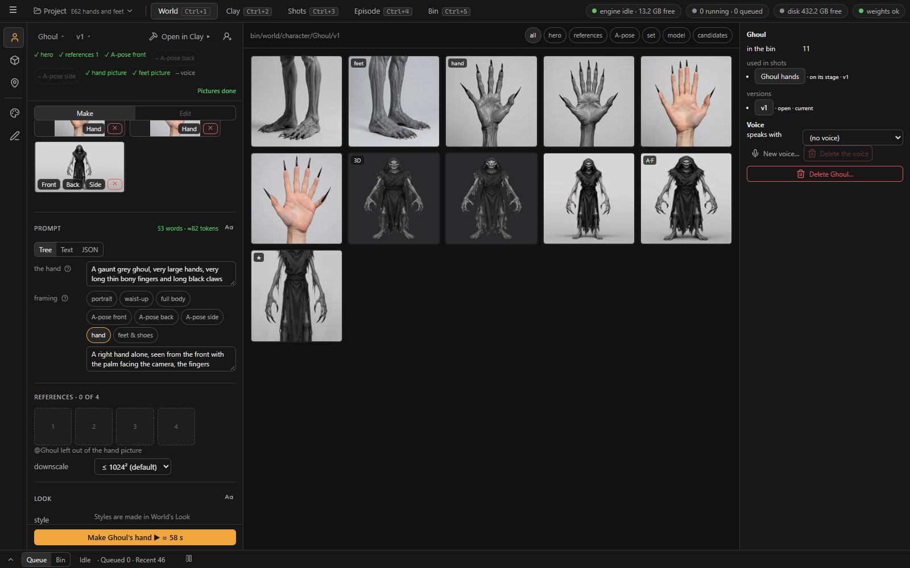
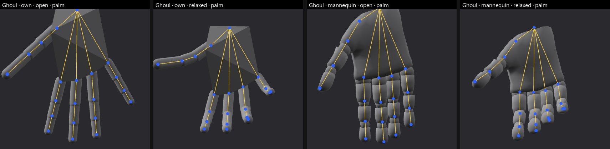
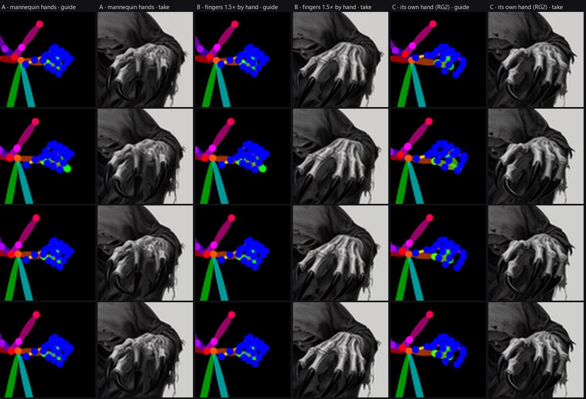
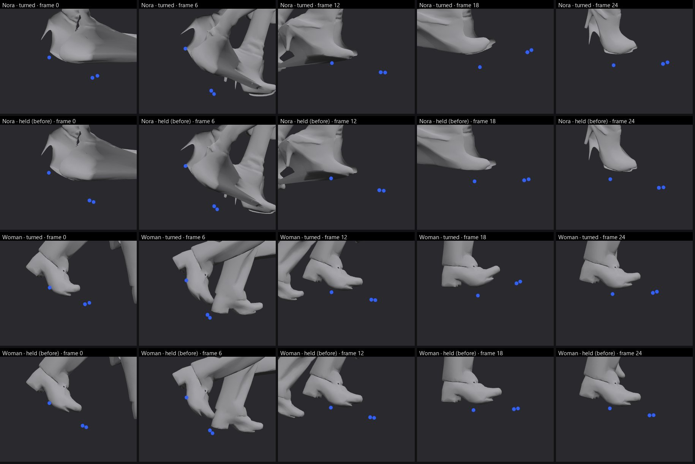
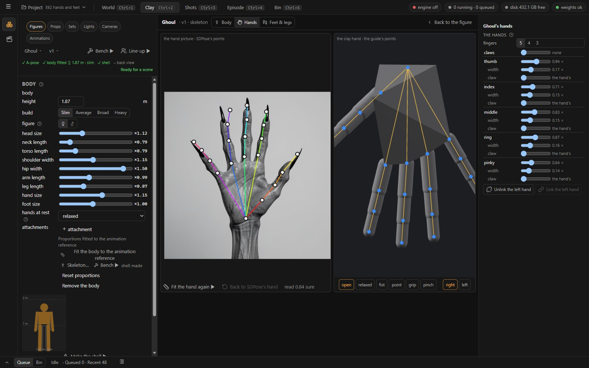
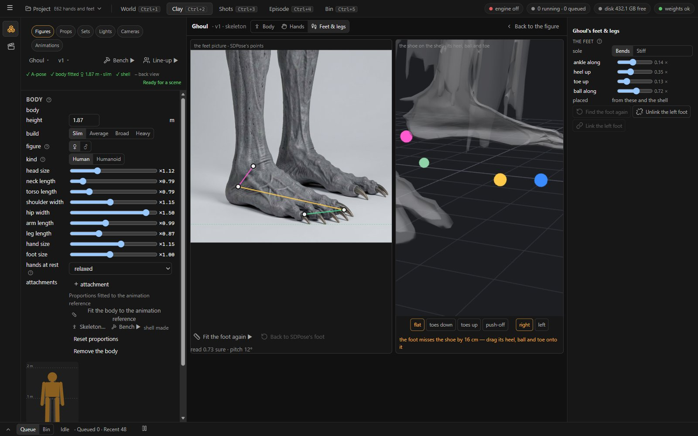
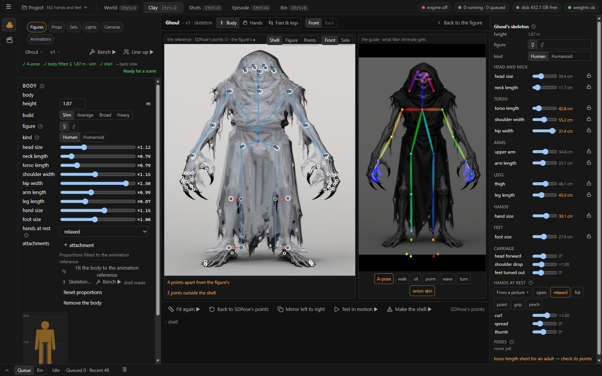

# proto01_rig · Rigging the hands, and humanoids that are not human

Status: **proposal, 2026-11-04; answered the same day → D187** (§8); **legs and shoes added → D188** (§9); **E62 run the same evening** (§10); **RG1 built** (§11); **Q9, Q10 answered → D189, RG2 built** (§12); **RG3 built** (§13); **RG4 built** (§14) — the waves done. Read from the code at `055315e`.

## 1. The request

The author, 2026-11-04, after the shells' doubled hands were fixed:

> Initially we wanted to create a rigging screen, where we can allocate the joints to the correct place — perhaps we should think about
> this, particularly for the hands. Bear in mind that some characters will not be human — only humanoid, they should also be able to pose
> and move. Hands can also vary in size and shape — ghosts and ghouls have large hands with elongated fingers, dwarfs have chunky fingers, etc.

## 2. What loom2 has

| Part | Today |
| --- | --- |
| **The body** | 12 joints, fitted from SDPose's 18 body points on the A-pose picture, then shaped by the body's factors (head, neck, torso, shoulders, hips, arms, legs, the elbow's and the knee's place, hands, feet). The skeleton bench is the rigging screen for it: any of the 12 joints is dragged onto the shell in the front or side view (D183, `body.joint_offsets`), the shell is bound again from the placed joints. |
| **The hands** | No joints of their own. The hand rig is the dummy's: UAL2's mannequin hand — five human fingers in the mannequin's proportions — scaled by one factor, `hands`, fitted from the palm. The rest hand is a preset with curl, spread and thumb. The shell's own hands are folded away (`055315e`; Pixal3D's hands are mittens). |
| **The guide** | The pose pass draws 21 points a hand from that rig's finger bones (D101). Wan Animate is told a scaled mannequin's hand, whoever the character is. |
| **The bench and the hands** | It shows SDPose's 21 points a hand on the reference and lets them be dragged — they correct the palm's fit and pick the rest preset; they do not shape a finger. |
| **Creatures** | Attachments — a tail, horns, ears, wings, a backpack — as rigid parts riding on a joint (CA0). No joint beyond the 12; D183 left "joints the rig does not have (a tail)" for later. The bench warns when a part leaves an adult's range and blocks nothing ("a child or a creature is the author's call"). |

## 3. What a measurement says (Followed's three characters)

SDPose's hand points on each A-pose picture, in centimetres through the picture's own scale (the shell's placement), against the rig's hand
at the character's height and `hands` factor:

| Character | palm length, picture / rig | middle finger, picture / rig |
| --- | --- | --- |
| Nora | 9.0 / 10.2 | 3.9 / 9.2 |
| Man with a newspaper | 12.3 / 14.3 | 4.8 / 13.0 |
| Woman with shopping | 6.5 / 8.5 | 5.5 / 7.8 |

- The rig's hand is 13–31 % larger than these palms even after its factor.
- **The A-pose picture is a poor ruler for fingers.** Relaxed fingers are foreshortened toward the camera (Nora's middle finger reads 3.9 cm),
  and a hand among bags is misread (the woman's right palm reads 0.4 cm wide). A small hand in a full-figure picture is 40–60 pixels.
- For a ghoul or a dwarf the difference is the **shape**, not the size: no single factor makes long thin fingers or short thick ones.

## 4. Proposal

**R1 · A hand reference picture.** A fourth reference beside the A-pose's front, back and side (D161, D175): *Hand* —
"‹character›'s right hand alone, palm to the camera, fingers straight and spread, plain light background". It is made in World › Make with
the character's sheet, so its words carry the shape ("long bony fingers with black claws", "short thick fingers"), and picked by hand like
the others. SDPose reads 21 points far better on a large flat hand than on a small relaxed one, and BiRefNet's matte of it gives each
finger's width.

**R2 · A hand skeleton per character.** Each hand gets its own joints — the wrist and four a finger, the 21 the guide draws — stored on the
body: the palm's length and width, each finger's three segment lengths, its thickness and where its knuckle sits, and a claw's length. The
proportions come from the hand reference, the size from the A-pose's palm. Both hands are the same unless unlinked. Five fingers by default;
four or three hide fingers (Q4).

**R3 · The clay hand, built from that skeleton.** Instead of the mannequin's human hand: a rounded palm slab between the wrist and the
knuckles, each finger tapered capsules of its own length and thickness, a claw a cone at the tip. It poses with the same presets and keys
(open, relaxed, fist, point, grip, pinch, D129's holds). A ghoul's fingers are long because its skeleton's are; a dwarf's are thick because
its thickness says so. The mannequin stays only for the animation bench's dummy, which is nobody's (D183).

**R4 · The rigging screen's *Hands* view.** The skeleton bench gains *Hands* beside the body:

- the hand reference with its 21 points, each dragged to correct what SDPose read (*Fit again* refits; *Mirror to the other hand*);
- a row per finger — length, thickness, claw — each a field with a drag and a lock, as the body's parts are;
- the clay hand in 3D beside it, with the presets to try and a prop held, so a bad knuckle shows before a shot does;
- the guide playing the *hands* clip, as the bench's guide pane does for the body.

Help behind a ?, every action a button or a right-click (D32, D116).

**R5 · The guide carries the character's hands.** The pose pass draws the fitted hand's 21 points, so Wan Animate is told a ghoul's long
fingers, not a mannequin's. (E62 b measures whether it listens.)

**R6 · Humanoid characters.** The body already follows the same rule — fitted, then placed by hand. For non-humans:

- a *Humanoid* switch on the character widens the parts' ranges (arms to 1.8, legs from 0.4, head to 3) and drops the adult-range warnings;
- a body SDPose cannot read (a ghoul's face, a troll's) starts from the parametric body, and the author places the joints (D183's drags);
- not in this proposal: joints the rig does not have — a tail that moves, wings that flap, a third arm, a digitigrade leg (Q7).

## 5. A spike first: E62

Two answers decide the build:

- **E62 a · Can the hands be read?** The hand reference made through the product path for Followed's three and three humanoids — a ghoul
  with long bony fingers and claws, a dwarf with short thick fingers, a goblin with four fingers. SDPose's 21 points and BiRefNet's widths a
  finger, checked against points placed by hand. About a dozen small GPU jobs, one at a time.
- **E62 b · Does Wan Animate listen to a hand?** The ghoul made through the product path (its picture, A-pose, body and shell), then
  waving twice: once with the mannequin's hands in the guide, once with its own. If Wan draws the long fingers either way, R5 is dropped and
  R3 serves the clay alone. One 77-frame batch each, a few minutes apiece, after the ghoul's shell (about 4 minutes).

No weights to fetch: SDPose, BiRefNet and Wan Animate are installed.

## 6. Waves, after E62

| Wave | What | Ends usable as |
| --- | --- | --- |
| **RG1** | The hand reference framing (R1); the hand skeleton fitted and stored (R2) | the body record carries hands; nothing drawn differently yet |
| **RG2** | The clay hand (R3) on shells; the guide from it (R5, if E62 b keeps it) | every shell's hands are its own shape |
| **RG3** | The *Hands* view on the skeleton bench (R4) | the author corrects a hand by hand |
| **RG4** | The *Humanoid* switch (R6) | a ghoul's arms and a dwarf's legs without warnings |

## 7. Questions for the author

| # | Question | Recommendation |
| --- | --- | --- |
| **Q1** | Fit the hands from a hand reference picture (R1), or from the A-pose picture and by hand only? | The hand reference: the A-pose's hands are too small and too relaxed to measure fingers. |
| **Q2** | One hand fitted and mirrored to the other, or both fitted separately? | Mirrored, with *Unlink* for a character whose hands differ (one claw, one prosthetic). |
| **Q3** | The clay hand built from capsules (R3), or the mannequin's hand stretched bone by bone? | Capsules: any proportion, no stretched skin, one look in every pass. |
| **Q4** | Four- or three-fingered hands: supported as hidden fingers? | Yes, a finger count a hand; E62 a shows what SDPose makes of four fingers and the guide draws only those shown. |
| **Q5** | Claws and long nails: a length a finger, or one a hand? | One a hand with an override a finger. |
| **Q6** | The *Humanoid* switch (R6)? | Yes. |
| **Q7** | Joints the rig does not have (a moving tail, wings, extra arms, digitigrade legs): now or later? | Later, a study of its own; attachments stay rigid until then. |
| **Q8** | Run E62 (GPU jobs only, one at a time, no downloads)? | Yes, before any wave. |

## 8. The author's answers (2026-11-04 19:34 → D187)

> I like your proposal! Answers:
> Q1: dedicated hand picture - should be included among the reference pictures, like the A-Pose, but also available as a sketching element
> Q4: yes - also, should be separately promptable
> Q8: yes

| # | Answer |
| --- | --- |
| **Q1** | A dedicated hand picture, among the reference pictures like the A-pose — **and a framing in World › Sketches** for sketching hands freely. |
| **Q2** | As recommended: one hand fitted and mirrored, *Unlink* for hands that differ. |
| **Q3** | As recommended: the capsule clay hand. |
| **Q4** | Yes, a finger count a hand — **and the hand picture has words of its own**, prompted apart from the character's sheet. |
| **Q5** | As recommended: a claw length a hand, a finger may override it. |
| **Q6** | As recommended: the *Humanoid* switch. |
| **Q7** | As recommended: later, a study of its own. |
| **Q8** | Yes: E62 before any wave. |

## 9. Legs and shoes (the author, 2026-11-04 → D188)

> We should do the same with legs/shoes

**What loom2 has.** The legs are fitted from SDPose's hips, knees and ankles and placed by hand on the shell (D183's drags). There is **no
ankle joint**: the shin's segment carries the foot (`segmentEnd`: the shin plus 6 cm down and 8 cm forward), so the shell's own shoe rides
rigidly on the shin — it cannot flex at the ankle or roll on the ball. The guide's foot points (heel, big toe, small toe, D101) come from the
mannequin's foot bones, scaled by one factor `feet` fitted from the toes' spread in the A-pose (S5), turned out by `feet_out`; on a shell the
mannequin is cut to its hands, so those feet are not drawn — the clay's shoe and the guide's feet disagree whenever a clip rolls a foot.

**A difference from the hands.** Pixal3D's hands are mittens; its shoes are shoes — a riding boot, a heel, a clog, bare clawed toes are the
character. So the shoe is **kept and rigged**, not replaced.

| | Proposal |
| --- | --- |
| **F1 · A feet picture** | A reference beside the hand picture: ‹character›'s legs and shoes from the side, standing, the whole foot and the heel in the picture — the side tells the sole's length, the heel's height and the toe's shape, which the A-pose's front view cannot. Among the references and as a framing in Sketches, with words of its own ("tall black riding boots with a 7 cm heel", "bare grey feet with long clawed toes"), as D187's hand picture. |
| **F2 · A foot skeleton per character** | The shin ends at an **ankle**; the foot has a **heel**, a **ball** and a **toe tip**; a raised heel pitches the foot at rest. Read from the feet picture (the side) and the A-pose (the width), placed by hand on the shell; one foot fitted and mirrored, *Unlink* for feet that differ. |
| **F3 · The shell's own shoe, rigged** | Bound by bone heat to the ankle and the ball, so it bends at the ankle and rolls on the ball as the clips' feet do; a *stiff sole* (a boot, a clog) bends at the ankle only. |
| **F4 · The rigging screen's Feet & legs view** | The hips and knees placed on the shell (D183) and now the ankles; the heel, ball and toe dragged in the side view; a row a foot (length, heel height, toe) with locks; tried on a walk (the heel-to-toe roll) and a crouch. |
| **F5 · The guide's feet** | The pose pass draws the heel, the big toe and the small toe from the placed foot, not the mannequin's. |
| **F6 · Humanoid legs** | Their proportions by D187's *Humanoid* switch. A digitigrade leg (a creature walking on its toes, the heel high — a goat's, a werewolf's) is a new joint chain: Q9. |

**E62 c.** (a) Can a feet picture be read: SDPose's six foot points on a side view, and the matte's length and heel height — Followed's three
and three humanoids (the ghoul's bare clawed feet, the dwarf's heavy boots, a high-heeled shoe). (b) Does a shell's shoe hold up when bent:
one of Followed's shells bound with an ankle and a ball and bent 30° at each, in the browser — no GPU.

| # | Question | Recommendation |
| --- | --- | --- |
| **Q9** | Digitigrade legs: with the feet now, or with Q7's later study (tails, wings)? | Later, with Q7: it adds a joint to the leg's chain, which the guide's COCO-18 legs do not have. |
| **Q10** | A *stiff sole* switch for boots and clogs? | Yes, a foot's switch; off by default. |

## 10. E62 (2026-11-04): what the spike measured

Run through the product path on the rig, one GPU job at a time: `engine/spikes/e62_hands.py`, outputs in `engine/spikes/out/e62/`.

**a · Hand pictures.** Twelve hand pictures (Followed's three characters, a ghoul, a dwarf and a four-fingered goblin; Klein 9B and FLUX.2
dev at 1024², Klein 21–24 s warm, dev 51–54 s), each read by SDPose four ways — the product's keypoints job (RT-DETR boxes the people), the
same graph without the boxes, and the picture shrunk to 50 % and 30 % of the canvas — and matted by BiRefNet.

| Finding | Measured |
| --- | --- |
| **A hand picture made with the character's references draws the character.** | Nora's (her four references riding along): Nora full-length with a hand beside her; dev three Noras. |
| **So does the character's whole sheet in the words.** | Nora's sheet as words: Klein drew Nora raising a hand, dev two giant hands beside her. Words about the hand alone gave close-ups every time (the humanoids'). |
| **SDPose reads a close-up hand badly at its size, well when it is small.** | Confidence 0.44–0.57 on 300–490 px palms, chains crossing; at 30 % of the canvas 0.84–0.99 (the man 0.94, the woman 0.97, Nora 0.99, the ghoul 0.91, the dwarf 0.89), chains along each finger to its tip. Reading without boxes alone: 0.46–0.57. |
| **The measures tell the hands apart.** | Middle finger ÷ palm: humans 0.68–0.71, the dwarf 0.69, the ghoul 0.79 (Klein) and 0.99 (dev). Finger width ÷ length: the ghoul 0.13–0.18, the man 0.24, the dwarf 0.29–0.38, the woman 0.36. |
| **Neither model draws four fingers when asked.** | The goblin's hand came back with five on both; SDPose always reads five and its fifth chain wanders off the hand. A finger count is set by hand (Q4). |
| **Klein makes the cleaner close-up.** | A flat hand on plain grey; dev put the man and the woman behind their hands and drew the ghoul's as bare bones. |

**c (a) · Feet pictures.** Followed's three, the ghoul's bare clawed feet, the dwarf's boots, stilettos, read the same ways.

| Finding | Measured |
| --- | --- |
| **The side-view figure reads the feet as it is.** | Followed's three came back full-length from the side (the sheet's words again); SDPose's foot points without boxes 0.78–0.92 — the side-view reference (D175) may already serve. |
| **Feet close-ups read best at 30–50 %.** | 0.82–0.89 on the humanoids' (0.26–0.61 at their size). |
| **The heel-to-toe pitch tells the shoes apart.** | The dwarf's boots 2–6°, flat shoes 6–11°, bare clawed feet 15–20°, stilettos 30–55°. |

**b · Does Wan Animate draw the fingers the guide gives? Yes.** The ghoul made through the product path (its picture and A-pose on FLUX.2
dev, the body fitted, the shell — 250 s), a scene with its figure and the CC0 *Spell_Simple_Idle_Loop* (the hands raised in front), the
final shot made (51 frames at 16 fps, the figure in a window, so its guide is drawn on the server from the stored keypoints). Performed twice
on seed 62: **A** with the mannequin's hands as Stage stored them (165 s with its matte), **B** with every finger lengthened 1.5× from its
knuckle in the stored keypoints (145 s). In A the raised hand is a short claw curled toward the palm; in B the same seed draws long bony
fingers stretched across the chest — the reference's claws on both. The guide's hands decide the drawn hands: **R5 stays**.

**c (b) · Does a shell's shoe bend?** A prototype (`frontend/src/spikes/e62Feet.ts`, no GPU): the shell bound as the shots bind it, an
ankle and a ball added to each leg, the shell weighed again by bone heat, each bent 30°.

| Finding | Measured |
| --- | --- |
| **The shell's own shoe bends acceptably by bone heat** where the ankle and the ball sit right. | Nora's heeled boots and the woman's shoes: the toe tips down and up at the ankle, the toes roll at the ball; the shoe's triangles stretch 1.02–1.24 at the 99th percentile (worst 1.41) for 30° at the ankle, 1.06–1.09 (worst 1.23) at the ball. |
| **The foot cannot be found on the shell by itself.** | Under the man's trouser hems and the ghoul's robe the search took cloth on the floor 27–28 cm behind the ankle for a heel, and the ankle bone swung the trouser leg. The heel, the ball and the toe come from a side picture's points, corrected by hand (F2, F4). |
| **Pixal3D gives the shoe's shape as the picture has it.** | Nora's sheet says flat boots; her A-pose and shell have heels. A raised heel at rest (F2) follows the shell. |

### What E62 changes in the build

- **R1 / F1:** a hand picture and a feet picture are made from **words about the hand or the shoes alone** — never the character's
  references, never its whole sheet — prefilled from the sheet's hand and shoe words (skin, nails, rings, gloves; the shoes) and edited
  freely (Q4: its own words). Klein 9B by default (the clean close-up); the Make column's card can change it (D186).
- **Reading:** SDPose without boxes, the picture shrunk to 30 % of its canvas for a hand, 30–50 % for feet. The side-view reference (D175)
  already gives the feet's points on a full figure and is read too.
- **Q4:** the finger count is the author's, set by hand — neither model draws four fingers when asked, and SDPose always reads five.
- **R5** (the guide from the character's hands) is kept: Wan Animate follows it.
- **F3** (the shell's own shoe, rigged) is kept: bone heat bends it; its points come from the pictures and the Feet & legs view, not from
  the shell's geometry.

## 11. RG1 built (2026-11-04): the body record carries hands and feet

What the author sees, in World › Make for a character:

- **Two more reference framings** beside the A-pose's front, back and side: *hand* and *feet & shoes*. Switched on, the framing words are
  the hand's (or the feet's) sentence, the frame is square at 1024², the model card moves to Klein 9B (it can be changed), and the
  *this picture* field becomes **the hand** (or **the feet**): the picture's own words, kept on the version (Q4). Blank, the sheet's words
  about the hands or the feet are used, shown greyed. The run sends no subject, no mention and no Look — References says "@Ghoul left out
  of the hand picture".
- **Two more slots** in the animation reference: *hand* and *feet*, each with its make (*Make hand-picture candidates ▶*, *Make
  feet-picture candidates ▶*), its read (*Read the hand ▶*, *Read the feet ▶*) and its clear, on the slot's right-click. A candidate made
  as a hand offers *Hand* (one made as feet, *Feet*); picking it reads it at once. The slot says what the read saw in a few words —
  "hand · 5 fingers · middle 0.83 palms", "feet · read · pitch 12°", "reading…", or "Not read — make candidates?" with the reason in its
  tooltip.
- The readiness line counts the two pictures (optional), the Bin badges them *hand* and *feet*, and trashing one lets its slot go.
- **World › Sketches** has the same two framings as chips above the prompt (Q1): the sentence, square, Klein; the words are the author's.

What the server keeps: the version's `hand_ref_asset_id`, `feet_ref_asset_id`, `hand_words`, `feet_words`, the points each read saw
(`hand_points`, `feet_points`) and a note when a read failed; the body's `hand_shape` (a hand in palm lengths: each finger's base, angle,
three segments and width; the count and the claws the author's — the left mirrored until unlinked) and `foot_shape` (in foot lengths:
the pitch, the ankle's height and place, the heel's and toe's heights, the ball's place, the foot against the leg when read on a full
figure). The read is one keypoints job of a few seconds: SDPose without person boxes on the picture shrunk to 30 % of its canvas (a hand)
or 40 % (a feet picture), BiRefNet's matte beside it for the widths and the floor. Picking a side view while there is no feet picture
reads the feet from it. Nothing is drawn differently yet — RG2 builds the clay hand and the guide from these shapes.

**Two rules the rig changed** (the ghoul, `F:/loom2-projects/_e62`):

| Seen | Rule |
| --- | --- |
| With the sheet's hand clauses alone ("very large hands, very long thin bony fingers and long black claws") Klein drew a human hand with black stiletto nails; led by "A gaunt grey ghoul" it drew a grey, bony, clawed one, still a close-up. | The prefilled words are led by the sheet's first clause when it says what the character is (it starts with *a*, *an* or *the*); a name ("Nora") does not lead. |
| Klein drew the ghoul's feet from three-quarters front; SDPose was surer of the far foot, whose heel then read 0.75 foot lengths over the near foot's floor. | The near foot is measured when it was read surely enough (the lowest in the picture); else the surest. The far foot read pitch 15.5°, the near 12.4° (heel 0.35 up). |

Measured on the rig (Klein 9B warm, one job at a time): two hand pictures in 34 s (25 s and 9 s), two feet pictures in 32 s (22 s and
9 s), a read 2–4 s (18 s as the engine's first job after a restart).
The ghoul's hands: one candidate read 0.72 sure (Klein drew a sixth digit and SDPose's index chain wandered), the other 0.84 — the middle
finger 0.83 palms, the fingers 0.14 palms wide (E62: 0.79 and 0.13–0.18). The author picks the candidate that looks right; the count is set
by hand (Q4, RG3).

## 12. Q9 and Q10 answered; RG2a built (2026-11-05): the character's own hands drawn and guided

**The author, 2026-11-05:** "Answer to questions as per your recommendation, continue" → **D189**: digitigrade legs wait for Q7's later
study (until then a humanoid leg with a raised heel); each foot has a *stiff sole* switch, off by default, bending the shoe at the ankle
only (`FootShape.stiff`, set in the Feet & legs view; RG2b's rig honours it).

**RG2 is built in two parts.** Clips fold the ankles into the shins (the retargeter keeps the twelve joints and turns each foot only to
point the knee's hinge), so nothing flexes a foot today and a rigged shoe would not bend. **RG2a** builds the hands now; **RG2b** carries the
ankle's and the ball's turn from the clips (a channel of the pose of its own, rig-independent) and binds the shell's shoe to them.

**RG2a, the hands** (R3, R5):

- **The finger bones are the character's.** On the Detailed level, each finger's bones move to its knuckle, its direction and its three
  lengths from `body.hand_shape`, in palm lengths of the rig's palm at the character's size (`hands`); a finger keeps the rig's own lift off
  the palm, so a thumb still stands off it. The curl axes, the hand presets (open, relaxed, fist, point, grip, pinch), the rest hand and
  every key then turn the character's own fingers — and the guide's 21 points ride on them, so **the pose pass draws the character's
  hands** (R5). A hidden finger (Q4's count) has its points drawn at confidence 0, which the guide skips (client and server alike).
- **The clay hand** (R3, `stage/clayHand.ts`): a palm slab (the hull of the wrist's sides and the shown fingers' bases, 0.3 palm thick),
  each finger three tapered capsules of its width, a claw a cone at the tip (the hand's claw, a finger's own when set). Every piece rides on
  its bone; drawn on a shell in place of the mannequin's hand, in clay, in every pass.
- A character without a read hand keeps the mannequin's hand and the guide it had; the skeleton bench's rest-hand fit and its views take the
  character's hand too.
- **Found on the way:** the mannequin's clones share one geometry, so cutting one figure to its hands (CS3) cut every figure's — a figure
  next to a shell lost its body, and the clay hand would have hidden every other character's hands. Each figure now cuts its own index over
  the shared attributes.

**Measured** (the ghoul, `F:/loom2-projects/_e62`): on the real mannequin the guide's middle finger is 0.833 palms with its own hand (its
read) against the mannequin's 0.91, the index 0.715 against 0.868 (`engine/spikes/rg2_hands.cjs`). Its final layer — "the skeleton
changed" since its hand was read — re-rendered through the product (the guide drawn again from Clay, performed on its seed 62, Wan Animate
128 s, the matte 25 s): **C**, its own hand, draws long, bony, spread fingers with their claws — between E62's A (the mannequin's hand, a
short curled claw) and B (the fingers stretched 1.5× by hand). The long thin rod from the raised hand to the waist in the clay pass is the
shell's own (its folded mitten stretched between wrist and robe as the arm rises), there before RG2.

**RG2b, the feet** (F3, F5; D189), built the same morning:

- **The clips' foot turns.** The retargeter reads, per frame and per foot, the **ankle's** turn (the source foot's forward tipped toward the
  shin's way down, toes down +) and the **ball's** (the toes' forward tipped up from the foot's, a push-off +) — rig-independent, from the
  foot and toe bones each rig has. They ride on the keys as a pose's `extra` (`r_ankle`, `r_ball`, `l_ankle`, `l_ball`): baked with every
  clip, kept by the key thinning (a walk's heel-to-toe roll is not thinned away), swapped by a mirror, carried through the foot lock and the
  ground contact. On the library's *Walk_Loop*: the ball 36° at push-off, the toes up 16° at heel strike, the other foot's toes down 28°.
- **The guide's feet roll.** The Detailed figure turns its foot and ball bones by them about each foot's own side-to-side axis, so the pose
  pass's heel and toes follow the clip's roll (F5) — for every character, not only those with a read foot.
- **The shell's shoe is rigged where its foot can be found** (F3). From the foot's shape: an ankle at the figure's ankle (placed by hand
  where D183 placed it), a heel, a ball and a toe — the foot's length from the shell's own sole when it has one on the floor in the foot's
  corridor (within 6 cm of the ankle's line, ahead of it; E62 c found Nora's toe so), else from the shape or the leg. The shoe is weighed by
  bone heat to an ankle and a ball bone (one for a stiff sole, D189's switch, `FootShape.stiff`) and turned with the pose. **Only where the
  foot so placed lands on the shell** — its ball and toe within 6 cm of the surface; otherwise the shoe rides on the shin as before until
  the foot is placed by hand (RG3's Feet & legs view).

**Measured** (`engine/spikes/rg2_feet.cjs`, the real mannequin and shells, *Walk_Loop*, Nora's E62 foot read given to the check without
writing it into Followed): Nora's and the woman's shoes rigged (their toes 2.5 cm and 1.7 cm from the shell), their toes 2.4–2.5 cm higher
at heel strike and 1–1.5 cm at push-off than held, the shoes bent cleanly; the man's (his trouser hems: the toe 20 cm off) and the ghoul's
(its robe and splayed claws: 16 cm off) left on the shin. Not measured: Wan Animate on a walk with the rolling guide feet (no GPU run).

## 13. RG3 built (2026-11-05): the rigging screen's Hands and Feet & legs

The skeleton bench (Clay's Library › a character › *Skeleton…*) has three parts in its strip: **Body** (as before), **Hands**, **Feet & legs**.

- **Hands** (R4): the hand picture with SDPose's 21 points, each dragged where the finger really is, then *Fit the hand again* — a refit on
  the CPU (`POST …/parts/hand/refit`) that keeps the count, the claws and the widths, and SDPose's own points beside (*Back to SDPose's
  hand*); a hidden finger's points dimmed. Beside it the clay hand in 3D with the guide's 21 points, tried with the presets, right or left.
  The Inspector: the finger count (5, 4, 3), the claws, each finger's length, width and own claw (right-click: the hand's again), *Unlink /
  Link the left hand* (Q2), *Start from a human hand* for a character drawn without a hand picture, *Back to the mannequin's hand*.
- **Feet & legs** (F4): the feet picture (or the A-pose side view) with the big toe, the small toe, the heel and the ankle, dragged and fitted
  again the same way (the floor the read took kept). Beside it **the shoe on the shell** — see-through, from the foot's side, its rig's ankle,
  heel, ball and toe: dragged onto the shoe they **place the foot by hand** (`FootShape.place`, metres from the ankle; the left mirrored while
  linked), and the shoe is rigged to them whatever the shell's geometry — the man's trouser hems and the ghoul's robe (RG2b) are placed so.
  It says the state in a few words ("rigged", "rigged · placed by hand", "the foot misses the shoe by 16 cm — drag its heel, ball and toe onto
  it") and bends the shoe to try it (toes down, toes up, push-off). The Inspector: the stiff sole (D189), the foot's numbers (inert while
  placed by hand), *Find the foot again*, *Unlink / Link the left foot*, *Start from a plain foot*.

Found on the way: the fake engine's hand (its chains straight along the arm) made a finger point back toward the wrist; the shape refused
the angle only when the body was saved, so the read failed without a word — a finger may now point any way (a misread can), and a read the
body cannot keep is said on the version.

## 14. RG4 built (2026-11-05): the Humanoid switch

A character is a **human** or a **humanoid** (R6): a switch beside the figure (♀ / ♂) in the Library's body section and in the skeleton
bench's parts. A humanoid's parts range wider — arms to ×1.8, legs from ×0.4, the head to ×3 — on the sliders and in the fit (`body.py`:
the fields widened, `HUMAN_LIMITS` keeping a human's fit where it was), and no part of it turns amber for leaving an adult's range (the status
says "a humanoid — no adult's ranges"). A body SDPose cannot read still starts from the parametric body and its joints are placed by hand
(D183). Joints the rig does not have — a moving tail, wings, extra arms, a digitigrade leg — wait for Q7's study (D189).

With RG4 the waves of D187 and D188 are built: the hand and feet pictures (RG1), the character's own hands and feet drawn, guided and rigged
(RG2), the rigging screen's Hands and Feet & legs (RG3), the Humanoid switch (RG4).

